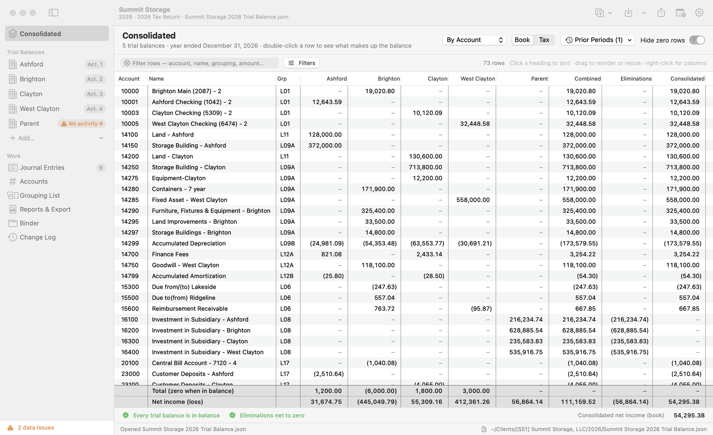
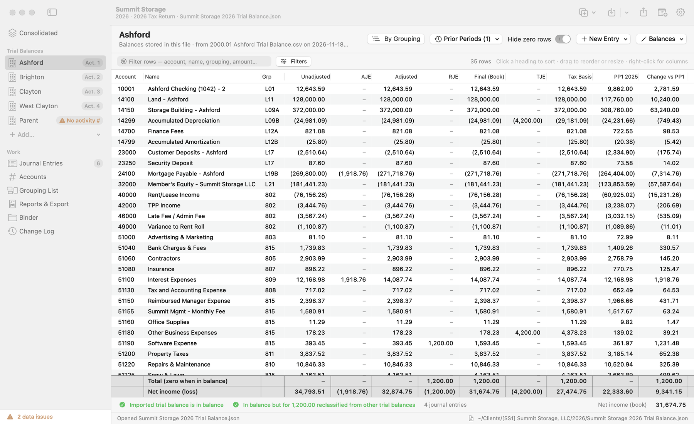
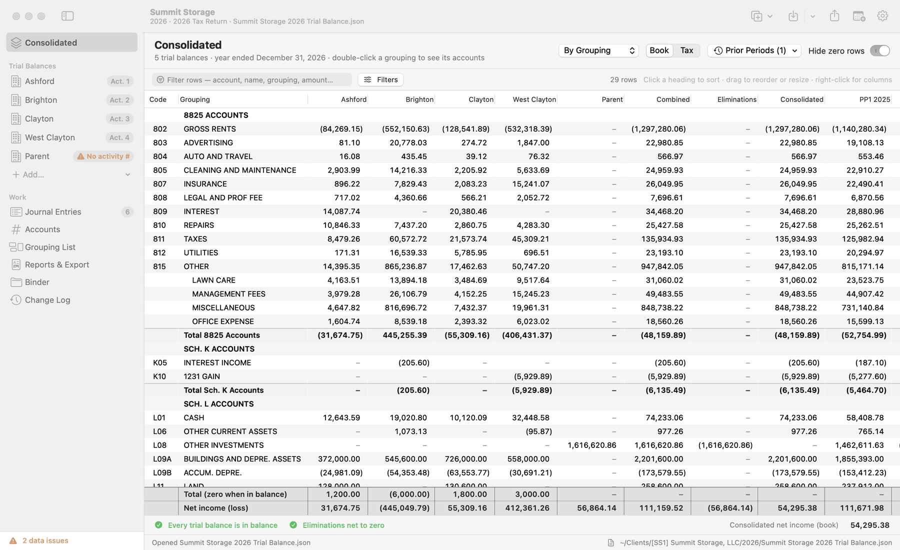
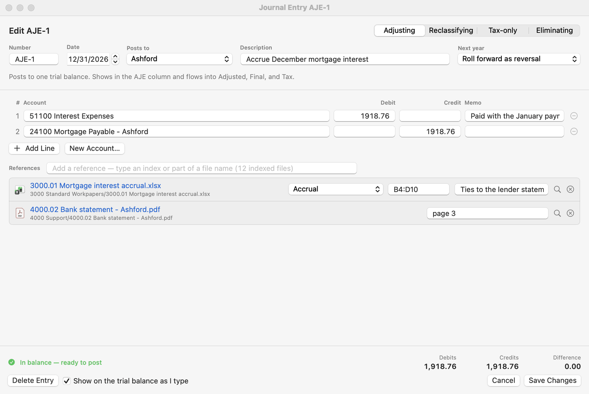
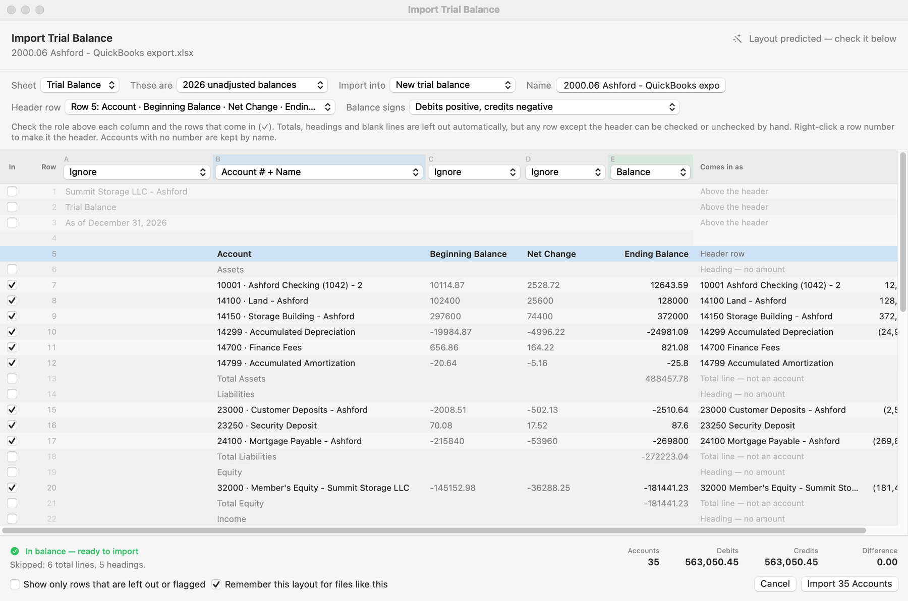
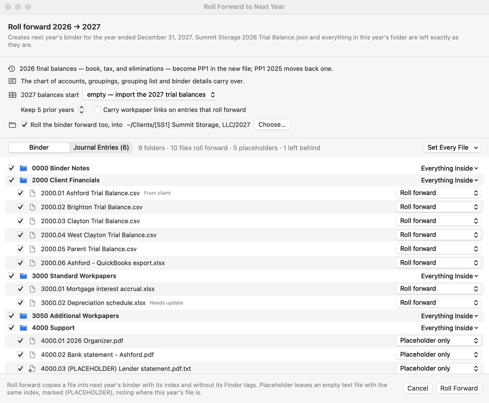
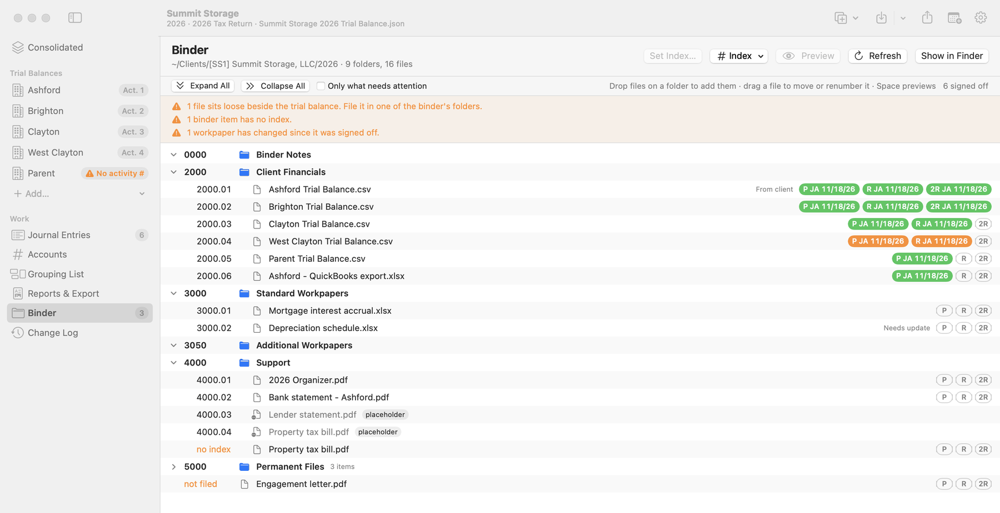
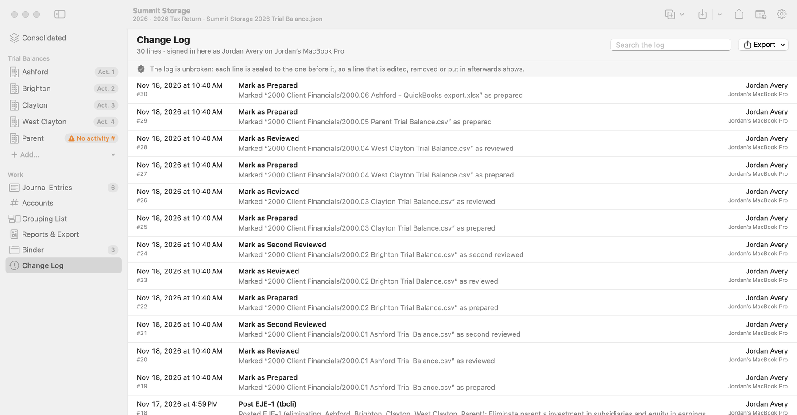
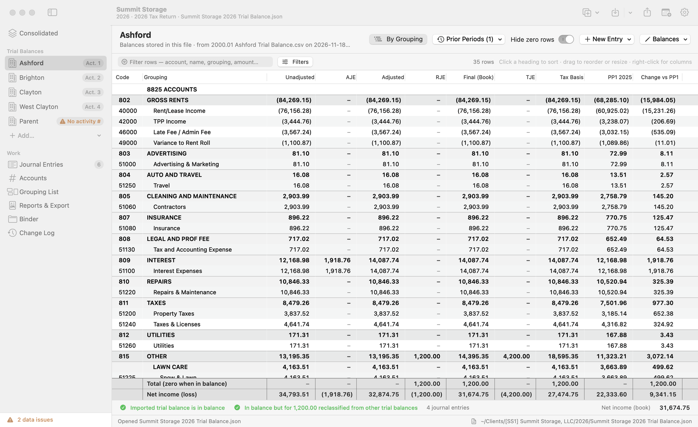

# TB Tool

[](https://github.com/dlb1177/tb-tool/actions/workflows/tests.yml)

A trial balance workpaper tool for the Mac. Import any number of trial balances, post journal
entries against them, and watch them consolidate, with everything kept in **one JSON file in
the client's folder**. No server, no account, no database.



*Every screenshot here shows a made-up client, "Summit Storage".*

## What it does

- **Imports trial balances in whatever shape they arrive**: Excel, CSV, tab-delimited text, or
  cells pasted from the clipboard. The layout is predicted and shown for you to confirm before
  anything comes in. Account numbers are optional. When a file names an account differently
  from the chart, a review lets you settle the name and the grouping, with a preview.
- **Keeps several trial balances on one chart of accounts** (properties, companies, funds) and
  consolidates them in columns, with eliminations.
- **Four kinds of journal entry**: adjusting (AJE), reclassifying (RJE), tax-only (TJE) and
  eliminating (EJE). Each lands in its own column: Unadjusted → AJE → Adjusted → RJE → Final
  (Book) → TJE → Tax Basis.
- **Shows the effect of an entry while you type it.** The entry sits in its own window; the
  trial balance, consolidation and reports update live on the other display.
- **Groups accounts to tax lines**, with subgroups, and reports by grouping. A Form 1065 / 8825
  list is built in; you keep your own standard list per entity type. Each grouping carries an
  account type, and an account's type is simply its grouping's: it is never set on the account,
  so the two cannot disagree. Ungrouped accounts raise an alert.
- **References workpapers from entries**: pick from every indexed file in the binder by typing
  part of its index or name. A reference to an Excel workbook names the tab and, if you like,
  the cells, and clicking it opens Excel right there.
- **Carries prior years** as PP1, PP2… columns, and **rolls forward** to next year, with each
  entry marked to carry over with amounts, without amounts, as a reversal, or not at all.
- **Manages the binder**: the client's folder for the year, with numbered folders and indexed
  workpapers. Drop files in from Finder and they take the next index; drag a file to move or
  renumber it, with every rename shown for confirmation first; press Space to preview. No two
  items ever share an index, loose and unindexed files are flagged, and a new binder starts
  with your standard folders.
- **Rolls the binder forward** with the trial balance, copying each file, leaving a
  placeholder, or leaving it behind.
- **Keeps a paper trail.** Workpapers are signed off as prepared, reviewed and second reviewed,
  each mark recording who, on which Mac, when, and a fingerprint of the file, so a workpaper
  changed afterwards shows. Every change to the file is written to a change log that makes
  later tampering evident.
- **Exports** to Excel (a formatted workbook with binder headings), CSV and JSON, and reads and
  writes a plain, documented file format that scripts and AI assistants can work with directly.

## The manual

**[docs/MANUAL.md](docs/MANUAL.md)** is the complete reference: every screen, window, menu and
shortcut, the posting rules, the file format, and the command line. It is one self-contained
Markdown file, written so that a person or an AI assistant can read it start to finish and know
everything the tool does.

## A quick look

| | |
|---|---|
|  **One trial balance** with its adjustment columns and prior year |  **Grouping summary** with subgroups nested and net income pinned at the bottom |
|  **A journal entry** in its own window, with its references |  **Importing**: the predicted layout, shown for confirmation |
|  **Rolling forward** the trial balance and the binder |  **The binder**, with index numbers, sign-offs and alerts |
|  **The change log**: what, who, on which Mac, when |  **A trial balance by grouping**, at the click of a button |

## Getting it

**Requirements:** macOS 14 (Sonoma) or later, on Apple silicon or Intel.

### Download

Get `TB-Tool.zip` from the [latest release](https://github.com/dlb1177/tb-tool/releases/latest),
unzip it, and put `TB Tool.app` wherever you like (Applications, or a client's folder).

The app is not notarized by Apple, so macOS will refuse to open it the first time. Open
**System Settings ▸ Privacy & Security**, scroll to the message about TB Tool, and click
**Open Anyway**. You only do this once.

### Or build it

With Xcode 15 or later installed (for its Swift toolchain):

```sh
git clone https://github.com/dlb1177/tb-tool.git
cd tb-tool
./build_app.sh        # runs the tests, builds a universal binary, assembles and signs TB Tool.app
```

`TB Tool.app` appears in the project folder. An app you build yourself opens without the
Privacy & Security step.

## Five-minute start

1. Open TB Tool and choose **New Trial Balance File…**. Fill in the client name, the year, and
   whatever binder details you want at the top of your reports, then choose where the file goes.
   Put it in the client's folder for the year; the standard binder folders are made beside it.
2. Click **Import** and pick one file per trial balance. For each, check the column roles and
   the rows that come in, then click Import.
3. Open **Accounts**, select accounts, and press **⌘G** to give them a grouping.
4. Press **⌘J** for an adjusting entry. Type part of an account's number or name to find it.
   Watch the trial balance change as you type, then post.
5. Open **Reports & Export** and export a report, or click **Quick Export** for the whole
   workbook.

Every change is saved to the JSON file as you make it, and written to its change log. ⌘Z undoes
it.

## What's in this repository

| Path | What it is |
|---|---|
| `Sources/TBCore` | The engine: model, JSON store, import, posting rules, consolidation, prior years, roll forward, the binder, sign-offs and the change log, reports, exports. No user interface. |
| `Sources/TBTool` | The Mac app (SwiftUI and AppKit). |
| `Sources/tbcli` | A command-line tool over the same engine, for scripts. |
| `Tests/TBCoreTests` | The engine's tests, with made-up fixture trial balances. Run with `swift test`. |
| `Resources` | The app icon and `Info.plist`. |
| `docs` | The manual and its screenshots. |

There are no dependencies beyond the Swift standard library and Apple's frameworks. The Excel
reader and writer are part of the engine.

## Your data

TB Tool never sends anything anywhere. A client's file is one JSON document that you can read
in any text editor; the format is described in [the manual](docs/MANUAL.md#15-the-json-file).
Backups go in a `TB Backups` folder beside it. Standard grouping lists, binder layouts, saved
import layouts, saved filters and window positions are kept on your Mac under `~/Library`.

The change log and the sign-offs record the name and login of whoever is using the Mac, the
Mac's name, and its hardware identifier. They stay in the client's JSON file like everything
else.

## License

No license has been chosen for this code yet. Until one is added, all rights are reserved.
