# TB Tool — the manual

This is the complete reference for TB Tool: what it is for, every screen and window, every menu
and shortcut, the rules it enforces, the file it writes, and the command line. It is written to
be read from top to bottom once, and searched afterwards.

All screenshots show a made-up client, "Summit Storage": four storage properties and a parent.

## Contents

1. [What TB Tool is](#1-what-tb-tool-is)
2. [Ideas you need first](#2-ideas-you-need-first)
3. [Installing and opening](#3-installing-and-opening)
4. [Setting up a file](#4-setting-up-a-file)
5. [Importing trial balances](#5-importing-trial-balances)
6. [The trial balance screens](#6-the-trial-balance-screens)
7. [Working in a grid](#7-working-in-a-grid)
8. [Journal entries](#8-journal-entries)
9. [Accounts](#9-accounts)
10. [Groupings](#10-groupings)
11. [Prior years and rolling forward](#11-prior-years-and-rolling-forward)
12. [Reports and exports](#12-reports-and-exports)
13. [Saving, undo, backups and the data check](#13-saving-undo-backups-and-the-data-check)
14. [The JSON file](#14-the-json-file)
15. [The command line](#15-the-command-line)
16. [Menus and shortcuts](#16-menus-and-shortcuts)
17. [Where things are kept](#17-where-things-are-kept)
18. [For AI assistants and scripts](#18-for-ai-assistants-and-scripts)
19. [Troubleshooting](#19-troubleshooting)

---

## 1. What TB Tool is

TB Tool is a Mac app for the trial balance stage of a tax or accounting engagement. You bring
in the client's trial balances, post your adjustments against them, map the accounts to tax
lines, and export the result.

It keeps everything for one engagement in **one JSON file** that lives in the client's folder.
There is no server, no sign-in and no database. Copy the folder and you have copied the
engagement.

It is built for a client with **several trial balances on one chart of accounts**: a group of
properties, a set of related companies, a fund and its subsidiaries. Each trial balance is its
own column. Journal entries name the trial balance they post to, so you do not need a separate
account number per property. A client with a single trial balance works the same way; the
consolidation simply has one column.

## 2. Ideas you need first

**The file.** One `.json` file per engagement per year. It identifies itself with
`"fileType": "trial-balance"`. Everything described in this manual is stored in it except
standard grouping lists, saved import layouts, saved filters and window positions, which are
preferences of the app on your Mac ([section 17](#17-where-things-are-kept)).

**Trial balances.** A file holds any number of sibling trial balances (the sidebar lists them).
Each one stores its *unadjusted* balances: what you imported or typed. Nothing else about a
balance is stored. Every adjusted figure is computed from the unadjusted balances and the
journal entries each time it is shown.

**One chart of accounts.** All the trial balances in a file share one chart. An account is
identified by its number, or by its name when the client's books have no account numbers.

**Four kinds of journal entry**, each with its own column:

| Type | Prefix | Posts to | Changes |
|---|---|---|---|
| Adjusting | AJE | one trial balance | Adjusted, Final (Book), Tax Basis |
| Reclassifying | RJE | one trial balance | Final (Book), Tax Basis |
| Tax-only | TJE | one trial balance | Tax Basis only |
| Eliminating | EJE | a trial balance on each line | the Eliminations column of the consolidation only |

**The columns of one trial balance**, left to right:

```
Unadjusted + AJE = Adjusted
Adjusted   + RJE = Final (Book)
Final      + TJE = Tax Basis
```

**Consolidation.** For each account: every trial balance's balance (book or tax), their sum
(**Combined**), the eliminating entries (**Eliminations**), and Combined plus Eliminations
(**Consolidated**).

**Signs.** Debits are positive and credits are negative everywhere: in the file, in exports,
and on screen (credits are shown in brackets). A column of a trial balance totals zero when it
is in balance.

**Groupings.** A grouping is a tax line or lead-schedule line (`L01 · CASH`) that accounts roll
up to. Groupings belong to sections ("Sch. L Accounts"). A grouping can have **subgroups**, and
it says what **type of account** belongs in it (cash is an asset). Each file carries its own
grouping list.

**The current year and prior periods.** The year of the file's year end is the current year.
Prior years' closing balances can be stored beside it and are shown as **PP1** (one year
back), **PP2**, and so on.

## 3. Installing and opening

**Requirements.** macOS 14 or later.

**Installing.** Download `TB-Tool.zip` from the project's Releases page and unzip it, or build
the app yourself with `./build_app.sh` (see the README). Put `TB Tool.app` in Applications or
in a client's folder.

A downloaded copy is not notarized, so the first time you open it macOS refuses. Open
**System Settings ▸ Privacy & Security**, find the message about TB Tool, and click **Open
Anyway**.

**What opens.** When the app starts, in this order:

1. If exactly one trial balance file sits in the same folder as the app, it opens. (This is why
   you can keep a copy of the app in a client's folder.)
2. Otherwise the file you had open last time opens.
3. Otherwise the welcome screen appears, with **Open Trial Balance File…**, **New Trial Balance
   File…**, and a list of any trial balance files found beside the app.

You can also drop a trial balance file on the app's icon, or use File ▸ Open (⌘O).

**The main window.** A sidebar on the left; the selected screen on the right; a status line at
the bottom showing the last thing that happened and the path of the open file (click it to show
the file in Finder).

The sidebar holds:

- **Consolidated**: every trial balance side by side.
- **Trial Balances**: one row per trial balance, and **Add…**.
- **Journal Entries**, with a count.
- **Accounts**, with a count of accounts that have no grouping yet.
- **Grouping List**.
- **Reports & Export**.
- At the bottom, the **data check** ([section 13](#13-saving-undo-backups-and-the-data-check)).

The toolbar holds **New Entry**, **Import**, **Quick Export**, **Roll Forward**, and the gear
for **Trial Balance Settings**.

**Windows.** Everything that is not one of the main screens opens in its own window: a journal
entry, the activity behind an account, the accounts in a grouping, the balance editor, the
import screen, settings, roll forward, the broken-links list. They are ordinary windows. Move
them, resize them, put them on another display. Each kind remembers where you last put it, and
a window holding unsaved typing asks before it closes.

## 4. Setting up a file

### A new file

File ▸ **New Trial Balance File…** (⌘N) opens the setup window.


- **Client**: the client name (it heads every report), client number, entity type, tax ID.
- **Year**: the current year and the year end (month and day). Prior-period columns count back
  from this year.
- **Binder**: engagement ("2026 Tax Return"), firm, prepared by, reviewed by. Firm and preparer
  are filled in from the app's settings.
- **Grouping list**: the list the file starts with. It defaults to the standard list for the
  entity type you chose ([section 10](#10-groupings)). The file gets its own copy.
- A preview shows how report headings will read.

Click **Create…** and choose where the file goes. Put it in the client's folder, so that
workpapers you link to entries are stored as paths relative to it.

### Changing it later

File ▸ **Trial Balance Settings…** (⇧⌘, or the toolbar gear) opens the same form for the open
file, plus the file's location, its grouping list's name, and the file it was rolled forward
from. Changing the year does not move any balances; it only changes which stored years count as
prior. To start the next year, roll forward ([section 11](#11-prior-years-and-rolling-forward)).

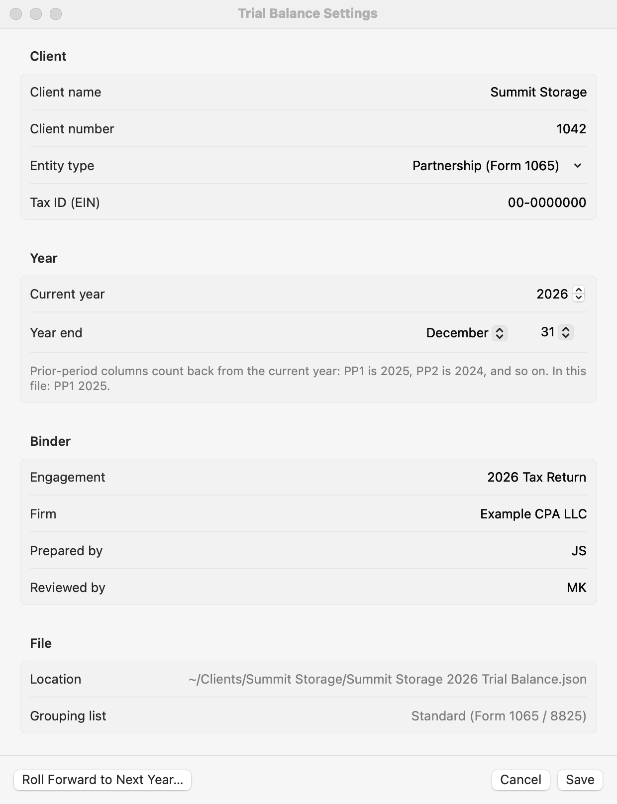

### Settings for the app itself

TB Tool ▸ **Settings…** (⌘,) holds what applies to every file: the firm and preparer that new
files start with, the Hide zero rows switch, and the standard grouping lists
([section 10](#10-groupings)).

## 5. Importing trial balances

One source file becomes one trial balance. Start from the toolbar's **Import** button, File ▸
Import Trial Balances… (⌘I), or **Add…** in the sidebar. Choose one file or several; each is
shown for confirmation in turn.

**Sources that can be read:** Excel (`.xlsx`, `.xlsm`), CSV, tab-separated and other delimited
text (`.tsv`, `.tab`, `.txt`), and cells copied from a spreadsheet, a PDF viewer or a web page
(File ▸ **Paste Trial Balance**, ⇧⌘V).

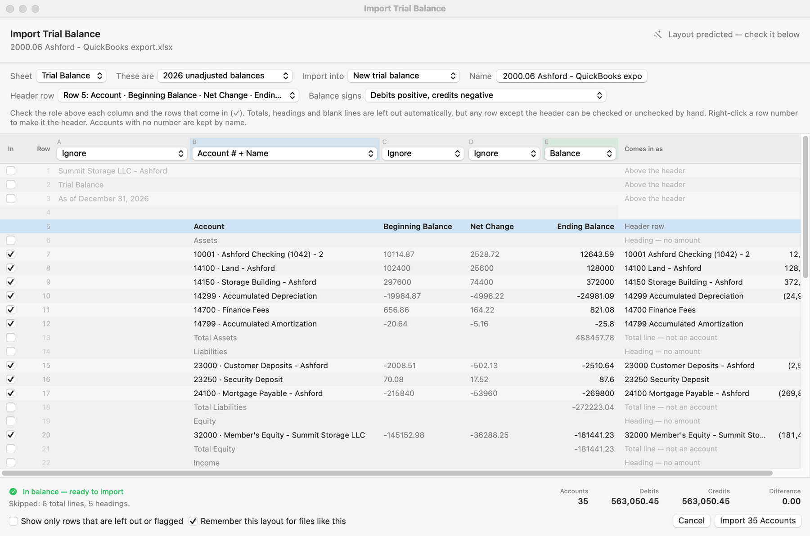

The import screen shows the source exactly as it is, with the app's reading of it:

- **Sheet**: for a workbook with several tabs, the one that looks most like a trial balance.
- **These are**: this year's unadjusted balances, or a prior year's closing balances (PP1 to
  PP5).
- **Import into**: a new trial balance (with the name to give it, suggested from the file
  name), or an existing one, whose balances are replaced. Journal entries are never touched.
- **Header row**: which row holds the column headings, or none.
- **Balance signs** (when there is a single balance column): debits positive, credits positive,
  or normal balances shown positive (the sign then comes from each account's type).
- **A role above each column**: Ignore, Account #, Account Name, Account # + Name, Debit,
  Credit, Balance, or Account Type. A file needs an account column (number, name, or both) and
  either one Balance column or both Debit and Credit.
- **A checkbox on each row** for whether it comes in, and on the right what it comes in as.

### What the prediction does

- Finds the header row under a title block.
- With Beginning / Net Change / Ending columns, picks **Ending**.
- Leaves out heading lines, total and subtotal lines, blank lines, and repeated headers, and
  says why beside each.
- For a single balance column, picks the sign convention under which the file balances.
- Reads sub-accounts shown as a path ("6500 Repairs - 6515 Supplies") as the sub-account.
- Adds together rows for the same account (a general ledger detail export), and tells you.
- Compares the file's own TOTAL line with what is brought in.

### Changing the prediction

- Change any column's role, the header row (or right-click a row number ▸ Use Row as the Header
  Row), or the signs.
- **Tick or untick any row except the header.** Untick an account to leave it out. Tick a row
  the app read as a total, a heading, or a line above the header to bring it in. A row brought
  in with no amount comes in at 0.00. One with no account is named for its row
  ("Unnamed (row 12)") so you can rename it afterwards.
- **Show only rows that are left out or flagged** narrows the list to what needs a look.
- **Remember this layout for files like this**: the next file with the same column headings
  uses these column roles automatically.

The footer shows the account count, debits, credits and the difference. The button reads
**Import N Accounts**, or **Import Out of Balance** if the file does not balance (you may still
import it; the data check will keep reminding you).

**The balances are copied into the JSON file.** The source file is never needed again and can
be moved or deleted.

**Accounts with no number** are kept by name everywhere.

**New accounts** join the shared chart.

### When the file names an account differently

If the file uses an account number that is already in the chart under a different name,
clicking Import opens a review before anything comes in. (A difference only in capitals or
spacing is ignored.)

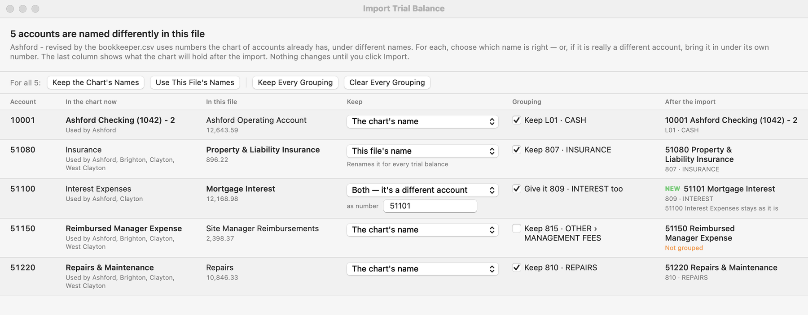

Each such account is one row: its number, its name in the chart and which trial balances
already use it, its name and amount in this file, and three things to decide.

- **Keep**
  - *The chart's name*: it is the same account and the chart is right. This is the default.
  - *This file's name*: it is the same account and the file is right. The account is renamed
    for every trial balance.
  - *Both — it's a different account*: the file's account comes in as a new account under its
    own number, and the account in the chart stays as it is. The next free number is suggested;
    type another, or clear it to keep the new account by name. A number that is already taken
    is refused.
- **Grouping**, when the account in the chart has one
  - For the same account, *Keep* leaves the grouping. Untick it and the account goes back to
    ungrouped, so it turns up again on the Accounts screen to be grouped afresh.
  - For a different account, *Give it … too* starts the new account in the same grouping.
    Unticked, it starts ungrouped.
- **After the import** previews the result: the number and name the chart will hold, its
  grouping (or "Not grouped"), and NEW beside an account that will be added.

**Keep the Chart's Names**, **Use This File's Names**, **Keep Every Grouping** and **Clear
Every Grouping** set every row at once. **Back to the Layout** returns to the first step with
your decisions kept. Nothing changes until you click Import, and the import is one undoable
step.

The same review appears when importing a prior year's balances.

### Other ways to create a trial balance

- **New Blank Trial Balance…** creates an empty one and opens the balance editor to key it in.
- **Replace Balances from File…** (right-click a trial balance, or its Balances menu) re-imports
  one.

## 6. The trial balance screens

### Consolidated

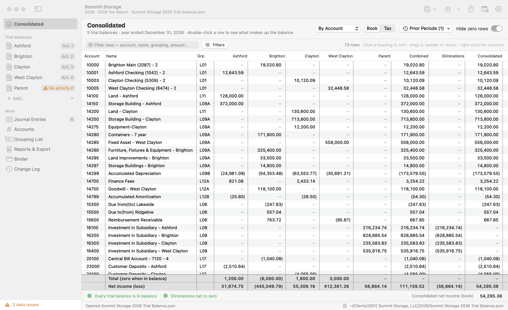

Every active account, one column per trial balance, then **Combined**, **Eliminations** and
**Consolidated**, then any prior-period columns. Controls at the top right:

- **Rows**: *By Account*, *By Grouping* (the grouping summary), or *Grouping Detail*.
- **Book / Tax**: which basis the columns show. Book is unadjusted plus adjusting and
  reclassifying entries. Tax adds the tax-only entries.
- **Prior Periods**: how many prior years to show.
- **Hide zero rows**.

Under the grid: whether every trial balance is in balance, whether the eliminations net to
zero, and consolidated net income.

**Double-click an account** to see what makes up its balance. **Double-click a grouping** to
see the accounts in it.

### One trial balance


Select a trial balance in the sidebar. The columns are Account, Name, Grp (grouping code),
**Unadjusted, AJE, Adjusted, RJE, Final (Book), TJE, Tax Basis**, then the prior periods and
**Change vs PP1**. At the top right:

- **Prior Periods**: how many, and whether they are shown on the book or the tax basis.
- **Hide zero rows**.
- **New Entry**: an adjusting, reclassifying or tax-only entry for this trial balance.
- **Balances**: Edit Unadjusted Balances…, Replace Unadjusted Balances from File…, and for each
  of PP1 to PP4: Import from File…, Enter or Edit Balances…, Remove.

Under the grid: whether the imported balances and the adjusted columns are in balance, the
number of entries, and net income.

Right-click a trial balance in the sidebar for New Adjusting Entry, Rename…, Edit Unadjusted
Balances…, Replace Balances from File…, and Delete…. Deleting removes its balances and the
entries posted only to it. It is refused while an eliminating entry still refers to it.

### Account activity

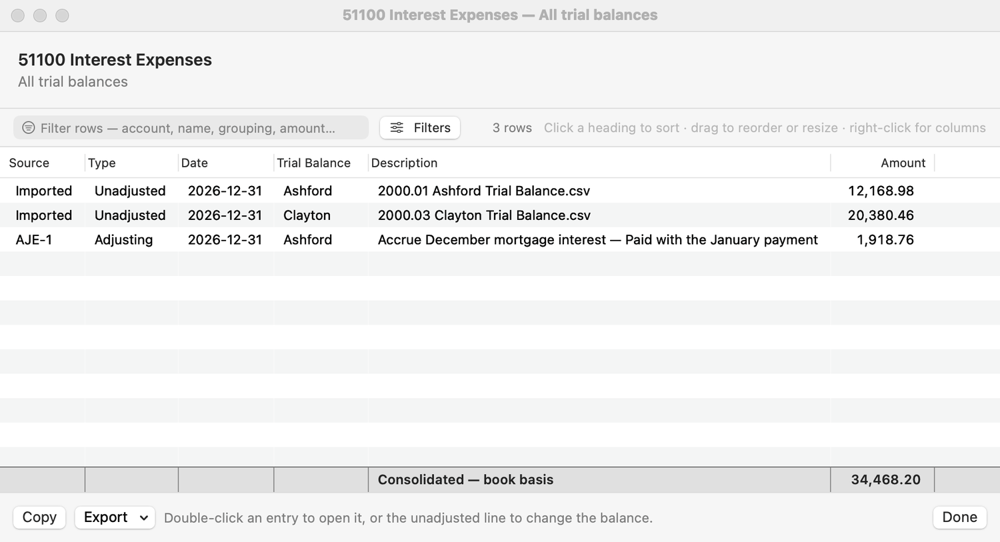

Double-clicking an account row opens its activity: the unadjusted amount from each trial
balance (marked *Imported* or *Edited*), then every journal line that touches it, then the
final book balance and, when it differs, the tax basis. Opened from the consolidation it covers
every trial balance and includes eliminations. Opened from one trial balance it covers that one.

- Double-click a journal line to open the entry.
- Double-click the unadjusted line to open the balance editor.
- **Copy** and **Export** are at the bottom.

### Changing balances by hand


**Balances ▸ Edit Unadjusted Balances…** lists the trial balance's accounts with a debit and a
credit field each.

- Type in either column; typing in one clears the other.
- The **Was** column shows the original amount of anything you have changed.
- **Find an account** filters the list. **All chart accounts** lists accounts this trial
  balance has no balance for. **Only changed** shows what you have touched.
- **Add an account** finds an account by number or name and adds a row for it. **New
  Account…** adds one to the chart.
- The footer shows debits, credits and the difference. The button reads **Save Balances**, or
  **Save Out of Balance**.

Saving is one undoable step. Journal entries are untouched. The same editor edits a prior
year's closing balances.

## 7. Working in a grid

Every trial balance, consolidation, report, activity and grouping grid behaves the same way.

- **Totals are pinned at the bottom**, the way the headings are pinned at the top. They stay
  under their columns as you scroll sideways.
- **Filter box**: type any words; rows containing all of them (in any column) remain, and a
  total of the rows shown appears.
- **Filters** button: build rules.

  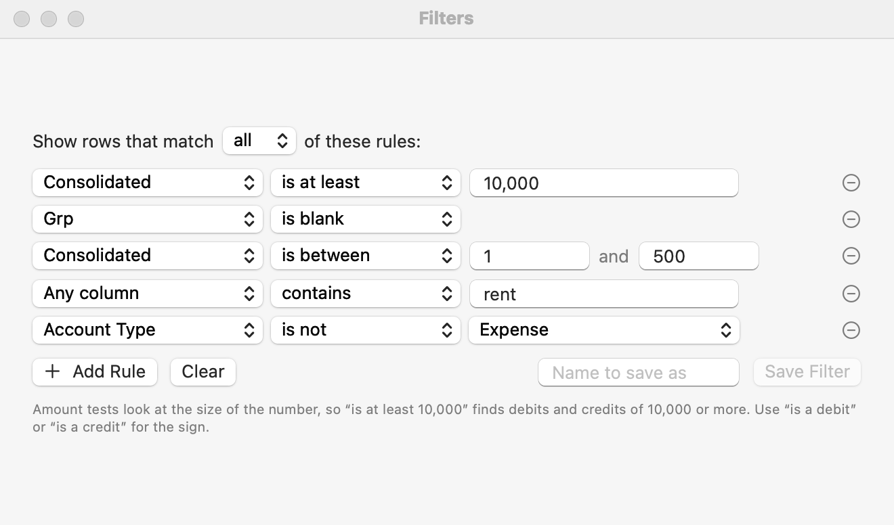

  - Each rule names a column (or *Any column*), a test, and a value.
  - Text tests: contains, doesn't contain, is exactly, is not, starts with, is blank, isn't
    blank.
  - Amount tests: is at least, is at most, is between, equals, isn't zero, is zero, is a debit,
    is a credit. Sizes ignore the sign, so "is at least 10,000" finds debits and credits of
    10,000 or more.
  - **Account Type** (is / is not Asset, Liability, Equity, Revenue, Expense) is offered on
    every grid whose rows are accounts, whether or not the type is a column.
  - Rules are joined by **all** or **any**.
  - Name a filter and **Save Filter**; saved filters are kept per screen.
- **Sorting**: click a heading. Click again to reverse. A third click returns to chart order.
  Section and subtotal rows drop out while a grid is sorted or filtered.
- **Columns**: each starts as narrow as it can be while showing everything in it. Drag an edge
  to resize, double-click an edge to fit that column, drag a heading to reorder. Right-click a
  heading to hide or show columns, **Fit Column Widths to Content**, or **Reset Column Order**.
  What you change is remembered per screen, through switching screens and quitting.
- **Copy**: select rows and press ⌘C to copy them, with headings, ready to paste into a
  spreadsheet. With nothing selected, ⌘C copies everything including the totals.
- **Hide zero rows** is one switch for the whole app. It appears on every trial balance and
  report screen and under View ▸ Hide Zero Balance Rows (⇧⌘0). The workbook export follows it.

The Accounts and Journal Entries screens are lists rather than grids. They sort by column and
remember column order and hidden columns, but not widths.

## 8. Journal entries

### The list


The Journal Entries screen lists every entry: number, type, date, trial balance, description,
amount, linked files, and what happens to it next year. At the top: search, **Filters**, a type
picker, **Edit**, **Duplicate**, **Next Year** (set the roll-forward choice for the selected
entries), **Delete**, and **New Entry**. Double-click an entry to open it. Right-click for the
same actions.

### Writing an entry

Start one from the toolbar's **New Entry**, the Entries menu, a trial balance's New Entry menu,
or ⌘J (adjusting), ⇧⌘J (reclassifying), ⌥⌘J (tax-only), ⌃⌘J (eliminating).


- **Type**: switch between the four kinds at the top right. The number follows the type's own
  sequence (AJE-1, AJE-2…; RJE-1…) unless you type your own.
- **Number, Date, Description.**
- **Posts to**: the trial balance. For an eliminating entry there is a trial balance picker on
  every line instead.
- **Next year**: what a roll forward does with this entry
  ([section 11](#11-prior-years-and-rolling-forward)).
- **Lines**: account, debit or credit, memo. **Add Line** (⌘L) adds a line that starts with
  whatever amount would balance the entry. **New Account…** adds an account to the chart.
- **Linked Files**: the workpapers that support the entry.
- The footer shows debits, credits and the difference, and lists anything stopping the entry
  from being posted.
- **Post Entry** (Return), **Post & New** (⇧⌘↩) to post and start another of the same type,
  **Cancel** (Esc). For an existing entry the button is **Save Changes** and there is a
  **Delete Entry** button.

### Finding an account


Wherever an account is chosen, type any part of its number or name. A list of every match
appears under the field and narrows as you type, with the matching text in bold. Words can be
in any order. ↑ and ↓ move through the list, Return or Tab picks, Esc closes it. An exact
number comes first, then numbers that start with what you typed, then names that start with
it, then names that contain it.

### Balances update while you type

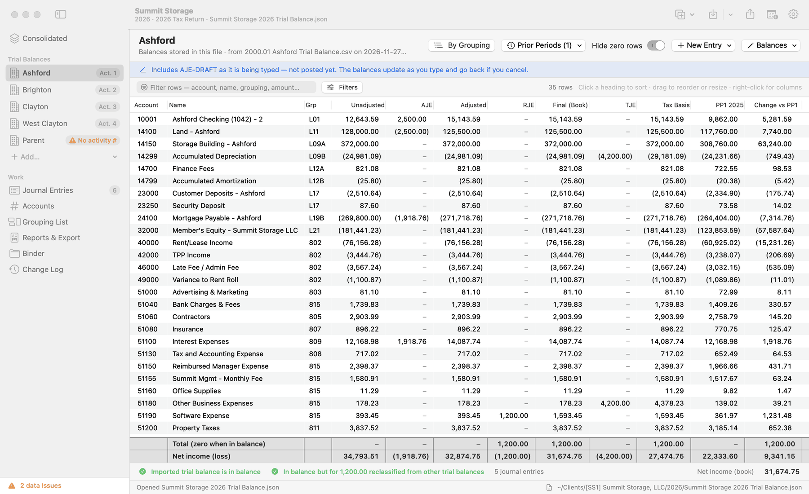

While an entry window is open, the trial balance, consolidation, Reports, Accounts, account
activity and grouping windows include the entry as typed. A banner says which entry is included
and that it is not posted. Put the entry on one display and the trial balance on another.
Cancel, and the balances go back.

Exports and Copy always use what is saved, never an unposted entry. The checkbox **Show on the
trial balance as I type** at the bottom of the entry window turns the preview off.

### The posting rules

An entry can be posted only when all of these hold. They are enforced in the app, on the
command line, and reported by the data check for a file edited by hand.

1. It has a number, and no other entry has the same number.
2. Its date is a real date.
3. It has at least two lines.
4. Every line names a trial balance and an account that is in the chart.
5. Every line has an amount.
6. Debits equal credits.
7. An adjusting, reclassifying or tax-only entry posts to a single trial balance. Only an
   eliminating entry can span trial balances.

### Linked files

Click **Link File…** or drop files on the Linked Files box. Each link can carry a note (tab,
page, cell). Click a file's name to open it; the magnifying glass shows it in Finder.

A link to a file inside the client's folder is stored relative to the folder, so the whole
folder can be moved. A link to a file elsewhere is stored as a full path.

**Broken links are flagged.** If a linked file is moved or renamed:

- the entry shows "missing" in the Files column;
- the Journal Entries screen shows a banner;
- the data check counts it.

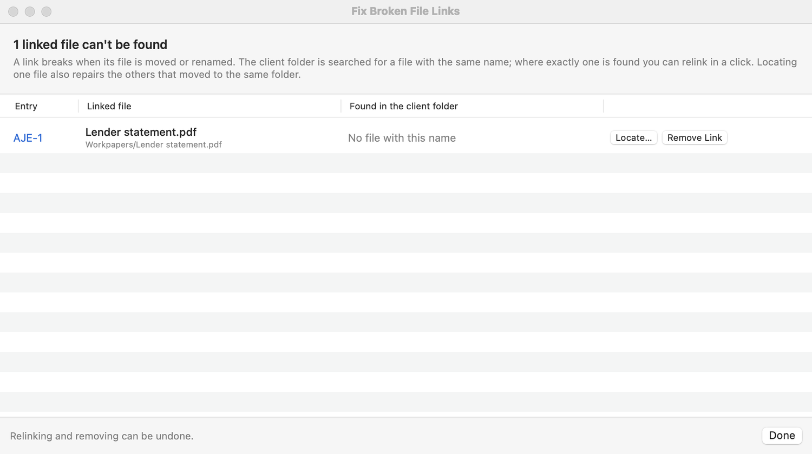

**Fix Links…** (also Entries ▸ Fix Broken File Links…) lists every broken link. It searches the
client's folder for a file of the same name:

- Where exactly one is found, **Relink** fixes it in a click, and **Relink All Found** fixes
  every such link.
- Where several are found, a menu lets you choose.
- **Locate…** lets you point at the file. The dialog opens in the folder the file was last in,
  or the nearest folder above it that still exists. Locating one file also repairs other broken
  links whose files moved to the same folder.
- **Remove Link** removes the link from the entry. No file is ever deleted.

## 9. Accounts

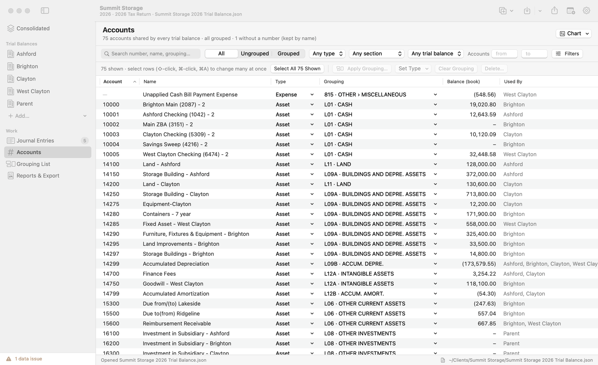

The Accounts screen is the shared chart: number, name, type, grouping, consolidated book
balance, and which trial balances use the account. It is built for hundreds of accounts.

**Filtering:** a search box; All / Ungrouped / Grouped; type; grouping section; trial balance;
an account number range (from 51000 to 51999; a short "to" such as 5 includes everything
starting with 5); and the **Filters** rule builder.

**Changing many at once:** select accounts (⇧-click, ⌘-click, ⌘A, or **Select All Shown**),
then:

- **Apply Grouping…** (⌘G): type a code or a name (`L01`, `cash`, `815 mgmt`) and press Return
  to apply the first match.
- **Set Type**, **Clear Grouping**, **Delete…**.

**Changing one:** the Type and Grouping cells are menus. Using one on a selected row applies to
the whole selection.

**Account types** are asset, liability, equity, revenue and expense. On import the type is read
from the file's own type column if it has one, otherwise guessed from the leading digit of the
number (1 asset, 2 liability, 3 equity, 4 revenue, 5 to 9 expense), otherwise from the name.
Net income is computed from the revenue and expense accounts, so the types matter.

**An account takes the type of its grouping.** Putting an account in `L01 · CASH` makes it an
asset, and the status line says how many types changed. If a type is changed afterwards so
that it disagrees with the grouping, a banner appears here with **Review Account Types…**
([section 10](#10-groupings)).

**Deleting** is allowed only for an account with no balances (this year or a prior year) and no
journal lines.

**The Chart menu:** New Account…, Import Chart of Accounts…, Export Chart of Accounts (JSON or
CSV).

### Reusing a chart between files

Export one file's chart and import it into another to carry the grouping and type decisions
across. The source can be a chart export, another trial balance file, or any sheet with account
and grouping columns. Accounts are matched by number, or by name where they have none. The
import window previews every change and offers:

- **Apply groupings**, and whether to replace groupings already set in this file;
- **Apply account types**;
- **Add accounts this file doesn't have**.

Groupings the source uses that this file's list lacks are brought across.

## 10. Groupings

### The grouping list


The Grouping List screen shows the file's list: section, code, name, and how many accounts are
in each. A grouping's count includes its subgroups.

- **New Grouping**, **Edit**, **Delete**. Double-click to edit.
- **New Subgroup** adds a subgroup under the selected grouping.


**Order.** The list keeps itself in order. Within each section, groupings are sorted by code,
reading numbers as numbers (802, 802B, 803 … and 2 before 10). Subgroups are sorted the same
way within their grouping; those with no code of their own follow, by name. A new grouping
falls into place as soon as you add it, and changing a code moves it. Every picker and every
report uses the same order. Sections stay in the order they were set up.

**Account type.** Every grouping has an account type: asset, liability, equity, revenue or
expense, or *Any type* for a memo line. You choose it when you add a grouping (the Add button
waits until you have), and it is shown in the Account Type column. A subgroup has no type of
its own; it uses its grouping's. Changing a grouping's type changes the type of every account
in it, and the editor tells you how many before you save.

**Rules for codes and subgroups:**

- **Every code is used once.** No two groupings, and no two subgroups, can have the same code.
- A subgroup's code is optional. Left blank, its accounts report under its grouping's code.
- Subgroups go one level deep, and take their grouping's section.
- **Subgroup of** in the editor moves a grouping under another, or makes a subgroup a grouping
  of its own.
- Deleting a subgroup moves its accounts up to its grouping. Deleting a grouping deletes its
  subgroups too and leaves their accounts ungrouped.

Accounts are assigned to a subgroup exactly as to a grouping; it appears indented under its
grouping in every picker.

**A file from before codes had to be unique** may have several groupings sharing a code (the
older built-in list had six "815 OTHER - …" lines). Such a file opens normally. The Grouping
List screen and the data check point it out, and **Combine as Subgroups** puts them under one
grouping with that code in one undoable step. No account loses its assignment and no total
changes.

### When account types and groupings disagree

Accounts follow their grouping's type automatically, so a disagreement only arises when a type
is changed afterwards: on the Accounts screen, by a chart import, by editing the file by hand,
or in a file from before groupings had types. The data check counts each grouping affected,
and a banner on the Accounts and Grouping List screens offers **Review Account Types…**.

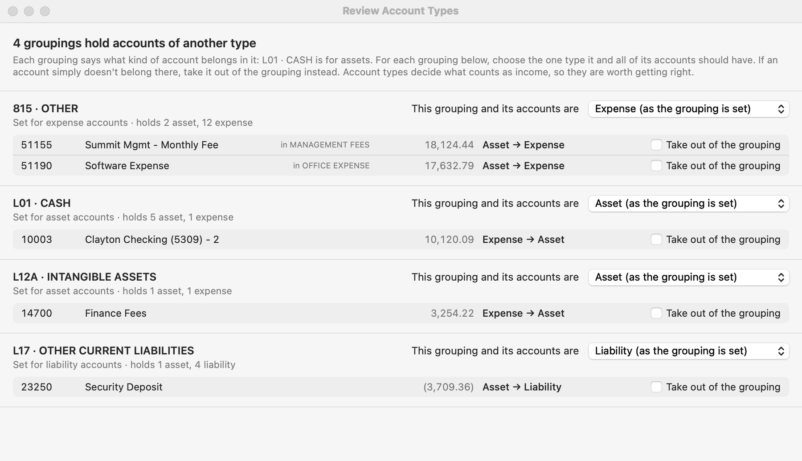

The review lists each grouping that holds accounts of another type, with what it is set for,
what it holds, and the accounts that differ with their balances. For each grouping:

- **This grouping and its accounts are** sets one type for the grouping and everything in it
  (including its subgroups). It starts on the grouping's own type, so the accounts that differ
  come into line. Choose another type and the grouping itself changes, taking all of its
  accounts with it.
- **Take out of the grouping** on an account leaves that account's type alone and ungroups it
  instead, for an account that was simply put in the wrong place.
- Each row previews the change ("Expense → Asset").

**Apply** makes every change in one undoable step.

### Grouping reports


The **summary** (Consolidated ▸ By Grouping, or Reports ▸ Grouping Summary) lists each section,
its groupings with their totals, and each grouping's subgroups nested beneath it. When a
grouping holds accounts directly as well as in subgroups, a "Not in a subgroup" line makes the
nested rows add up. Accounts with no grouping are listed one by one at the end so they can be
found. **Net income** is shown under the total in every column.

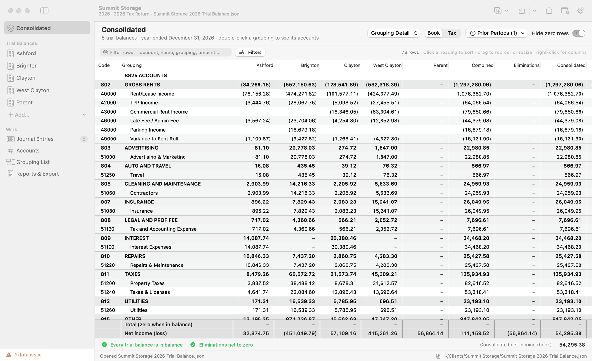

The **detail** is the same outline with every grouping and subgroup opened to its accounts.


**Double-click a grouping** in either to open its accounts in a window of their own, with every
consolidation column, a Book / Tax switch, and the prior periods. Double-click an account there
for its activity.

### Moving lists between files

The Grouping List screen's **List** menu:

- **Import Grouping List…** from a grouping list export, another trial balance file, a chart
  export, or a sheet with Section, Code and Name columns. Choose whether to **replace** the
  file's list or **add to** it; the window previews what is added, changed and removed, and
  which accounts would become ungrouped.

  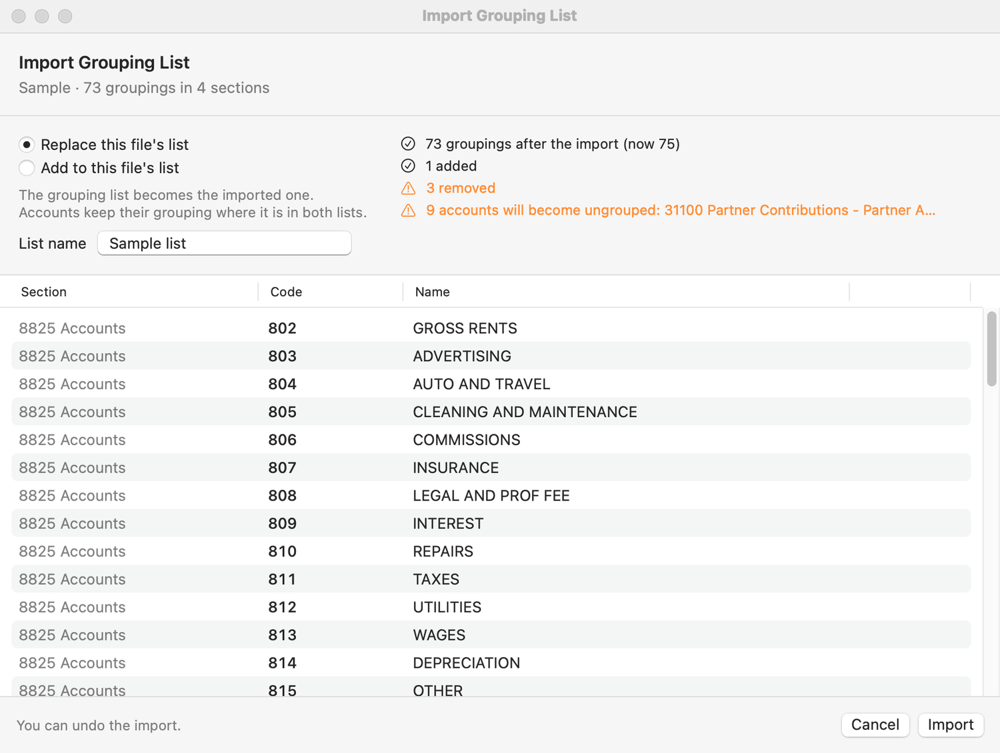

- **Export Grouping List** as JSON or CSV. The CSV columns are Section, Code, Name, Account
  Type, ID and Subgroup Of.
- **Switch to a Standard List**: the same import window, for one of your standard lists.
- **Save as a Standard List…**: keep this file's list on your Mac under a name.
- **Manage Standard Lists…**: opens the app's settings.

In a sheet you write by hand, add an **Account Type** column (Asset, Liability, Equity,
Revenue, Expense, or blank for any). Give a subgroup a **Subgroup Of** column holding its
grouping's code or ID, and leave its own code blank if you like. Rows that share a code are brought in as
one grouping with subgroups, because a code is used once.

### Standard grouping lists

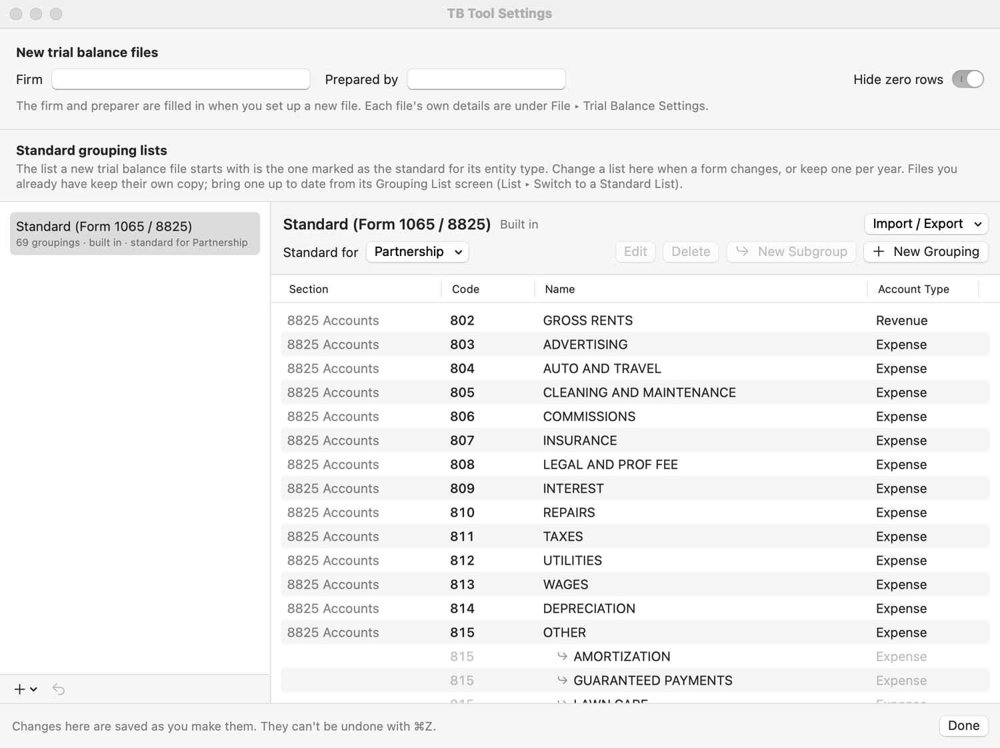

TB Tool ▸ **Settings…** (⌘,) keeps the standard lists on your Mac. A new file starts with the
list marked as the standard for its entity type.

- **The built-in list** covers Form 1065: Form 8825, Schedule K, page 1 and Schedule L, plus a
  memo line. You can change it. The arrow button under the list of lists puts it back as
  shipped.
- **Add a list** (+): New Empty List…, Duplicate (for next year's version), Import a List from
  a File…, or Add the Open File's List….
- **Standard for**: tick the entity types this list is the standard for (Partnership, S
  Corporation, C Corporation, Sole Proprietor, Trust or Estate, Nonprofit, Other). An entity
  type has one standard list. Types with none use the built-in list.
- **Edit the groupings** in place: New Grouping, New Subgroup, Edit, Delete. The same rules
  apply as in a file.
- **Import / Export**: replace this list's groupings from a file or from the open file, or
  export the list.
- Rename a list by typing over its name. Delete one with the minus button.

Changes here are saved as you make them and are not undone with ⌘Z.

**Changing a standard list does not change files you already have.** Each file carries its own
copy. To bring a file up to date, use its Grouping List screen ▸ List ▸ Switch to a Standard
List, which previews the effect first.

## 11. Prior years and rolling forward

### Prior periods

A file's year end sets its current year. Prior years' closing balances are stored by calendar
year and shown relative to it: with a current year of 2026, PP1 is 2025 and PP2 is 2024.

The **Prior Periods** menu on each balance screen chooses how many to show. The columns are
followed by **Change vs PP1**: this year's balance less PP1's.

Ways to get prior-year balances in:

- **Import a file**: a trial balance's Balances ▸ PP1 ▸ Import from File…, or pick the year in
  the import screen's *These are* menu.
- **Key them in**: Balances ▸ PP1 ▸ Enter Balances….
- **Roll forward**: the closing balances of the year you roll from become PP1 automatically.

An imported prior year is one set of balances, used for both book and tax. A year that arrived
by roll forward keeps book, tax and eliminations separately, so prior columns follow the Book /
Tax switch.

### Rolling forward

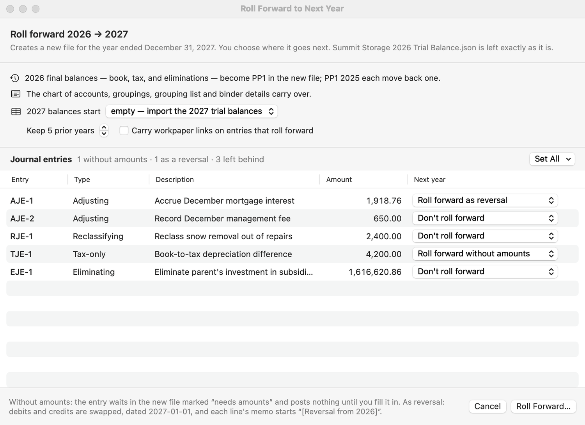

The toolbar's **Roll Forward** (or File ▸ Roll Forward to Next Year…) creates next year's file.
You choose where it is saved. **The file you are in is not changed.**

What the new file holds:

- **Prior years.** This year's final balances (book, tax, and eliminations) become PP1. Older
  years move back one. *Keep N prior years* sets how many are kept (5 unless changed).
- **The chart, groupings, grouping list and binder details.** A year in the engagement name
  moves on ("2026 Tax Return" becomes "2027 Tax Return").
- **Opening balances.** Either empty, ready for next year's trial balances to be imported; or
  the balance sheet carried forward, with income and expense accounts starting at zero and
  their net closed into the equity account you choose.
- **Journal entries**, according to each entry's *Next year* setting.

### What happens to each journal entry

Set this in the entry window, with the Next Year menu on the Journal Entries screen, or in the
roll forward window itself (which also has **Set All**).

| Setting | In next year's file |
|---|---|
| **Don't roll forward** (the default) | The entry is left behind. |
| **Roll forward with amounts** | A recurring entry: posted with the same amounts, dated one year later. It keeps this setting. |
| **Roll forward without amounts** | The accounts and description come across with blank amounts. The entry is listed as **needs amounts** and posts nothing until you fill it in and post it. |
| **Roll forward as reversal** | Every debit and credit is swapped. The entry is dated the first day of the new year. Each line's memo starts with `[Reversal from 2026]`. It is not marked to roll forward again. |

Linked files are not carried to rolled entries unless you tick **Carry workpaper links**; they
point at last year's workpapers.

## 12. Reports and exports


**Reports & Export** shows any report in a grid and exports it.

| Report | What it is |
|---|---|
| Consolidating Trial Balance | Every account, one column per trial balance, then Combined, Eliminations, Consolidated. |
| Grouping Summary | The consolidation rolled up to groupings, subgroups nested, net income at the bottom. |
| Grouping Detail | The same, opened to the accounts. |
| Single Trial Balance | One trial balance with all its columns. |
| Journal Entries | One row per journal line, with the entry's number, type, date, description, linked files and next-year setting. Can be limited to one type. |
| Data (Long Format) | One row per trial balance and account, with every column. Made for pivot tables, charts, or handing to another tool. |
| Chart of Accounts | Accounts with types, grouping and subgroup, and which trial balances use them. |

Controls appear as they apply: Book / Tax, the trial balance, the entry type, Prior Periods,
Hide zero rows. Double-click a row to open the entry, the account's activity, or the grouping's
accounts.

Like the other balance screens, the reports include an entry that is being typed, but
**exports and Copy leave it out**:


### Exporting

**Every export asks where to save, starting in the folder the JSON file is in.**

- **Excel**, **CSV**, **JSON**, **Copy** on the Reports screen export the report shown.
- **Export Full Workbook…** (⇧⌘E) writes one Excel workbook with every report as a sheet:
  Consolidated, Consolidated (Tax) when there are tax-only entries, Groupings, Grouping Detail,
  one sheet per trial balance, Journal Entries, Data, and Accounts.
- **Quick Export** (⌘E) asks for a folder and writes two time-stamped files there: the full
  workbook and `… data.csv`, the long-format data.
- The activity window and the grouping-accounts window have their own Copy and Export.

**What an Excel export looks like:**

- A heading at the top of each sheet from the binder details: client name, report title, "Year
  ended December 31, 2026", then client number, tax ID, entity type and engagement, then firm,
  prepared by and reviewed by.
- Real numeric cells, formatted with brackets for credits; bold totals.
- The heading and column titles are frozen and repeat on every printed page; pages are
  landscape and fit to width, with the sheet name and page number in the footer.
- The **Data** sheet has no heading: one header row and one record per row, so it pivots.

CSV exports of a report carry the same heading lines above the columns. A JSON export holds
the report's title and heading and a `rows` array of records keyed by column title, without
subtotal rows. Amounts in every export are
plain signed numbers: debits positive, credits negative.

## 13. Saving, undo, backups and the data check

**Saving.** There is no Save command. Every change is written to the JSON file as you make it.

**Undo.** ⌘Z undoes any change to the file, from any window, back to when you opened it. ⇧⌘Z
redoes. Changes to standard grouping lists in the app's settings are the exception.

**Backups.** The first time you change a file in a session, the file as it was is copied to a
`TB Backups` folder beside it, with the date and time in its name. The 20 most recent are kept.

**Changes made outside the app.** If the JSON file is changed by something else (a script, a
text editor, a sync), the app reloads it when you return. If it changed while you had it open
and you then make a change, the outside version is kept in `TB Backups` before yours is
written. If the outside version cannot be read, the app keeps showing the last good version
and tells you.

**The data check** at the bottom of the sidebar is green when nothing is wrong. Otherwise it
counts the problems; click it to read them. It reports:

- a trial balance whose imported balances do not balance;
- an entry that breaks a posting rule (possible only in a file edited by hand);
- a balance or journal line for an account that is not in the chart;
- an account pointing at a grouping that is not in the list;
- duplicate ids;
- a code used by more than one grouping;
- a grouping holding accounts of another type than the grouping's, with a **Review Account
  Types…** button;
- a subgroup whose grouping is missing;
- linked files that cannot be found, with a **Fix Links…** button.

## 14. The JSON file

The file is ordinary JSON with a fixed key order and one record per line, so it reads well and
compares cleanly in version control.

```json
{
  "fileType": "trial-balance",
  "schemaVersion": 4,
  "name": "Summit Storage",
  "periodEnd": "2026-12-31",
  "binder": { "clientNumber": "1042", "engagement": "2026 Tax Return", "entityType": "Partnership (Form 1065)",
              "taxID": "", "firm": "", "preparedBy": "JS", "reviewedBy": "" },
  "groupingListName": "Standard (Form 1065 / 8825)",
  "rolledForwardFrom": "Summit Storage 2025 Trial Balance.json",
  "entities": [
    { "id": "ashford", "name": "Ashford", "source": "Summit_TB_Ashford_2026-12-31.csv", "importedAt": "2026-11-13T15:20:11Z",
      "editedAt": "2026-11-14T09:02:40Z",
      "balances": [ { "account": "10001", "debit": 12643.59, "credit": 0.00 } ],
      "priorPeriods": [
        { "year": 2025, "source": "Rolled forward from …", "importedAt": "…",
          "balances": [ { "account": "10001", "book": 9862.00, "tax": 9862.00, "elim": 0.00 } ] } ] }
  ],
  "journalEntries": [
    { "id": "…", "number": "AJE-1", "type": "adjusting", "date": "2026-12-31",
      "description": "Accrue December mortgage interest", "rollForward": "reversal",
      "createdAt": "…", "modifiedAt": "…",
      "lines": [ { "entity": "ashford", "account": "51100", "debit": 1918.76, "credit": 0.00, "memo": "" },
                 { "entity": "ashford", "account": "24100", "debit": 0.00, "credit": 1918.76, "memo": "" } ],
      "references": [ { "path": "Workpapers/Mortgage interest accrual.xlsx", "note": "tab 2" } ] }
  ],
  "accounts":  [ { "id": "10001", "number": "10001", "name": "Ashford Checking", "type": "asset", "grouping": "L01" } ],
  "groupings": [ { "id": "815", "code": "815", "name": "OTHER", "section": "8825 Accounts", "type": "expense" },
                 { "id": "815-MGMT", "code": "", "name": "MANAGEMENT FEES", "section": "8825 Accounts", "parent": "815" } ]
}
```

### Fields

**Top level**

| Field | Meaning |
|---|---|
| `fileType` | Always `"trial-balance"`. The app refuses a JSON file without it. |
| `schemaVersion` | `4`. Files with 1, 2 or 3 open and are saved as 4 on the next change. A higher number than the app knows is refused. |
| `name` | The client name. Heads every report. |
| `periodEnd` | The year end, `YYYY-MM-DD`. Its year is the current year. |
| `binder` | `clientNumber`, `engagement`, `entityType`, `taxID`, `firm`, `preparedBy`, `reviewedBy`. All text. |
| `groupingListName` | Optional. The name of the list the file's groupings came from. A label only. |
| `rolledForwardFrom` | Optional. The file this one was rolled forward from. |
| `entities` | The trial balances. |
| `journalEntries` | The entries. |
| `accounts` | The shared chart. |
| `groupings` | The file's grouping list. |

Top-level fields the app does not know are kept when it saves. Unknown fields nested inside
entities, entries, accounts or groupings are not.

**An entity (a trial balance)**

| Field | Meaning |
|---|---|
| `id` | A short identifier made from the name ("west-clayton"). Journal lines refer to it. |
| `name` | The name shown. |
| `source`, `importedAt` | The file the balances came from, and when. |
| `editedAt` | Optional. When the balances were last changed by hand. |
| `balances` | Unadjusted balances: `account`, `debit`, `credit`. One of the two amounts is zero. |
| `priorPeriods` | Optional. Per year: `year`, `source`, `importedAt`, and `balances` with `account`, `book`, `tax`, `elim`, written signed (debit positive). `elim` is this trial balance's share of that year's eliminations. |

**A journal entry**

| Field | Meaning |
|---|---|
| `id` | A unique identifier. |
| `number` | "AJE-1". Unique within the file. |
| `type` | `adjusting`, `reclassifying`, `tax-only`, or `eliminating`. |
| `date` | `YYYY-MM-DD`. |
| `description` | Text. |
| `rollForward` | `none`, `amounts`, `blank`, or `reversal`. |
| `pending` | Optional, `true` for an entry rolled forward without amounts and not yet completed. A pending entry posts nothing. |
| `createdAt`, `modifiedAt` | Timestamps. |
| `lines` | `entity` (a trial balance id), `account` (an account id), `debit`, `credit`, `memo`. |
| `references` | Linked files: `path` and `note`. A path is relative to the JSON file's folder when the file is inside it, otherwise absolute. |

**An account**

| Field | Meaning |
|---|---|
| `id` | The account number, or the name when there is no number. Balances and journal lines refer to it. |
| `number`, `name` | As shown. |
| `type` | `asset`, `liability`, `equity`, `revenue`, or `expense`. |
| `grouping` | The id of a grouping or subgroup, or `null`. |

**A grouping**

| Field | Meaning |
|---|---|
| `id` | Unique. Accounts refer to it. |
| `code` | The code shown. Unique across the list. May be empty on a subgroup. |
| `name`, `section` | As shown. |
| `parent` | Optional. On a subgroup, the id of its grouping. |
| `type` | Optional. The account type that belongs in the grouping: `asset`, `liability`, `equity`, `revenue` or `expense`. Left out for "any type", and on a subgroup (which uses its grouping's). In a file older than version 4, groupings from the built-in list take the built-in types when the file is opened. |

### What is and is not stored

Only source data is stored: imported balances, journal entries, the chart and the grouping
list. Adjusted, final, tax and consolidated figures are **not** in the file. They are computed
each time, so they cannot drift from the entries.

### Related files

- **A grouping list**: `{ "fileType": "grouping-list", "schemaVersion": 2, "name": …,
  "entityTypes": […], "groupings": […] }`, with groupings as above.
- **A chart of accounts**: `{ "fileType": "chart-of-accounts", "schemaVersion": 2, "name": …,
  "exportedAt": …, "accounts": [ { "number", "name", "type", "grouping" } ], "groupings": […] }`.

## 15. The command line

`tbcli` works on the same files through the same engine and the same rules as the app. It is
inside the app bundle at `TB Tool.app/Contents/MacOS/tbcli`, and is built by `swift build` as
`.build/debug/tbcli`.

```
tbcli new <file.json> [--name "Client"] [--period YYYY-MM-DD]
tbcli import <file.json> <tb.xlsx|csv|txt> [--entity "Name"] [--sheet "Tab"] [--prior-year YYYY] [--use-file-names]
tbcli map <file.json> <mapping.csv>
tbcli coa-export <file.json> <out.json|out.csv>
tbcli coa-import <file.json> <chart.json|csv|xlsx|other TB.json> [--overwrite] [--add-missing] [--no-types]
tbcli groupings-export <file.json> <out.json|out.csv>
tbcli groupings-import <file.json> <list.json|csv|xlsx|other TB.json> [--merge]
tbcli post <file.json> <entry.json>
tbcli links <file.json>
tbcli rollforward <file.json> <next-year.json> [--carry-balance-sheet <equity account>]
tbcli check <file.json>
tbcli summary <file.json>
tbcli export <file.json> <out.xlsx | out.csv>
```

| Command | What it does |
|---|---|
| `new` | Creates an empty file with the built-in grouping list. |
| `import` | Imports one trial balance, detecting the layout (or using a saved one). The trial balance is named with `--entity`, or from the file name; if one by that name exists, its balances are replaced. With `--prior-year`, the file is that year's closing balances. An account the file names differently from the chart keeps the chart's name, and each is reported; with `--use-file-names` the chart takes the file's names instead. Prints what was read and what was skipped. |
| `map` | Assigns groupings from a two-column CSV: `account,grouping`. The grouping may be an id, a code, or "code name". An empty grouping clears the assignment. |
| `coa-export` / `coa-import` | The chart of accounts with types and groupings. Import fills in ungrouped accounts unless `--overwrite`; `--add-missing` adds accounts; `--no-types` leaves types alone. |
| `groupings-export` / `groupings-import` | The grouping list. Import replaces the list unless `--merge`. |
| `post` | Posts one journal entry from a JSON file. It is refused, with every reason, if it breaks a posting rule. |
| `links` | Lists linked files that cannot be found. Exits with status 2 if there are any. |
| `rollforward` | Writes next year's file. The source is unchanged. |
| `check` | Lists every data-check problem, or says the file is clean. |
| `summary` | Balance check and net income per trial balance and consolidated. |
| `export` | `.xlsx` writes the full workbook; `.csv` writes the long-format data. |

**An entry file for `post`:**

```json
{
  "type": "eliminating",
  "date": "2026-12-31",
  "description": "Eliminate parent's investment in subsidiaries",
  "rollForward": "amounts",
  "lines": [
    { "entity": "Ashford", "account": "32000", "debit": 181441.23, "memo": "Subsidiary equity" },
    { "entity": "Parent",  "account": "16100", "credit": 181441.23 }
  ],
  "references": [ { "path": "Workpapers/Investment rollforward.xlsx", "note": "tab 2" } ]
}
```

`number` may be left out (the next number for the type is used), as may `date` (the year end is
used) and `rollForward`. A line's `entity` may be the trial balance's id or its name.

## 16. Menus and shortcuts

**TB Tool**

| Item | Shortcut | |
|---|---|---|
| Settings… | ⌘, | The app's settings: new-file defaults and standard grouping lists. |

**File**

| Item | Shortcut | |
|---|---|---|
| New Trial Balance File… | ⌘N | |
| Open… | ⌘O | |
| Close File | | Returns to the welcome screen. |
| Trial Balance Settings… | ⇧⌘, | Client, year and binder details of the open file. |
| Roll Forward to Next Year… | | |
| Import Trial Balances… | ⌘I | |
| Paste Trial Balance | ⇧⌘V | From copied cells. |
| New Blank Trial Balance… | | |
| Import Chart of Accounts… / Export Chart of Accounts… | | |
| Import Grouping List… / Export Grouping List… | | |
| Show JSON File in Finder | ⇧⌘R | |

**Edit**: Undo (⌘Z), Redo (⇧⌘Z), Copy (⌘C), Select All (⌘A).

**View**: Hide Zero Balance Rows (⇧⌘0).

**Entries**

| Item | Shortcut |
|---|---|
| New Adjusting Entry | ⌘J |
| New Reclassifying Entry | ⇧⌘J |
| New Tax-only Entry | ⌥⌘J |
| New Eliminating Entry | ⌃⌘J |
| Fix Broken File Links… | |
| Quick Export… | ⌘E |
| Export Workbook… | ⇧⌘E |

**In a journal entry window:** Add Line ⌘L; Post Entry or Save Changes Return; Post & New ⇧⌘↩;
Cancel Esc. In an account field: ↑ ↓ to move through matches, Return or Tab to pick, Esc to
close the list.

**On the Accounts screen:** Apply Grouping… ⌘G.

**Toolbar:** New Entry (menu of the four types), Import (click to import files; the arrow
offers Paste, New Blank Trial Balance, Import Chart of Accounts, Import Grouping List), Quick
Export, Roll Forward, Trial Balance Settings.

## 17. Where things are kept

| What | Where |
|---|---|
| An engagement | Its `.json` file, wherever you put it. |
| Backups | `TB Backups/` beside the file. |
| Standard grouping lists | `~/Library/Application Support/TB Tool/Grouping Lists/`, one JSON file per list. The built-in list appears there only once you change it. |
| Saved import layouts | `~/Library/Application Support/TB Tool/import-layouts.json` |
| Saved filters, column layouts, window positions, view choices, new-file defaults | The app's preferences. |

Nothing is sent anywhere.

## 18. For AI assistants and scripts

A trial balance file can be read and changed without the app. If you are an assistant working
on one, these are the things to get right.

**Reading**

- Confirm `"fileType": "trial-balance"` before treating a JSON file as one.
- Balances in `entities[].balances` are **unadjusted**. To get an adjusted balance, add the
  journal lines for that trial balance and account, by entry type:
  - adjusted = unadjusted + `adjusting`
  - book = adjusted + `reclassifying`
  - tax = book + `tax-only`
  - consolidated = the sum of the trial balances' book (or tax) balances + `eliminating`
- Skip entries with `"pending": true`. They post nothing.
- An amount is `debit − credit`. Debits are positive.
- Net income is minus the sum of the `revenue` and `expense` accounts' balances.
- An account in a subgroup rolls up to the subgroup's `parent`. A subgroup with an empty `code`
  reports under its parent's code.
- For figures you do not want to compute yourself, run `tbcli export file.json out.csv` and
  read the long-format data: one row per trial balance and account with every column.

**Writing**

- Prefer `tbcli`. It applies the posting rules, numbers entries, and cannot leave the file in a
  state the app would reject. `tbcli post` for entries, `tbcli import` for balances, `tbcli map`
  for groupings.
- If you edit the JSON directly: never store a computed balance; keep `debit` and `credit` as
  two-decimal numbers with one of them zero; refer to trial balances and accounts by `id`; give
  a new entry a unique `id` and `number`; keep codes unique in `groupings`.
- Run `tbcli check file.json` afterwards. It lists everything the app's data check would.
- The app picks up outside changes when it next comes to the front, and keeps a backup of the
  version it replaces.

**The rules, in one place**

1. An entry balances, has at least two lines, a unique number and a real date.
2. Every line names an existing trial balance and an existing account, with a non-zero amount.
3. Only an `eliminating` entry may name more than one trial balance.
4. Account ids, trial balance ids, grouping ids and grouping codes are each unique.
5. A subgroup's `parent` is a grouping that is not itself a subgroup.
6. An account's `type` matches its grouping's `type` (for a subgroup, its parent's) when the
   grouping has one. `tbcli map` sets the account's type to match; `tbcli check` reports any
   that differ.

## 19. Troubleshooting

**macOS won't open the app.** A downloaded copy is not notarized. System Settings ▸ Privacy &
Security ▸ Open Anyway. See [section 3](#3-installing-and-opening).

**The import read my file wrongly.** Set the header row, then the role above each column.
Change the balance signs if debits and credits are reversed. Tick or untick rows. If a column
of account types is present, give it the Account Type role.

**The import asked me about account names.** The file uses a number the chart already has,
under another name. Choose which name stands, or bring it in as a different account. See
[section 5](#5-importing-trial-balances).

**A trial balance is out of balance after import.** Open the import again with **Show only rows
that are left out or flagged**: a total line may have been brought in, or an account left out.
Or correct the balance in Balances ▸ Edit Unadjusted Balances….

**Net income looks wrong.** Check account types on the Accounts screen. Net income comes from
the revenue and expense accounts.

**An account I need is not in the list.** New Account… in the entry window, the balance editor
or the Accounts screen's Chart menu.

**A linked file shows as missing.** Fix Links… on the Journal Entries screen.

**The data check says a code is used by several groupings.** The file predates unique codes.
Grouping List ▸ Combine as Subgroups.

**The data check says a grouping holds accounts of another type.** Open Review Account Types…
from the data check, the Accounts screen or the Grouping List screen, and choose the type for
each grouping. See [section 10](#10-groupings).

**Prior-year columns are not showing.** Use the Prior Periods menu. A stored year shows only if
it is before the file's current year.

**I changed a standard grouping list but my file did not change.** Files keep their own copy.
Grouping List ▸ List ▸ Switch to a Standard List.

**I want an earlier version of a file back.** Look in `TB Backups` beside it.
