# TB Tool — the manual

This is the complete reference for TB Tool: what it is for, every screen and window, every menu
and shortcut, the rules it enforces, the file it writes, and the command line. It is written to
be read from top to bottom once, and searched afterwards.

All screenshots show a made-up client, "Summit Storage": four storage properties and a parent.

## Contents

1. [What TB Tool is](#1-what-tb-tool-is)
2. [Ideas you need first](#2-ideas-you-need-first)
3. [Installing and opening](#3-installing-and-opening)
4. [Setting up a file](#4-setting-up-a-file)
5. [Importing trial balances](#5-importing-trial-balances)
6. [The trial balance screens](#6-the-trial-balance-screens)
7. [Working in a grid](#7-working-in-a-grid)
8. [Journal entries](#8-journal-entries)
9. [Accounts](#9-accounts)
10. [Groupings](#10-groupings)
11. [The binder](#11-the-binder)
12. [Prior years and rolling forward](#12-prior-years-and-rolling-forward)
13. [Reports and exports](#13-reports-and-exports)
14. [Saving, undo, backups and the data check](#14-saving-undo-backups-and-the-data-check)
15. [The JSON file](#15-the-json-file)
16. [The command line](#16-the-command-line)
17. [Menus and shortcuts](#17-menus-and-shortcuts)
18. [Where things are kept](#18-where-things-are-kept)
19. [For AI assistants and scripts](#19-for-ai-assistants-and-scripts)
20. [Troubleshooting](#20-troubleshooting)

---

## 1. What TB Tool is

TB Tool is a Mac app for the trial balance stage of a tax or accounting engagement. You bring
in the client's trial balances, post your adjustments against them, map the accounts to tax
lines, and export the result.

It keeps everything for one engagement in **one JSON file** that lives in the client's folder.
There is no server, no sign-in and no database. Copy the folder and you have copied the
engagement. Nothing leaves your Mac, with one exception that happens only when you ask for it:
**Group with AI** ([section 9](#9-accounts)) sends the accounts that have no grouping to
Anthropic's Claude for a first pass.

It is built for a client with **several trial balances on one chart of accounts**: a group of
properties, a set of related companies, a fund and its subsidiaries. Each trial balance is its
own column. Journal entries name the trial balance they post to, so you do not need a separate
account number per property. A client with a single trial balance works the same way; the
consolidation simply has one column.

## 2. Ideas you need first

**The file.** One `.json` file per engagement per year. It identifies itself with
`"fileType": "trial-balance"`. Everything described in this manual is stored in it except
standard grouping lists, binder layouts, saved import layouts, saved filters and window
positions, which are preferences of the app on your Mac
([section 18](#18-where-things-are-kept)).

**Trial balances.** A file holds any number of sibling trial balances (the sidebar lists them).
Each one stores its *unadjusted* balances: what you imported or typed. Nothing else about a
balance is stored. Every adjusted figure is computed from the unadjusted balances and the
journal entries each time it is shown.

**One chart of accounts.** All the trial balances in a file share one chart. An account is
identified by its number, or by its name when the client's books have no account numbers.

**Four kinds of journal entry**, each with its own column:

| Type | Prefix | Posts to | Changes |
|---|---|---|---|
| Adjusting | AJE | one trial balance | Adjusted, Final (Book), Tax Basis |
| Reclassifying | RJE | one trial balance, or one on each line | Final (Book), Tax Basis |
| Tax-only | TJE | one trial balance | Tax Basis only |
| Eliminating | EJE | a trial balance on each line | the Eliminations column of the consolidation only |

**The columns of one trial balance**, left to right:

```
Unadjusted + AJE = Adjusted
Adjusted   + RJE = Final (Book)
Final      + TJE = Tax Basis
```

**Consolidation.** For each account: every trial balance's balance (book or tax), their sum
(**Combined**), the eliminating entries (**Eliminations**), and Combined plus Eliminations
(**Consolidated**).

**Signs.** Debits are positive and credits are negative everywhere: in the file, in exports,
and on screen (credits are shown in brackets). A column of a trial balance totals zero when it
is in balance.

**Groupings.** A grouping is a tax line or lead-schedule line (`L01 · CASH`) that accounts roll
up to. Groupings belong to sections ("Sch. L Accounts"). A grouping can have **subgroups**.
Each file carries its own grouping list.

**Account types come from groupings.** Every grouping has an account type (cash is an asset),
and an account in that grouping has that type. The type is never chosen on the account itself,
so the two cannot disagree.

**The binder.** The folder the file sits in is the client's binder for the year: numbered
folders holding indexed workpapers. The app reads it, numbers it, moves files in it, and rolls
it forward with the trial balance ([section 11](#11-the-binder)).

**The paper trail.** Every change to a file is written to a change log inside it, with who made
it, on which Mac, and when. Workpapers are signed off as prepared, reviewed and second reviewed
the same way ([section 14](#14-saving-undo-backups-and-the-data-check)).

**The current year and prior periods.** The year of the file's year end is the current year.
Prior years' closing balances can be stored beside it and are shown as **PP1** (one year
back), **PP2**, and so on.

## 3. Installing and opening

**Requirements.** macOS 14 or later.

**Installing.** Download `TB-Tool.zip` from the project's Releases page and unzip it, or build
the app yourself with `./build_app.sh` (see the README). Put `TB Tool.app` in Applications or
in a client's folder.

A downloaded copy is not notarized, so the first time you open it macOS refuses. Open
**System Settings ▸ Privacy & Security**, find the message about TB Tool, and click **Open
Anyway**.

**What opens.** When the app starts, in this order:

1. If exactly one trial balance file sits in the same folder as the app, it opens. (This is why
   you can keep a copy of the app in a client's folder.)
2. Otherwise the file you had open last time opens.
3. Otherwise the welcome screen appears, with **Open Trial Balance File…**, **New Trial Balance
   File…**, and a list of any trial balance files found beside the app.

You can also drop a trial balance file on the app's icon, or use File ▸ Open (⌘O).

**More than one trial balance at once.** Each trial balance can have a window of its own:

- File ▸ **Open in New Window…** (⇧⌘O) opens another trial balance beside the one you have.
- File ▸ **New Window** (⌥⌘N) opens another window at the welcome screen.
- Double-clicking a trial balance file in Finder, or dropping it on the app's icon, while one is
  already open, opens it in a new window rather than replacing the one you are working in.

Each window is its own copy of the app: it appears as another TB Tool in the Dock and in the
⌘-Tab switcher, with the client's name as its window title. Each has its own undo, its own
journal entry windows and its own change log, so nothing done in one can disturb another.
File ▸ Open… (⌘O) still replaces the file in the window you are in. Opening the *same* file in
two windows is not prevented, and is not a good idea: each saves over the other, though the
version replaced is kept in `TB Backups` and each window reloads when it sees the file change.

**The main window.** A sidebar on the left; the selected screen on the right; a status line at
the bottom showing the last thing that happened and the path of the open file (click it to show
the file in Finder).

The sidebar holds:

- **Consolidated**: every trial balance side by side.
- **Trial Balances**: one row per trial balance, and **Add…**. Each shows its activity number,
  or an orange **No activity #** until it has one.
- **Journal Entries**, with a count.
- **Accounts**, with a count of accounts that have no grouping yet.
- **Grouping List**.
- **Reports & Export**.
- **Binder**: the folders and workpapers in the trial balance's folder, with a count of what
  needs attention ([section 11](#11-the-binder)).
- **Change Log**: every change made to the file
  ([section 14](#14-saving-undo-backups-and-the-data-check)).
- At the bottom, the **data check** ([section 14](#14-saving-undo-backups-and-the-data-check)).

The toolbar holds **New Entry**, **Import**, **Quick Export**, **Roll Forward**, and the gear
for **Trial Balance Settings**.

**Windows.** Everything that is not one of the main screens opens in its own window: a journal
entry, the activity behind an account, the accounts in a grouping, the balance editor, the
import screen, settings, roll forward, the broken-links list, and the windows that confirm a
change to the binder. They are ordinary windows. Move
them, resize them, put them on another display. Each kind remembers where you last put it, and
a window holding unsaved typing asks before it closes.

## 4. Setting up a file

### A new file

File ▸ **New Trial Balance File…** (⌘N) opens the setup window.

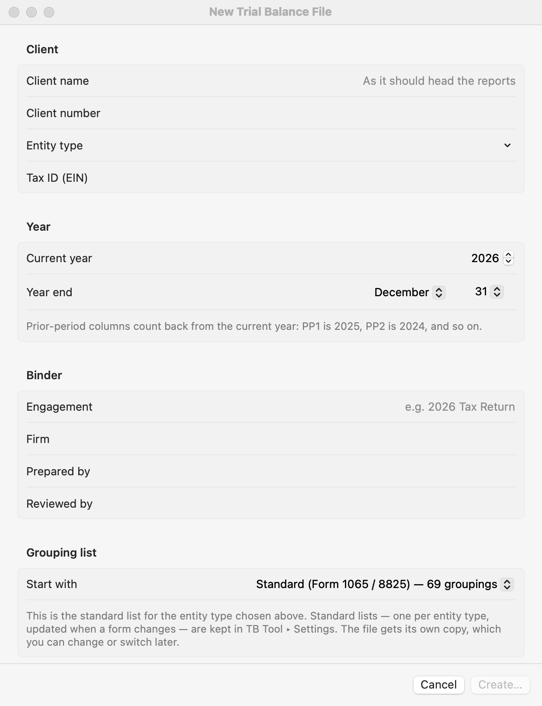

- **Client**: the client name (it heads every report), client number, entity type, tax ID.
- **Year**: the current year and the year end (month and day). Prior-period columns count back
  from this year.
- **Binder**: engagement ("2026 Tax Return"), firm, prepared by, reviewed by. Firm and preparer
  are filled in from the app's settings. The last row, **Make the standard binder folders
  beside the new file**, is on unless you turn it off: the folders of the binder layout for the
  entity type are made in the folder you save the file in. The layout is set in the app's
  settings, below.
- **Grouping list**: the list the file starts with. It defaults to the standard list for the
  entity type you chose ([section 10](#10-groupings)). The file gets its own copy.
- A preview shows how report headings will read.

Click **Create…** and choose where the file goes. Put it in the client's folder for the year:
that folder becomes the binder ([section 11](#11-the-binder)).

The binder folders are made only in a folder that is empty of folders. If the place you choose
already has folders in it, or is a general folder such as the Desktop or Documents, none are
made and the status line says so. A file made by **rolling forward** never uses the layout: it
takes last year's folders ([section 12](#12-prior-years-and-rolling-forward)).

### Changing it later

File ▸ **Trial Balance Settings…** (⇧⌘, or the toolbar gear) opens the same form for the open
file, plus the file's location, its grouping list's name, and the file it was rolled forward
from. Changing the year does not move any balances; it only changes which stored years count as
prior. To start the next year, roll forward ([section 12](#12-prior-years-and-rolling-forward)).


### Settings for the app itself

TB Tool ▸ **Settings…** (⌘,) holds what applies to every file. At the top right is
**Appearance**: *Automatic* (the app is light or dark as the Mac is, and changes with it),
*Light*, or *Dark*. The same choice is under View ▸ Appearance. Below are three tabs:

- **Grouping Lists**: the firm and preparer that new files start with, the Hide zero rows
  switch, and the standard grouping lists ([section 10](#10-groupings)).
- **Binder Layout**: the folders a brand-new binder starts with.
- **AI**: the Anthropic API key that Group with AI uses, and exactly what that feature sends
  ([section 9](#9-accounts)).

### The binder layout for new files

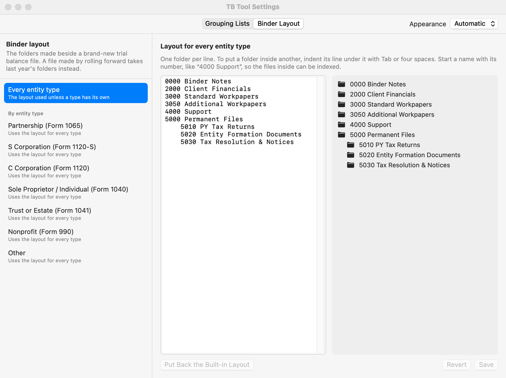

One layout serves **every entity type**. It ships as:

```
0000 Binder Notes
2000 Client Financials
3000 Standard Workpapers
3050 Additional Workpapers
4000 Support
5000 Permanent Files
    5010 PY Tax Returns
    5020 Entity Formation Documents
    5030 Tax Resolution & Notices
```

- **To change it**, select *Every entity type* on the left and edit the outline: one folder per
  line, and a folder inside another indented under it with Tab or four spaces. Start each name
  with its number, so the files inside can be indexed. The picture beside the outline shows the
  folders as they will be made. **Save** (⌘S) keeps it; **Revert** drops what you typed;
  **Put Back the Built-in Layout** restores the one above.
- **To give one entity type its own layout**, select the type and click **Give It Its Own
  Layout**. It starts as a copy of the layout for every type. **Use the Layout for Every Type
  Instead** removes it again.
- A layout is refused while two folders in the same place share a name, two folders share a
  number, or a name contains `/` or `:`.

The layout applies to files created after it is saved. Binders you already have are not
touched. A binder with no folders yet can be given them from its Binder screen (**Make the
Standard Folders**).

## 5. Importing trial balances

One source file becomes one trial balance. Start from the toolbar's **Import** button, File ▸
Import Trial Balances… (⌘I), or **Add…** in the sidebar. Choose one file or several; each is
shown for confirmation in turn.

**Sources that can be read:** Excel (`.xlsx`, `.xlsm`), CSV, tab-separated and other delimited
text (`.tsv`, `.tab`, `.txt`), and cells copied from a spreadsheet, a PDF viewer or a web page
(File ▸ **Paste Trial Balance**, ⇧⌘V).


The import screen shows the source exactly as it is, with the app's reading of it:

- **Sheet**: for a workbook with several tabs, the one that looks most like a trial balance.
- **These are**: this year's unadjusted balances, or a prior year's closing balances (PP1 to
  PP5).
- **Import into**: a new trial balance (with the name to give it, suggested from the file
  name), or an existing one, whose balances are replaced. Journal entries are never touched.
- **Header row**: which row holds the column headings, or none.
- **Split account numbers from names**: on to start with. See below.
- **Balance signs** (when there is a single balance column): debits positive, credits positive,
  or normal balances shown positive (the sign then comes from each account's type).
- **A role above each column**: Ignore, Account #, Account Name, Account # + Name, Debit,
  Credit, Balance, or Account Type. A file needs an account column (number, name, or both) and
  either one Balance column or both Debit and Credit.
- **A checkbox on each row** for whether it comes in, and on the right what it comes in as.

### What the prediction does

- Finds the header row under a title block.
- With Beginning / Net Change / Ending columns, picks **Ending**.
- Leaves out heading lines, total and subtotal lines, blank lines, and repeated headers, and
  says why beside each.
- For a single balance column, picks the sign convention under which the file balances.
- Reads sub-accounts shown as a path ("6500 Repairs - 6515 Supplies") as the sub-account.
- Adds together rows for the same account (a general ledger detail export), and tells you.
- Compares the file's own TOTAL line with what is brought in.

### Changing the prediction

- Change any column's role, the header row (or right-click a row number ▸ Use Row as the Header
  Row), or the signs.
- **Tick or untick any row except the header.** Untick an account to leave it out. Tick a row
  the app read as a total, a heading, or a line above the header to bring it in. A row brought
  in with no amount comes in at 0.00. One with no account is named for its row
  ("Unnamed (row 12)") so you can rename it afterwards.
- **Split account numbers from names.** Normally a number at the front of an account
  ("10001 Operating") is taken as its account number and the rest as its name, and a
  sub-account path ("6500 Repairs - 6515 Supplies") is read as the sub-account. Untick this
  when that is wrong for a file: names that merely start with a number ("2024 Bonus Accrual",
  "401k Match", "1st Street Deposit"). The text is then kept whole as the account's name, the
  account has no number, and it is kept by name. Remember this layout saves the choice with
  the column roles.
- **Show only rows that are left out or flagged** narrows the list to what needs a look.
- **Remember this layout for files like this**: the next file with the same column headings
  uses these column roles automatically.

The footer shows the account count, debits, credits and the difference. The button reads
**Import N Accounts**, or **Import Out of Balance** if the file does not balance (you may still
import it; the data check will keep reminding you).

**The balances are copied into the JSON file.** The source file is never needed again and can
be moved or deleted.

**Accounts with no number** are kept by name everywhere.

**New accounts** join the shared chart.

### When the file names an account differently

If the file uses an account number that is already in the chart under a different name,
clicking Import opens a review before anything comes in. (A difference only in capitals or
spacing is ignored.)


Each such account is one row: its number, its name in the chart and which trial balances
already use it, its name and amount in this file, and three things to decide.

- **Keep**
  - *The chart's name*: it is the same account and the chart is right. This is the default.
  - *This file's name*: it is the same account and the file is right. The account is renamed
    for every trial balance.
  - *Both — it's a different account*: the file's account comes in as a new account under its
    own number, and the account in the chart stays as it is. The next free number is suggested;
    type another, or clear it to keep the new account by name. A number that is already taken
    is refused.
- **Grouping**, when the account in the chart has one
  - For the same account, *Keep* leaves the grouping. Untick it and the account goes back to
    ungrouped, so it turns up again on the Accounts screen to be grouped afresh.
  - For a different account, *Give it … too* starts the new account in the same grouping.
    Unticked, it starts ungrouped.
- **After the import** previews the result: the number and name the chart will hold, its
  grouping (or "Not grouped"), and NEW beside an account that will be added.

**Keep the Chart's Names**, **Use This File's Names**, **Keep Every Grouping** and **Clear
Every Grouping** set every row at once. **Back to the Layout** returns to the first step with
your decisions kept. Nothing changes until you click Import, and the import is one undoable
step.

The same review appears when importing a prior year's balances.

### Importing into a trial balance you already have: replace, or add

When **Import into** names a trial balance that already exists, **Its balances** offers two
things:

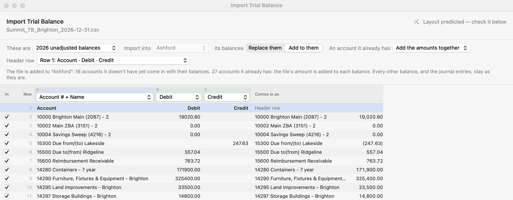

- **Replace them.** The file's balances take the place of everything the trial balance had.
  This is a re-import.
- **Add to them.** The file's accounts and balances **join** what is there. Use this when more
  accounts arrive after the first import — a supplementary trial balance, a subledger, a late
  adjustment from the client — and you want them added rather than starting again.
  - Accounts the trial balance doesn't have yet come in with their balances. New accounts join
    the shared chart as usual.
  - For **an account it already has**, choose: **Add the amounts together** (the default), or
    **Use the file's amount** (that account's balance becomes the file's).
  - Every balance the file doesn't mention stays as it is. Journal entries are not touched.

The line under the controls says what will happen, counted from the rows that are ticked:
how many accounts are new, and how many it already has. The trial balance's source then reads
`first file + second file`. As with any change, ⌘Z takes an addition back.

To go straight there: a trial balance's **Balances ▸ Add Accounts and Balances from File…**,
or right-click it in the sidebar. To add or change a few balances without a file, use
Balances ▸ Edit Unadjusted Balances… ([section 6](#6-the-trial-balance-screens)).

### Other ways to create a trial balance

- **New Blank Trial Balance…** creates an empty one and opens the balance editor to key it in.
- **Replace Balances from File…** (right-click a trial balance, or its Balances menu) re-imports
  one. **Add Accounts and Balances from File…** adds to one, as above.

## 6. The trial balance screens

### Consolidated


Every active account, one column per trial balance, then **Combined**, **Eliminations** and
**Consolidated**, then any prior-period columns. Controls at the top right:

- **Rows**: *By Account*, *By Grouping* (the grouping summary), or *Grouping Detail*.
- **Book / Tax**: which basis the columns show. Book is unadjusted plus adjusting and
  reclassifying entries. Tax adds the tax-only entries.
- **Prior Periods**: how many prior years to show.
- **Hide zero rows**.

Under the grid: whether every trial balance is in balance, whether the eliminations net to
zero, and consolidated net income.

**Double-click an account** to see what makes up its balance. **Double-click a grouping** to
see the accounts in it.

### One trial balance

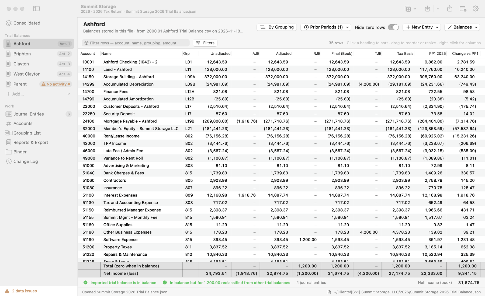

Select a trial balance in the sidebar. The columns are Account, Name, Grp (grouping code),
**Unadjusted, AJE, Adjusted, RJE, Final (Book), TJE, Tax Basis**, then the prior periods and
**Change vs PP1**. At the top right:

- **No activity number**, in orange, while the trial balance has none. Click it to set one.
- **By Grouping**: shows the same balances laid out by grouping (below). Click it again for
  the plain list.
- **Prior Periods**: how many, and whether they are shown on the book or the tax basis.
- **Hide zero rows**.
- **New Entry**: an adjusting, reclassifying or tax-only entry for this trial balance.
- **Balances**: Edit Unadjusted Balances…, Add Accounts and Balances from File…, Replace
  Unadjusted Balances from File…, and for each
  of PP1 to PP4: Import from File…, Enter or Edit Balances…, Remove.

Under the grid: whether the imported balances and the adjusted columns are in balance, the
number of entries, and net income.

Right-click a trial balance in the sidebar for New Adjusting Entry, Details…, Edit Unadjusted
Balances…, Replace Balances from File…, and Delete…. Deleting removes its balances and the
entries posted only to it. It is refused while an eliminating entry still refers to it.

### One trial balance, by grouping

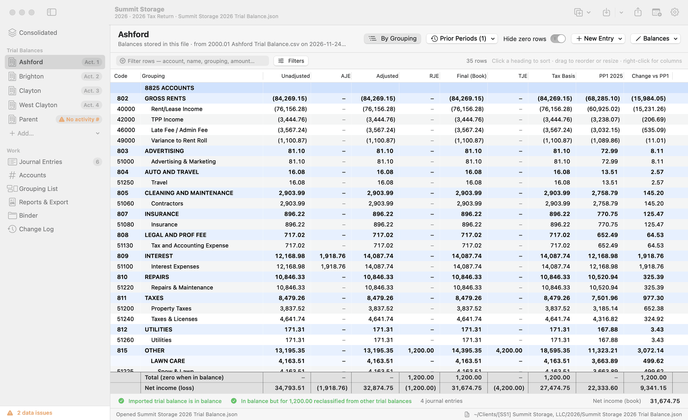

**By Grouping** lays the trial balance out the way the Grouping Detail report does: each
section on a blue band, each grouping with its total in bold on a lighter band, subgroups
nested under their grouping a shade lighter still, and the accounts inside each. Accounts with no grouping come last, under *Ungrouped accounts*. The
amount columns, the total and net income are exactly those of the plain list. Double-click an
account for its activity, or a grouping for its accounts across every trial balance. The
choice is remembered, and it has its own column layout.

**Sorting goes back to the plain list.** A list sorted by a column has no groupings in it, so
clicking a heading while By Grouping is on turns By Grouping off: the button goes back to
unselected and you get the plain list, sorted by the column you clicked. Click By Grouping
again to return to the groupings. The same layout is available for
export as the Single Trial Balance report with **By grouping** ticked
([section 13](#13-reports-and-exports)).

### A trial balance's name and activity number

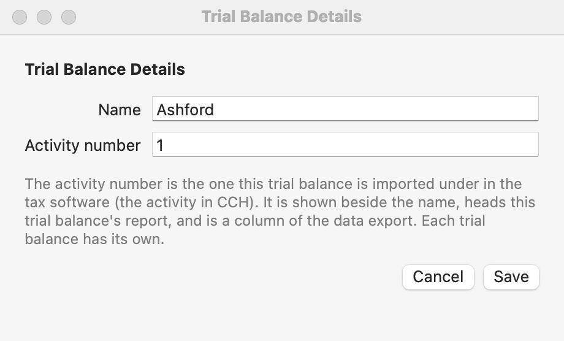

**Details…** (or Balances ▸ Name and Activity Number…) sets the trial balance's name and its
**activity number**: the number it is imported under in the tax software (the activity in CCH).
It is shown beside the name in the sidebar, heads that trial balance's report, and is the
Activity column of the long-format data export, so each row of that export says which activity
it belongs to. Two trial balances cannot share a number. It carries into next year's file on a
roll forward.

**Every trial balance needs one.** It does not have to be given at import, but until it is the
trial balance is flagged: an orange **No activity #** beside its name in the sidebar, an orange
**No activity number** button at the top of its screen, and a line in the data check.

### Account activity


Double-clicking an account row opens its activity: the unadjusted amount from each trial
balance (marked *Imported* or *Edited*), then every journal line that touches it, then the
final book balance and, when it differs, the tax basis. Opened from the consolidation it covers
every trial balance and includes eliminations. Opened from one trial balance it covers that one.

- Double-click a journal line to open the entry.
- Double-click the unadjusted line to open the balance editor.
- **Copy** and **Export** are at the bottom.

### Changing balances by hand

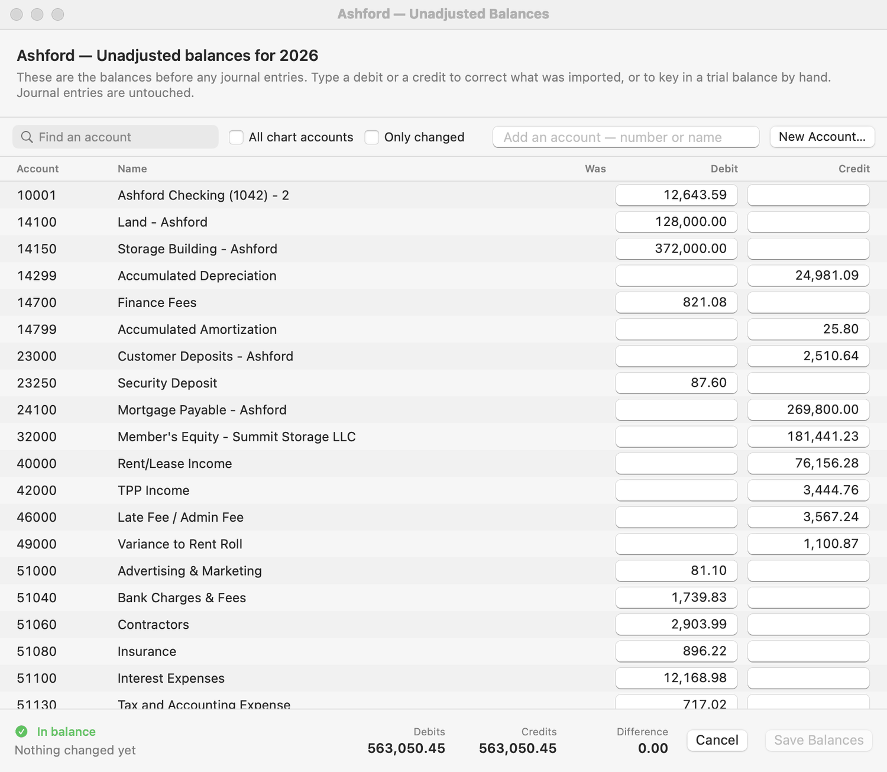

**Balances ▸ Edit Unadjusted Balances…** lists the trial balance's accounts with a debit and a
credit field each.

- Type in either column; typing in one clears the other.
- The **Was** column shows the original amount of anything you have changed.
- **Find an account** filters the list. **All chart accounts** lists accounts this trial
  balance has no balance for. **Only changed** shows what you have touched.
- **Add an account** finds an account by number or name and adds a row for it. **New
  Account…** adds one to the chart.
- The footer shows debits, credits and the difference. The button reads **Save Balances**, or
  **Save Out of Balance**.

Saving is one undoable step. Journal entries are untouched. The same editor edits a prior
year's closing balances.

## 7. Working in a grid

Every trial balance, consolidation, report, activity and grouping grid behaves the same way.

- **Totals are pinned at the bottom**, the way the headings are pinned at the top. They stay
  under their columns as you scroll sideways.
- **Filter box**: type any words; rows containing all of them (in any column) remain, and a
  total of the rows shown appears.
- **Leaving a search box.** Every search and filter box in the app works the same way: press
  **Esc** or Return, or **click anywhere else**, and you are out of the box, with the keyboard
  back on the list (arrows move, Space previews, ⌘C copies). **What you typed stays**, so the
  list stays narrowed while you work in it. The ✕ in the box clears it.
- **Shaded bands**, as in the exports: a section sits on a blue band, a grouping that heads
  its accounts on a lighter one, its subgroups lighter still, and the totals on grey. You see
  them wherever groupings are shown — a trial balance by grouping, the consolidation by
  grouping, the grouping reports, a grouping's accounts — in light and dark appearance.
- **Filters** button: build rules.

  

  - Each rule names a column (or *Any column*), a test, and a value.
  - Text tests: contains, doesn't contain, is exactly, is not, starts with, is blank, isn't
    blank.
  - Amount tests: is at least, is at most, is between, equals, isn't zero, is zero, is a debit,
    is a credit. Sizes ignore the sign, so "is at least 10,000" finds debits and credits of
    10,000 or more.
  - **Account Type** (is / is not Asset, Liability, Equity, Revenue, Expense) is offered on
    every grid whose rows are accounts, whether or not the type is a column.
  - Rules are joined by **all** or **any**.
  - Name a filter and **Save Filter**; saved filters are kept per screen.
- **Sorting**: click a heading. Click again to reverse. A third click returns to chart order.
  Section and subtotal rows drop out while a grid is sorted or filtered.
- **Columns**: each starts as narrow as it can be while showing everything in it. Drag an edge
  to resize, double-click an edge to fit that column, drag a heading to reorder. Right-click a
  heading to hide or show columns, **Fit Column Widths to Content**, or **Reset Column Order**.
  What you change is remembered per screen, through switching screens and quitting.
- **The total of a selection.** Select two or more rows (⇧-click for a run, ⌘-click to add or
  remove one) and rest the pointer on them: a small panel shows what the selected rows add up
  to **in every amount column**, with the number of rows. Move the pointer off the selection,
  or click elsewhere, and it goes. It works on every grid: a trial balance, the consolidation,
  the reports, account activity and a grouping's accounts.

  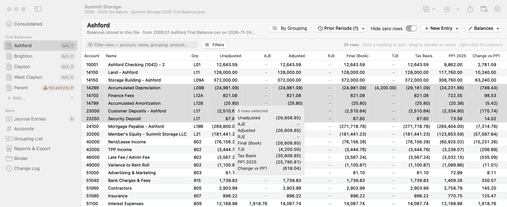

  If accounts are selected, they are what is added, even if a grouping line is selected with
  them. If only grouping lines are selected, those are added, and a subgroup is left out when
  its own grouping is selected too, so nothing is counted twice.
- **Copy**: select rows and press ⌘C to copy them, with headings, ready to paste into a
  spreadsheet. With nothing selected, ⌘C copies everything including the totals.
- **Hide zero rows** is one switch for the whole app. It appears on every trial balance and
  report screen and under View ▸ Hide Zero Balance Rows (⇧⌘0). The workbook export follows it.

**Column widths are the same everywhere.** The Accounts and Grouping List screens, and the
binder's All Files view, follow the same rule as the grids: every column starts at the
narrowest width that shows its heading and everything in it, and a column you resize by hand
keeps the width you gave it, on that screen, from then on. (Accounts and Grouping List are
lists rather than grids: they sort by column and remember column order and hidden columns, and
do not have the filter box or pinned totals. The Journal Entries screen has no columns to
size: it sets each entry out in full, as the report does.)

## 8. Journal entries

### The list

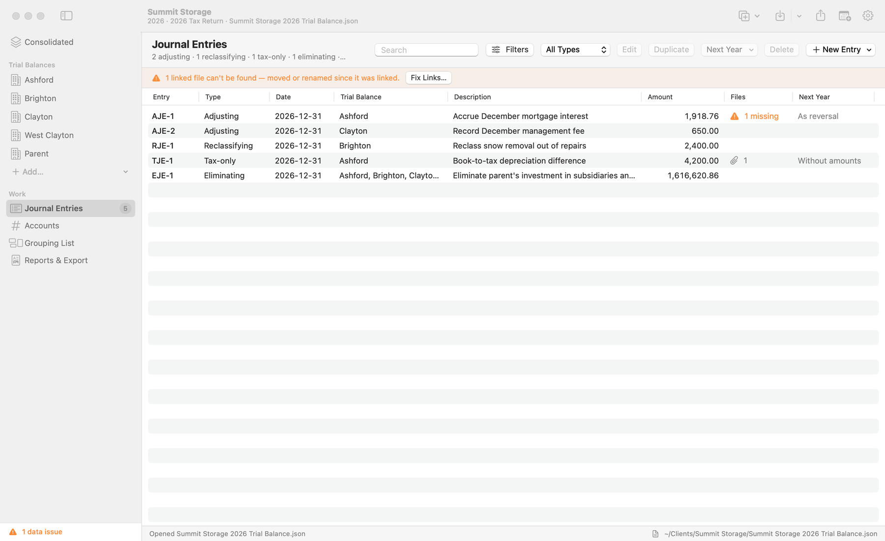

The Journal Entries screen shows every entry in full, set out the way the Journal Entries
report prints it ([section 13](#13-reports-and-exports)): a heading for each kind of entry,
then each entry on its own with its number, date and description across the top, its
references (click one to open the workpaper), its lines, and its total. Nothing is cut short
and nothing has to be opened to be read. Each kind ends with its total, and the screen with
the total of all entries. An entry rolled forward without amounts is marked *Waiting for
amounts*; what happens to an entry next year is noted at its top right.

At the top: **search** (number, description, account, trial balance, memo, reference),
**Filters**, a **type picker** (All Types, or one kind), **Edit**, **Duplicate**, **Next
Year** (set the roll-forward choice for the selected entries), **Delete**, and **New Entry**.

**Selecting.** Click an entry to select it. ⌘-click adds or removes one; ⇧-click takes
everything from the last entry clicked to this one. The bar above the list says how many are
selected. Next Year and Delete act on all of them; Edit and Duplicate need exactly one.
Double-click an entry to open it. Right-click an entry (or the selection it is part of) for
the same actions.

**Reordering, and renumbering.** Drag an entry up or down and let go on another entry of the
same kind: on its top half to put it above, on its bottom half to put it below. A blue line
shows where it will land. Dragging one of several selected entries moves them all, in the
order they were in. Entries are listed in number order, so moving one **renumbers** that kind
of entry to match the new order:

- When the numbers are an unbroken run (AJE-1, AJE-2, AJE-3) there is only one way to do it,
  and it is done at once.
- When the numbers have gaps (AJE-1, AJE-2, AJE-5), you are asked: **Number AJE-1 to AJE-3**
  closes the gaps, **Keep the Same Numbers** hands the same three numbers out in the new
  order.
- When they aren't one series (AJE-1, *Depreciation*, AJE-3), you are told they would all be
  numbered afresh, and can cancel.

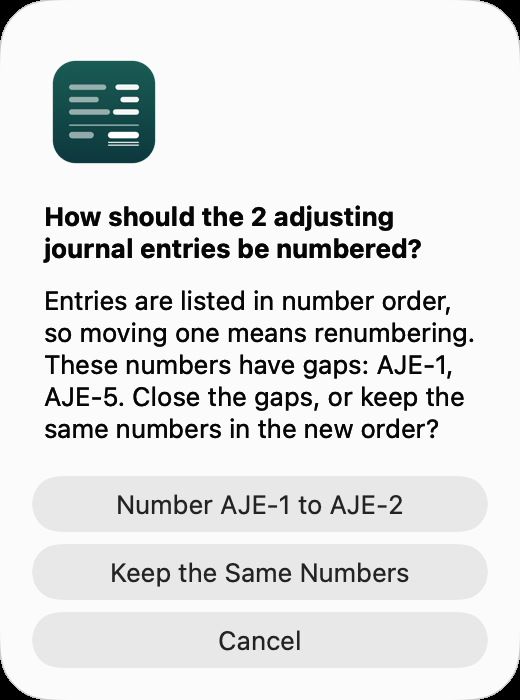

An entry stays among the entries of its own kind: an adjusting entry can't be dragged in among
the reclassifying entries. References, lines and everything else about an entry are untouched;
only its number changes. The change log gets one line listing each old and new number, and ⌘Z
puts the order and the numbers back. With a search or filter narrowing the list, a move still
renumbers every entry of that kind, including the ones not shown.

### Writing an entry

Start one from the toolbar's **New Entry**, the Entries menu, a trial balance's New Entry menu,
or ⌘J (adjusting), ⇧⌘J (reclassifying), ⌥⌘J (tax-only), ⌃⌘J (eliminating).

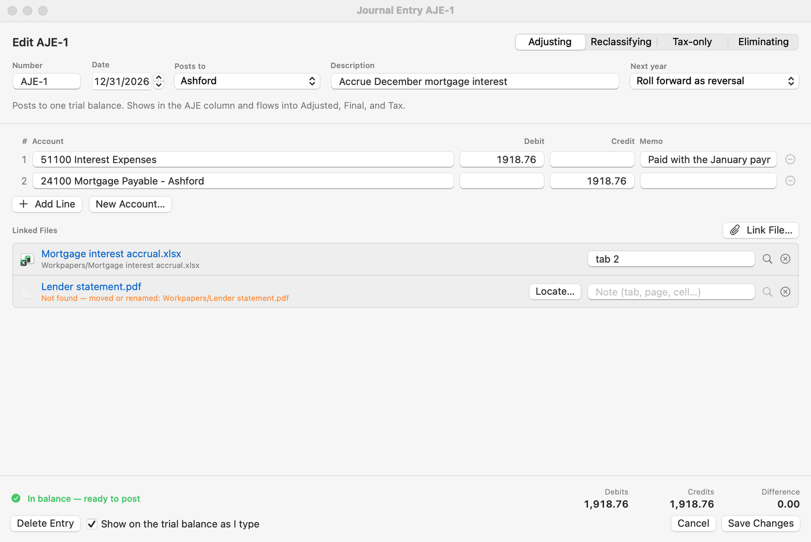

- **Type**: switch between the four kinds at the top right. The number follows the type's own
  sequence (AJE-1, AJE-2…; RJE-1…) unless you type your own.
- **Number, Date, Description.**
- **Posts to**: the trial balance, for an adjusting or tax-only entry. A reclassifying or
  eliminating entry has a trial balance picker on every line instead.
- **Next year**: what a roll forward does with this entry
  ([section 12](#12-prior-years-and-rolling-forward)).
- **Lines**: account, debit or credit, memo. **Add Line** (⌘L) adds a line that starts with
  whatever amount would balance the entry, **and puts the cursor in the new line's account
  field**, ready to type. Tabbing from the last memo lands on Add Line, and **Return presses
  it**: Tab, Return, type the account, and so on down the entry without the mouse. **New Account…** adds an account to the chart.
- **References**: the workpapers that support the entry, picked from the binder.
- The footer shows debits, credits and the difference, and lists anything stopping the entry
  from being posted.
- **Post Entry** (Return), **Post & New** (⇧⌘↩) to post and start another of the same type,
  **Cancel** (Esc). For an existing entry the button is **Save Changes** and there is a
  **Delete Entry** button.

### Finding an account

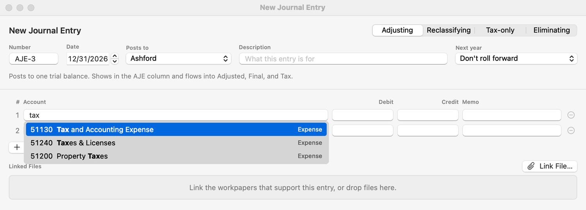

Wherever an account is chosen, type any part of its number or name. A list of every match
appears under the field and narrows as you type, with the matching text in bold. Words can be
in any order. ↑ and ↓ move through the list, Return or Tab picks, Esc closes it. An exact
number comes first, then numbers that start with what you typed, then names that start with
it, then names that contain it.

### Balances update while you type


While an entry window is open, the trial balance, consolidation, Reports, Accounts, account
activity and grouping windows include the entry as typed. A banner says which entry is included
and that it is not posted. Put the entry on one display and the trial balance on another.
Cancel, and the balances go back.

Exports and Copy always use what is saved, never an unposted entry. The checkbox **Show on the
trial balance as I type** at the bottom of the entry window turns the preview off.

### The posting rules

An entry can be posted only when all of these hold. They are enforced in the app, on the
command line, and reported by the data check for a file edited by hand.

1. It has a number, and no other entry has the same number.
2. Its date is a real date.
3. It has at least two lines.
4. Every line names a trial balance and an account that is in the chart.
5. Every line has an amount.
6. Debits equal credits.
7. An adjusting or tax-only entry posts to a single trial balance. A reclassifying entry and an
   eliminating entry can name a different trial balance on each line.

**Allocating across trial balances.** A reclassifying entry can debit one account in three
trial balances and credit it in a fourth, which is how overhead paid by one property is spread
over the others in a single entry. The entry must balance as a whole. Each trial balance is
then out of balance on its own by its share; the entry window says by how much, each trial
balance's screen reports it as "reclassified from (or to) other trial balances" instead of as
an error, and the consolidation stays in balance.

**Changing an entry's type.** An entry with lines on more than one trial balance cannot be
switched to adjusting or tax-only; the type goes back and a message says why. Put every line
on the same trial balance first.

### References

A reference ties an entry to a workpaper in the binder.

**Adding one.** Click in the **Add a reference** field. A list drops down of **every indexed
file in the binder**, in index order, whatever folder or subfolder each is in, with its folder
shown on the right. Type any part of an index or a file name (in any order) and the list
narrows as you type. ↑ ↓ move, Return or Tab takes the highlighted file, Esc closes the list.
The field then empties, ready for the next one.

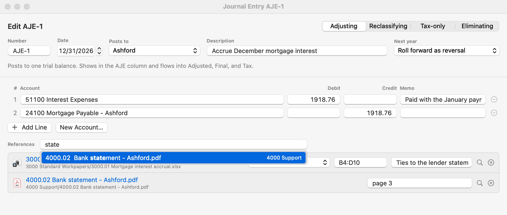

Only indexed files are offered, so index a workpaper on the Binder screen first
([section 11](#11-the-binder)). Placeholders are offered too, marked as such. Files are no
longer chosen through a Finder dialog or by dropping them on the entry.

**Each reference has:**

- its name, which opens the file when clicked;
- a **note** (page, line, whatever helps);
- a magnifying glass, which shows the file in Finder;
- an ✕, which removes the reference. The file itself is never touched.

**A reference to an Excel workbook** (`.xlsx`, `.xlsm`, `.xls`, `.xlsb`, `.xltx`, `.xltm`)
also has:

- **Tab**: a menu of the workbook's tabs. **You must choose one**, even when the workbook has
  only one tab; the entry cannot be posted or saved until you do, and the field is outlined in
  orange until then. For an `.xls` or `.xlsb` workbook, whose tabs the app cannot read, you
  type the tab's name instead.
- **Cells** (optional): the cells on that tab, such as `B4` or `B4:D10`. Whole columns
  (`B:D`), whole rows (`4:10`) and several areas separated by commas also work. Anything else
  is refused when the entry is posted.

**Opening a workbook reference.** Clicking the name opens the workbook in Excel **on that
tab**, with **those cells selected** if you gave any. To do this TB Tool asks Excel to go
there, and the first time macOS asks whether TB Tool may control Excel: click **OK**. If you
refuse, or Excel is not installed, the workbook simply opens, and the status line says why it
was not taken to the tab. The same workbook can be referenced more than once on an entry, for
different tabs.

The journal report and its exports show the tab and cells after the file:
`3000.01 Mortgage interest accrual.xlsx ['Accrual'!B4:D10]`.

A reference is stored as the file's path within the binder, so the whole folder can be moved.
**References follow the file**: when you renumber, rename or move a workpaper on the Binder
screen, every entry that refers to it is updated.

**Broken links are flagged.** If a referenced file is moved or renamed outside TB Tool (in
Finder, say):

- the entry shows "missing" in the Files column;
- the Journal Entries screen shows a banner;
- the data check counts it.


**Fix Links…** (also Entries ▸ Fix Broken File Links…) lists every broken link. It searches the
client's folder for a file of the same name:

- Where exactly one is found, **Relink** fixes it in a click, and **Relink All Found** fixes
  every such link.
- Where several are found, a menu lets you choose.
- **Locate…** lets you point at the file. The dialog opens in the folder the file was last in,
  or the nearest folder above it that still exists. Locating one file also repairs other broken
  links whose files moved to the same folder.
- **Remove Link** removes the link from the entry. No file is ever deleted.

In the entry window, a reference whose file cannot be found is shown in orange; remove it and
pick the file again from the list.

## 9. Accounts


The Accounts screen is the shared chart: number, name, type, grouping, consolidated book
balance, and which trial balances use the account. It is built for hundreds of accounts.

**Filtering:** a search box; All / Ungrouped / Grouped; type; grouping section; trial balance;
an account number range (from 51000 to 51999; a short "to" such as 5 includes everything
starting with 5); and the **Filters** rule builder.

**Ungrouped accounts raise an alert.** While any account has no grouping, the data check
counts it, the sidebar badge shows how many, and a banner on this screen and on the Grouping
List screen names the first few. **Show Them** (or **Show Ungrouped Accounts** from the data
check) narrows this screen to exactly those accounts, ready to select and group with ⌘G.

**Changing many at once:** select accounts (⇧-click, ⌘-click, ⌘A, or **Select All Shown**),
then:

- **Apply Grouping…** (⌘G): type a code or a name (`L01`, `cash`, `815 mgmt`) and press Return
  to apply the first match.
- **Clear Grouping**, **Delete…**.

**A first pass by AI:** **Group with AI…** at the top right (and **Suggest Groupings with
AI…** on the alert banner) asks Claude to suggest a grouping for every ungrouped account. See
[Grouping accounts with AI](#grouping-accounts-with-ai) below.

**Changing one:** the Grouping cell is a menu. Using it on a selected row applies to the whole
selection.

**Account types** are asset, liability, equity, revenue and expense. Net income is computed
from the revenue and expense accounts, so the types matter.

**An account's type is its grouping's.** The Type column is read-only. There is nothing to set
on the account: put it in `L01 · CASH` and it is an asset; move it to another grouping and its
type follows. To change what type a grouping gives its accounts, edit the grouping on the
Grouping List screen ([section 10](#10-groupings)); every account in it changes together.

An account that has **no grouping yet** shows a provisional type in grey: the one read from the
file's own type column on import if it had one, otherwise guessed from the leading digit of
the number (1 asset, 2 liability, 3 equity, 4 revenue, 5 to 9 expense), otherwise from the
name. It is used until the account is grouped, which is one more reason the ungrouped alert is
there.

**Changing an account's number or name.** Double-click an account (or select it and click
**Edit…**, or right-click ▸ Edit Number and Name…).

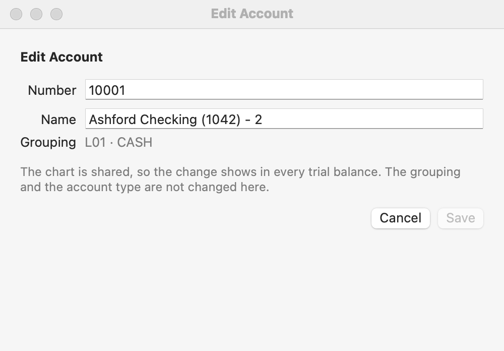

- **The name** changes everywhere the account is shown, in every trial balance.
- **The number** is what balances and journal lines know the account by, so when you change it
  everything that refers to the account is moved to the new number: this year's balances in
  every trial balance, prior years' balances, and every journal entry line. Nothing is lost
  and nothing has to be re-entered; the grouping and type stay as they are. The window says how
  much will move before you save.
- A number that another account already has is refused: two accounts cannot share one. (To
  combine two accounts, move the balance with a reclassifying entry or by editing balances.)
- An account kept by name can be given a number, and a number can be removed.
- The change log records it as one line, *Account number 10001 → 10900*. ⌘Z changes it back.

**New Account…** asks for a number, a name and a grouping. The type shown is the grouping's.

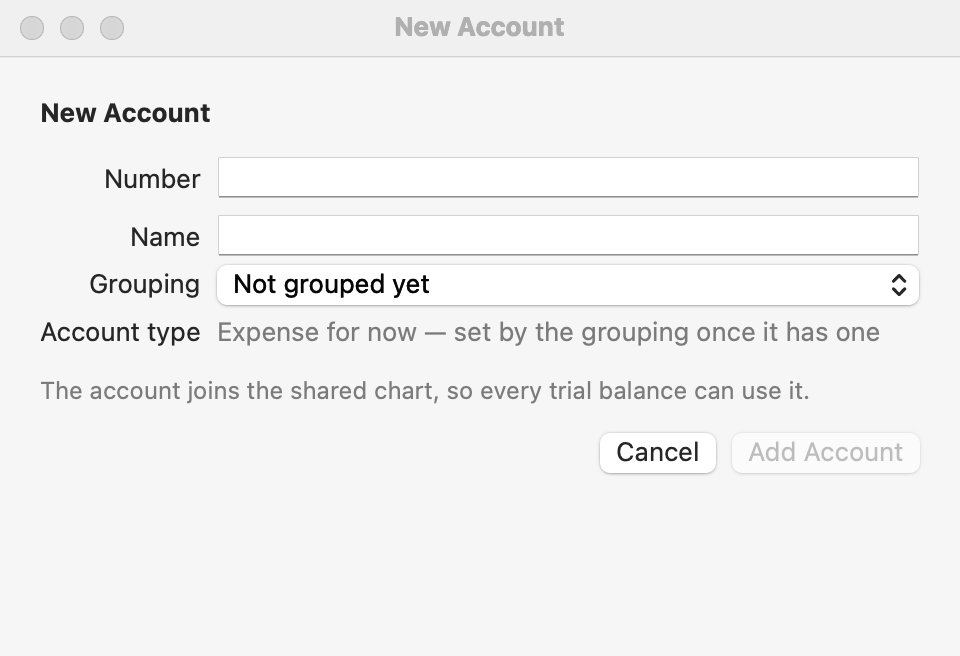

**Deleting.** Select accounts and click **Delete…**. An account that nothing refers to is
deleted after one confirmation. An account **in use** — it has a balance this year, a balance
in a prior year, or a line in a journal entry — brings up a list of exactly what refers to it,
trial balance by trial balance and entry by entry, so nothing is hidden. (A prior-year balance
is the usual surprise: it isn't on this year's screens unless the prior-year columns are
shown.)

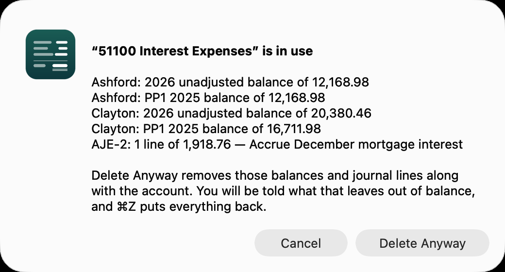

- **Delete Anyway** deletes the account and, with it, every balance and journal line listed.
  You are then told what that leaves out of balance, line by line: each trial balance and
  year (*Ashford: PP1 2025 is now out of balance by (12,168.98)*), and each journal entry
  (*AJE-1 is now out of balance by (1,918.76)*). An entry whose only lines were on that
  account is removed. Journal entries and this year's trial balances that no longer balance
  stay in the data check until you put them right.
- **Delete Only the N Not in Use** appears when the selection mixes accounts that are in use
  with accounts that aren't.
- **Cancel** leaves everything as it was.

The change log records what was removed and what it left out of balance. ⌘Z brings back the
account, its balances and its journal lines together. Balances of exactly zero never count as
being in use.

**Right-click an account** for Edit Number and Name… and Show Activity.

**The Chart menu:** New Account…, Import Chart of Accounts…, Export Chart of Accounts (JSON or
CSV).

### Grouping accounts with AI

**Group with AI…** hands the accounts that have no grouping to Claude Opus 5.5, Anthropic's
model, for a first pass. It is meant for the moment after an import, when a few dozen (or a
few hundred) new accounts each need a tax line. It works from **this file**: the grouping list
it may choose from, and the accounts you have already grouped, which show how this set of
books is treated. It never invents a grouping, and it never changes anything by itself: you
review every suggestion first.

Open it from the Accounts screen (**Group with AI…**), from the ungrouped-accounts banner
(**Suggest Groupings with AI…**), or File ▸ Group Ungrouped Accounts with AI… (⌥⌘G).

**This is the one thing in TB Tool that sends data off your Mac**, and only when you press
Send. It needs an Anthropic API key of your own; see *The API key* below.

**1. Choose what to send.**

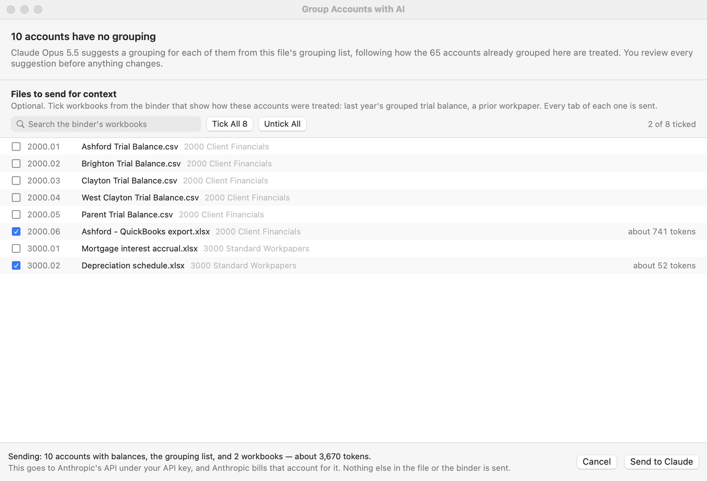

The window says how many accounts have no grouping and how many grouped accounts there are to
learn from. Below is every Excel and CSV file in the binder (`.xlsx`, `.xlsm`, `.csv`,
`.tsv`), each with a checkbox. **Ticking files is optional.** Tick the ones that show how
these accounts were treated before: last year's grouped trial balance, a prior-year workpaper,
the client's own financial statements. Search narrows the list; **Tick All** ticks what is
shown. With none ticked, Claude works from the trial balances already imported.

Each ticked workbook is read on your Mac and reduced to a lightweight text version: **every
tab**, every cell that holds something, as plain lines, with formatting, formulas and empty
rows left behind. Its approximate size appears beside it. The line at the bottom says exactly
what will go and about how large it is in *tokens* (the unit Anthropic bills by; roughly three
characters each). A request too large for one pass is refused before anything is sent, with
the size, so you can untick the larger files. Nothing is ever cut short silently.

**2. Send.** **Send to Claude** sends one request (a chart with more than 200 ungrouped
accounts is sent 200 at a time, one after another). It can take a minute or two; **Stop**
abandons it. The trial balance is not changed while you wait.

**3. Review.**

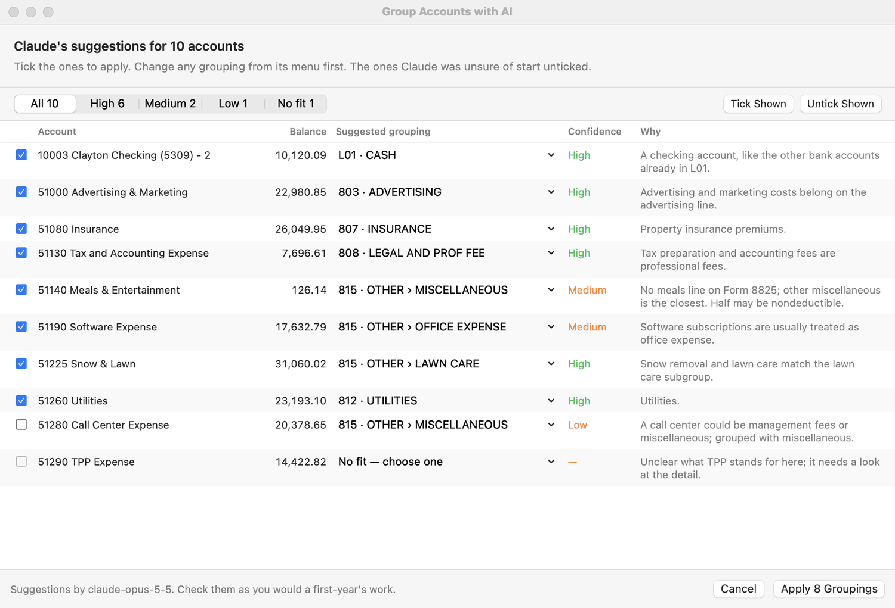

Every account comes back with a **suggested grouping**, a **confidence** (high, medium or
low) and one line saying **why**. An account for which nothing in your list fits comes back as
*No fit* rather than being forced into one.

- Suggestions of high and medium confidence start ticked; **low and no-fit start unticked**.
- The buttons across the top show All, High, Medium, Low or No fit. **Tick Shown** and
  **Untick Shown** act on what is showing.
- **Change any suggestion** from its menu before applying, or choose Leave Ungrouped.
- **Apply N Groupings** applies the ticked ones as a single change. ⌘Z undoes all of it. The
  rest stay ungrouped, still counted by the alert, for you to group by hand or send again.

Treat it as you would a first-year's first pass: usually right on the plain accounts, worth a
second look on the ones it marked medium, and yours to decide on the rest. An account's type
follows its grouping, as always.

**What is sent, exactly:**

- the client's name, year end and entity type, and the names of its trial balances;
- the file's grouping list (ids, codes, names, sections, account types);
- the number, name and grouping of each account already grouped;
- the number, name and final book balance of each ungrouped account, in each trial balance,
  and its prior-year balance if the file has one;
- every tab of each workbook you ticked.

Journal entries, sign-offs, the change log, tax IDs, and every file you did not tick stay on
your Mac. The request goes straight from your Mac to Anthropic's API (`api.anthropic.com`)
under your key; there is no server of TB Tool's in between. How long Anthropic keeps API data
and what it may do with it is set by your agreement with Anthropic, not by TB Tool. **Check
your firm's policy and the client's engagement terms before sending client data to any outside
service.**

**The change log records each request**: when, by whom, how many accounts, and the names of
the files that went with it. Applying suggestions is a second entry listing each account and
the grouping it was given.

**The API key.** TB Tool ▸ Settings… ▸ **AI**.

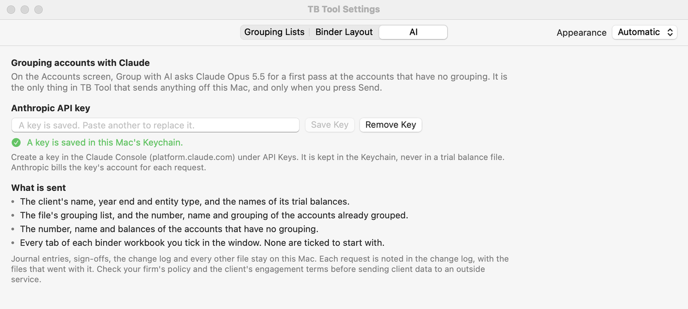

Create a key in the Claude Console (platform.claude.com ▸ API Keys), paste it, and click
**Save Key**. It is kept in your Mac's **Keychain**, never in a trial balance file, the app's
preferences, or a backup of the client folder. **Remove Key** deletes it. Anthropic bills the
key's account for each request, by size; a typical request costs well under a dollar. After installing a new
version of TB Tool, macOS may ask once whether TB Tool may use the saved key: choose Always
Allow.

**If it doesn't work:**

| It says | What to do |
|---|---|
| The API key wasn't accepted | The key is mistyped, revoked, or from another workspace. Paste it again in Settings ▸ AI. |
| The account's rate limit was reached | Wait a minute and send again. It retries twice by itself first. |
| Anthropic's service is busy | The same: it has already retried; try again shortly. |
| A billing problem | The key's account is out of credit or has no payment method. Fix it in the Claude Console. |
| The request was too large | Untick some of the larger files. |
| A file can't be read | An older `.xls` or a damaged workbook. Untick it, or save it as `.xlsx`. |
| Claude declined this request | Rare. Send again without the context files. |
| It stopped part way | The suggestions that did arrive are shown, with a note. Apply what you want and send again for the rest. |

### Reusing a chart between files

Export one file's chart and import it into another to carry the grouping and type decisions
across. The source can be a chart export, another trial balance file, or any sheet with account
and grouping columns. Accounts are matched by number, or by name where they have none. The
import window previews every change and offers:

- **Apply groupings**, and whether to replace groupings already set in this file;
- **Apply account types to accounts with no grouping** (a grouped account's type always comes
  from its grouping);
- **Add accounts this file doesn't have**.

Groupings the source uses that this file's list lacks are brought across.

## 10. Groupings

### The grouping list

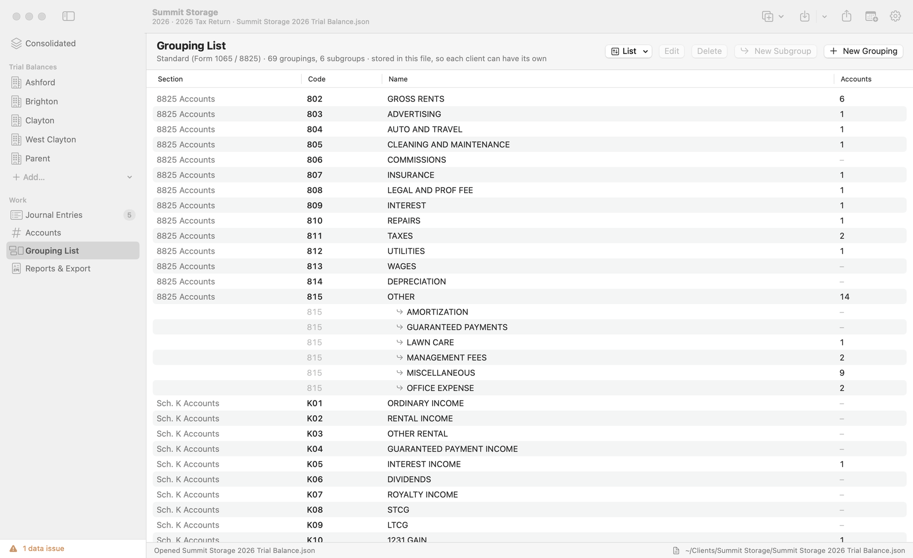

The Grouping List screen shows the file's list: section, code, name, and how many accounts are
in each. A grouping's count includes its subgroups.

- **New Grouping**, **Edit**, **Delete**. Double-click to edit.
- **New Subgroup** adds a subgroup under the selected grouping.

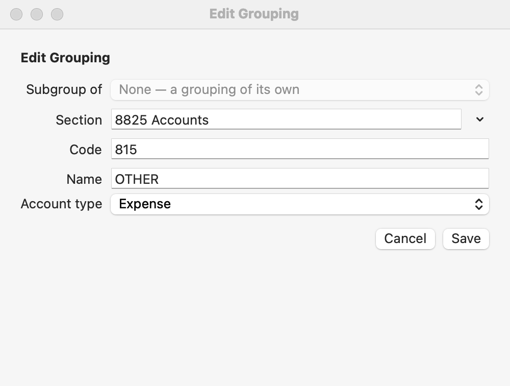

**Order.** The list keeps itself in order. Within each section, groupings are sorted by code,
reading numbers as numbers (802, 802B, 803 … and 2 before 10). Subgroups are sorted the same
way within their grouping; those with no code of their own follow, by name. A new grouping
falls into place as soon as you add it, and changing a code moves it. Every picker and every
report uses the same order. Sections stay in the order they were set up.

**Account type.** This is the one place account types are decided. Every grouping has an
account type: asset, liability, equity, revenue or expense. You choose it when you add a
grouping (the Add button waits until you have), and it is shown in the Account Type column. A
subgroup has no type of its own; it uses its grouping's. Every account in a grouping has the
grouping's type, always. Changing a grouping's type changes the type of every account in it,
and the editor tells you how many before you save.

*Any type* is there for a memo line that holds accounts of every kind. Accounts in such a
grouping keep the provisional type they were imported with.

When a file is opened whose accounts say otherwise (one from an earlier version of the app, or
edited by hand), each account takes its grouping's type and the status line says how many
changed. The same happens when a grouping list or a chart of accounts is imported.

**Rules for codes and subgroups:**

- **Every code is used once.** No two groupings, and no two subgroups, can have the same code.
- A subgroup's code is optional. Left blank, its accounts report under its grouping's code.
- Subgroups go one level deep, and take their grouping's section.
- **Subgroup of** in the editor moves a grouping under another, or makes a subgroup a grouping
  of its own.
- Deleting a subgroup moves its accounts up to its grouping. Deleting a grouping deletes its
  subgroups too and leaves their accounts ungrouped.

Accounts are assigned to a subgroup exactly as to a grouping; it appears indented under its
grouping in every picker.

**A file from before codes had to be unique** may have several groupings sharing a code (the
older built-in list had six "815 OTHER - …" lines). Such a file opens normally. The Grouping
List screen and the data check point it out, and **Combine as Subgroups** puts them under one
grouping with that code in one undoable step. No account loses its assignment and no total
changes.

### Grouping reports

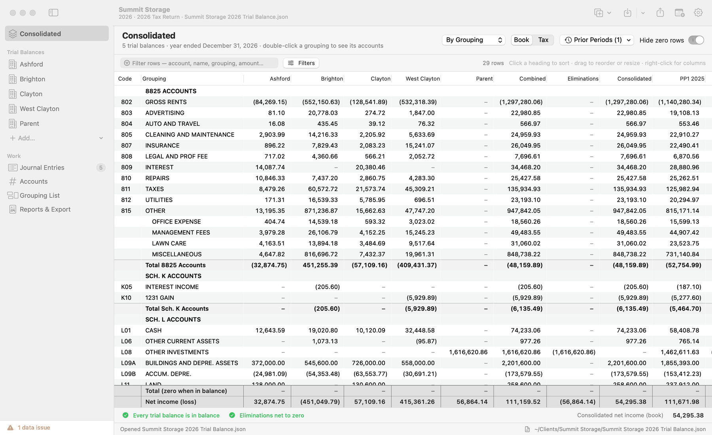

The **summary** (Consolidated ▸ By Grouping, or Reports ▸ Grouping Summary) lists each section,
its groupings with their totals, and each grouping's subgroups nested beneath it. When a
grouping holds accounts directly as well as in subgroups, a "Not in a subgroup" line makes the
nested rows add up. Accounts with no grouping are listed one by one at the end so they can be
found. **Net income** is shown under the total in every column.


The **detail** is the same outline with every grouping and subgroup opened to its accounts.

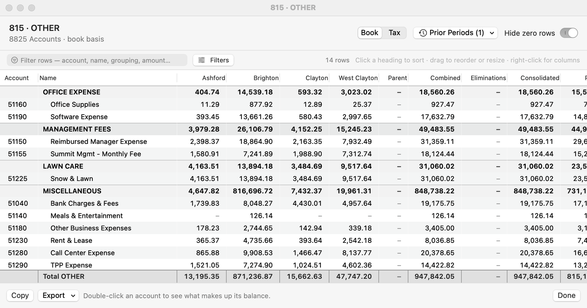

**Double-click a grouping** in either to open its accounts in a window of their own, with every
consolidation column, a Book / Tax switch, and the prior periods. Double-click an account there
for its activity.

### Moving lists between files

The Grouping List screen's **List** menu:

- **Import Grouping List…** from a grouping list export, another trial balance file, a chart
  export, or a sheet with Section, Code and Name columns. Choose whether to **replace** the
  file's list or **add to** it; the window previews what is added, changed and removed, and
  which accounts would become ungrouped.

  

- **Export Grouping List** as JSON or CSV. The CSV columns are Section, Code, Name, Account
  Type, ID and Subgroup Of.
- **Switch to a Standard List**: the same import window, for one of your standard lists.
- **Save as a Standard List…**: keep this file's list on your Mac under a name.
- **Manage Standard Lists…**: opens the app's settings.

In a sheet you write by hand, add an **Account Type** column (Asset, Liability, Equity,
Revenue, Expense, or blank for any). Give a subgroup a **Subgroup Of** column holding its
grouping's code or ID, and leave its own code blank if you like. Rows that share a code are brought in as
one grouping with subgroups, because a code is used once.

### Standard grouping lists


TB Tool ▸ **Settings…** (⌘,) keeps the standard lists on your Mac. A new file starts with the
list marked as the standard for its entity type.

- **The built-in list** covers Form 1065: Form 8825, Schedule K, page 1 and Schedule L, plus a
  memo line. You can change it. The arrow button under the list of lists puts it back as
  shipped.
- **Add a list** (+): New Empty List…, Duplicate (for next year's version), Import a List from
  a File…, or Add the Open File's List….
- **Standard for**: tick the entity types this list is the standard for (Partnership, S
  Corporation, C Corporation, Sole Proprietor, Trust or Estate, Nonprofit, Other). An entity
  type has one standard list. Types with none use the built-in list.
- **Edit the groupings** in place: New Grouping, New Subgroup, Edit, Delete. The same rules
  apply as in a file.
- **Import / Export**: replace this list's groupings from a file or from the open file, or
  export the list.
- Rename a list by typing over its name. Delete one with the minus button.

Changes here are saved as you make them and are not undone with ⌘Z.

**Changing a standard list does not change files you already have.** Each file carries its own
copy. To bring a file up to date, use its Grouping List screen ▸ List ▸ Switch to a Standard
List, which previews the effect first.

## 11. The binder

The **binder** is the folder the trial balance file is in: one folder per client per year,
with the trial balance at its top.

```
[SS1] Summit Storage, LLC/
  2026/
    Summit Storage 2026 Trial Balance.json
    0000 Binder Notes/
    2000 Client Financials/
      2000.01 Ashford Trial Balance.csv
      2000.02 Brighton Trial Balance.csv
    3000 Standard Workpapers/
    3050 Additional Workpapers/
    4000 Support/
    5000 Permanent Files/
      5010 PY Tax Returns/
      5020 Entity Formation Documents/
        5020.01 Operating agreement.pdf
      5030 Tax Resolution & Notices/
    TB Backups/
```

A new file starts with those folders: they are the binder layout, which you can change
([section 4](#4-setting-up-a-file)).

Everything in that folder other than the trial balance file itself, `TB Backups` and hidden
files is part of the binder. A trial balance saved in a general folder (your home folder,
Desktop, Documents or Downloads) has no binder, so that everything on your Desktop is not
mistaken for workpapers.

### Index numbers

- A **folder's index** is the number its name starts with: `2000 Client Financials` is 2000.
- A **file's index** is a number, a point and a suffix: `2000.02 GL.xlsx` is 2000.02. The
  number is the folder's; the suffix counts the files in it.
- A file whose name does not start that way is **unindexed**. So is a folder with no number.
- **No two files share an index, and no two folders share a number.** The tools below never
  create a duplicate, and one made in Finder is reported.

### The Binder screen

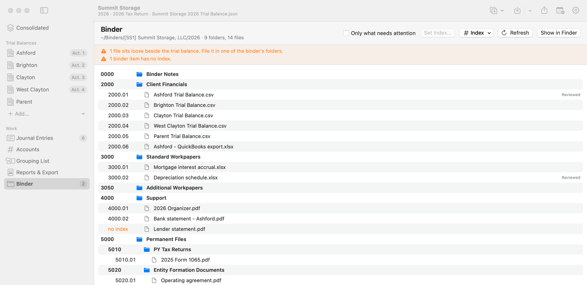

**Binder** in the sidebar is meant to replace the Finder window for the binder: files and
folders are made, brought in, moved, numbered, renamed, previewed, opened, signed off and
removed here.

Across the top:

- **New**: a folder, a folder inside the selected folder, a placeholder, or the standard
  folders.
- **Index**: Set Index…, Index the Selected Files, Remove the Index, Close the Gaps, Index the
  Unindexed Files.
- **Open** (⌘O), **Preview** (Space), **Delete** (⌘⌫), Refresh, **Show in Finder**.

Under that:

- **Folders | All Files**: the two views, below.
- **Expand All**, **Collapse All** (Folders view).
- **Search files**: type any part of an index, a file name or a folder name.
- **Status**: only the files at a point of sign-off.
- **Needs attention**: only what the alerts are about.

The folder is read when a file is opened and whenever you come back to TB Tool from another
app. Refresh reads it again.

| To | Do this |
|---|---|
| Select an item | Click it, or move with ↑ and ↓. |
| Select several | **⌘-click** adds or removes one; **⇧-click** takes everything from the last click to this one; ⇧↑ and ⇧↓ extend; ⌘A selects all. |
| Open what is selected | Double-click, the Open button, or **⌘O**. Several files open at once. |
| Preview a file | Press **Space** (or click Preview). |
| Move to the Trash | The Delete button or **⌘⌫**. |
| Close or open a folder | Click its arrow, double-click it, or press ← and →. |
| Add files from Finder | Drop them on a folder. |
| Move or renumber a file | Drag it. |
| Sign a file off | Click **P**, **R** or **2R** on its row. |
| Everything else | Right-click the item. |

Control-click is a right-click, as everywhere on the Mac: it opens the menu for the row (or
for the whole selection, when the row is part of one). Use ⌘-click to add to a selection.

**Alerts.** The top of the screen, the badge in the sidebar and the data check all report:

- files sitting **loose** beside the trial balance, which should be filed in a folder;
- items with **no index**;
- an index **used more than once**;
- a workpaper that **changed after it was signed off**, or a signed-off workpaper that can no
  longer be found.

### Two views: Folders and All Files

**Folders** shows the binder opened out: every folder and file, indented as they are nested,
with its index, its name, any Finder tags, and its sign-off marks. A file with no index says
*no index*; a loose file beside the trial balance says *not filed*; a placeholder is marked.

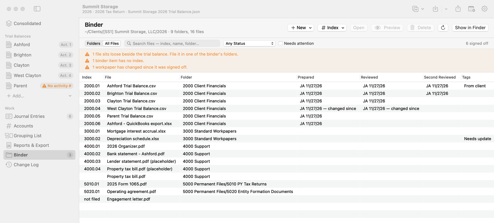

**All Files** drops the folders and lists every file in the binder in columns: **Index**,
**File**, **Folder** (the path of the folder it is in), **Prepared**, **Reviewed**, **Second
Reviewed** (who and when, with *changed since* if the file changed afterwards), and **Tags**.
Click a heading to sort; drag headings to reorder; columns start as narrow as their contents
and keep any width you set. Select rows as in any list (⌘-click, ⇧-click); double-click opens;
right-click gives Open, Preview, Show in Finder, Set Index…, Rename…, Index, the sign-off
marks, and Move to Trash. Space, ⌘O and ⌘⌫ work here too. Dragging to move or renumber is done
in the Folders view.

### Searching, and filtering by sign-off

The **search box** works in both views. Type words in any order; a file stays if its index,
its name or the folders it is in contain all of them. Searching for a folder's name shows
everything in that folder. In the Folders view the matching files are shown under their
folders, with every folder open.

The **Status** menu narrows either view to files that are:

- *Not Prepared*, *Prepared*;
- *Not Reviewed*, *Reviewed*;
- *Not Second Reviewed*, *Second Reviewed*;
- *Changed Since Sign-off*.

Placeholders have no sign-off, so a status hides them. Search, Status and Needs attention
combine. Folders cannot be closed or dragged into while a search or status is in force.

### Opening and closing folders

Each folder has an arrow. Click it (or double-click the folder, or press ← on it) to close the
folder; a closed folder shows how many items it holds. **Collapse All** closes every folder,
leaving the top-level list; **Expand All** opens everything. What you leave closed stays closed
the next time you open the file. ← on a file selects the folder it is in.

### Previewing and opening

Select a file and press **Space**: the file is shown in a Quick Look panel, as in Finder,
without opening it in its own app. Press Space again (or Esc) to close it. With the preview
open, ↑ and ↓ move through the binder and the preview follows.

**⌘O**, the Open button or a double-click opens what is selected in its own app. With several
files selected they all open. (With nothing selected in the binder, ⌘O is File ▸ Open… as
usual.)

### Making folders and subfolders

**New ▸ New Folder…** makes a folder at the top of the binder. **New ▸ New Folder in “…”…**,
or right-click a folder ▸ **New Folder Inside…**, makes a subfolder. You are asked for a number
and a name, and the number is filled in for you:

- at the top of the binder, the next thousand after the highest folder there (after
  `5000 Permanent Files` comes 6000);
- inside a folder, ten past the highest folder already inside it, or past the folder's own
  number (inside `5000 Permanent Files`, after 5030 comes 5040).

Type a different number if you like. A number another folder already has is refused, since no
two folders share one. Leave the number empty for a folder with none.

**To renumber a folder or subfolder**, select it and choose Index ▸ **Set Index…** (or
right-click ▸ Change Index…). The files inside that carry its number are renumbered with it:
making `5020 Entity Formation Documents` 5040 turns `5020.01 …` into `5040.01 …`. If another
folder has the number you can insert before it or take its place, as with files.

### Renaming

Select a file or folder and press **Return**, as in Finder. Its name becomes a field in its
row: type the new name and press Return again to save it, or Esc to leave it as it was.
Clicking elsewhere also saves. (Right-click ▸ **Rename** does the same.)

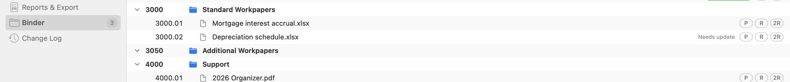

**Only the name is offered for changing.** The index stays in front and **the extension stays
behind** — it is shown after the field, not in it — so a file cannot lose its type by being
renamed. If you type the extension anyway it is not doubled. To change an index, use Set
Index…; to change a file's type, save it as that type from its own app. In the All Files view,
Return (or right-click ▸ Rename…) asks for the name in a small dialog instead.

### The standard folders, in this binder or another folder

- **New ▸ Add the Standard Folders to This Binder…** makes whichever folders of the binder
  layout ([section 4](#4-setting-up-a-file)) are not already there. Nothing that exists is
  changed or moved.
- **New ▸ Make the Standard Folders in Another Folder…** (also File ▸ **Make Binder Folders in
  a Folder…**, which works with no file open) asks for any folder and makes them there. This is
  for putting an old binder in order: make the folders in it, then file what is loose.

Either way you are shown the folders that will be made, and asked, first.

### Placeholders

A placeholder holds a place, and an index, for a document that has not arrived. A roll forward
leaves them ([section 12](#12-prior-years-and-rolling-forward)), and you can make one yourself:
**New ▸ New Placeholder…** with a folder or one of its files selected, or right-click a folder
▸ **New Placeholder Here…**. Give the document's name; the index is filled in with the
folder's next one (change it, or empty it for none). The file made is
`4000.05 (PLACEHOLDER) Bank statement - December.pdf.txt`.

**To turn a document back into a placeholder** (it was the wrong one, or last year's, and the
real one is still to come), right-click it ▸ **Turn into Placeholder…**. You are asked to
confirm, because the file goes to the Trash; an empty placeholder with the same index and name
takes its place. Journal entries that referred to the file refer to the placeholder, and its
sign-off marks come off. ⌘Z puts the file back.

**When the document arrives, drop it on its placeholder**, from Finder or from elsewhere in
the binder. Either way the same question is asked:

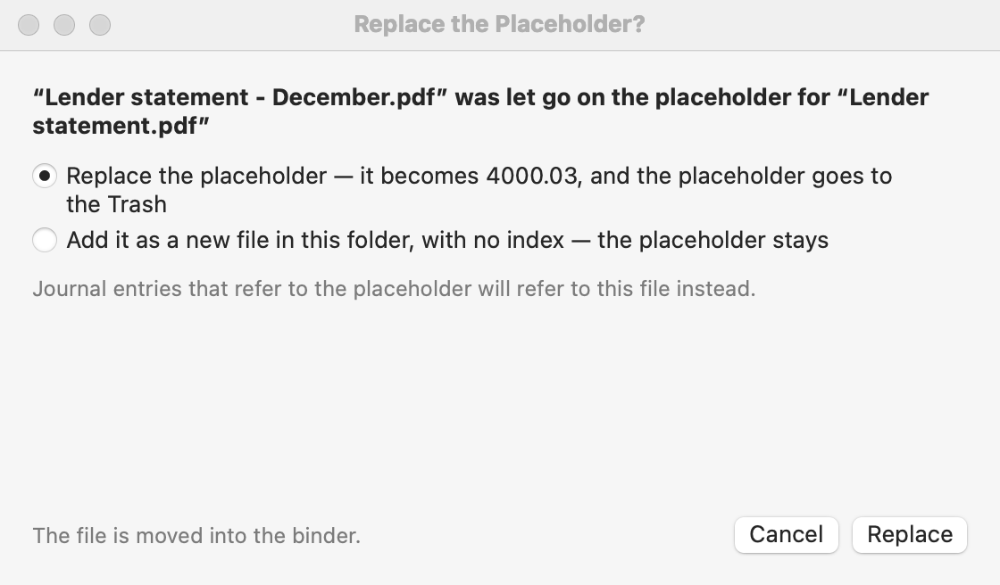

- **Replace the placeholder** (the default): the document takes the placeholder's index, the
  placeholder goes to the Trash, and journal entries that referred to the placeholder refer to
  the document.
- **Add it as a new file, with no index**: the document is put in the folder and the
  placeholder stays.

### A file dropped on another file: a new version, or its index

Let a file go **on** another file — from Finder, or from elsewhere in the binder — and you are
asked which of three things you mean:

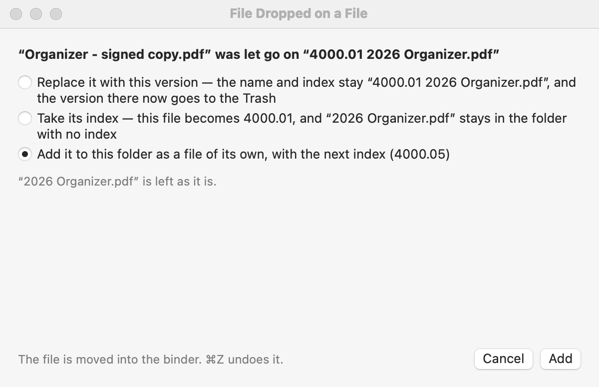

- **Replace it with this version.** The new file takes the old one's **name and index**
  exactly, and the old version goes to the Trash. This is for an updated copy of a document
  you already have. Journal entries keep referring to it. Its sign-off marks stay but turn
  orange, *changed since sign-off*, because it is no longer the file that was signed: click a
  mark to sign the new version. If the new file is of a different type (a `.pdf` replaced by
  an `.xlsx`), the name keeps everything but takes the new extension. Close the old document
  in other apps first; if it cannot be moved, nothing is changed and a message says so.
- **Take its index.** The file becomes that number, and the file that had it stays in the
  folder with no index.
- **Add it to this folder as a file of its own**, with the folder's next index. (Not offered
  when the file is already in that folder.)

A file from Finder starts on the third choice; a file from the binder starts on the second.
Nothing happens until you click the button, and ⌘Z undoes whichever you choose, putting the
replaced version back from the Trash.

### Bringing files in from Finder

Drag files from a Finder window or the Desktop and **drop them on a folder** in the Binder
screen (Folders view). Dropping on a file adds to the folder that file is in.

**One file** is asked about:

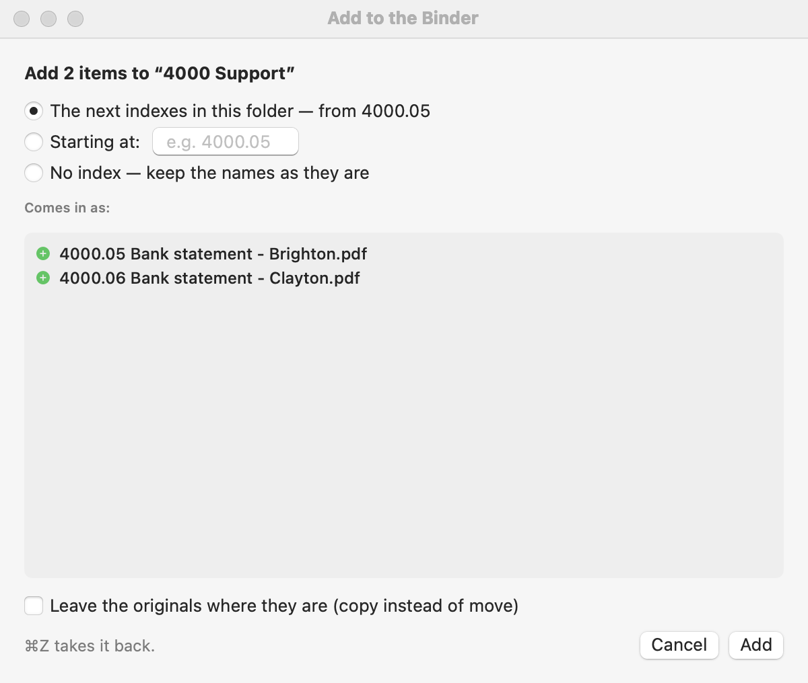

- **The next index in this folder** is the default.
- **This index**: a number you type. If it is taken, the file that has it, and any that follow
  it without a gap, move up to make room; the list shows each rename.
- **No index**: the file keeps its name.

If you let the file go **between two files that have a free number between them** (between
`4000.02` and `4000.05`, say), that free number is offered, already chosen: the file lands
where you put it and nothing has to be renumbered.

**Several files at once come in without an index**, with no questions, and arrive selected.
Number them in one go with Index ▸ **Index the Selected Files**: each takes the next index of
its folder, in the order listed. Reorder them afterwards by dragging.

A number a file arrives with (`2000.09 Old.pdf`) is replaced when it is given a new one.
Folders that are dropped come in under their own names. **Files are moved** into the binder,
as Finder moves them; tick **Leave the original where it is** in the window above to copy
instead (the choice is remembered, and applies to several files too). Nothing is overwritten:
if a file of the same name is already there, nothing is added and a message says so. ⌘Z takes
an add back: a moved file returns to where it came from, a copy goes to the Trash.

Files dropped below the last row, on no folder, land beside the trial balance and are flagged
*not filed* until you file them.

### Dragging to move and renumber

In the Folders view, drag a file to a new place in the list. A line shows where it will go:
**above** a file, **below** a file, or the row lights up when you are **on** it.

**If only the dragged file has to be renamed, it is simply moved.** That is the case when it
lands on a free number or is filed in a folder. **If other files have to be renumbered, you
are shown the renames and asked first:**

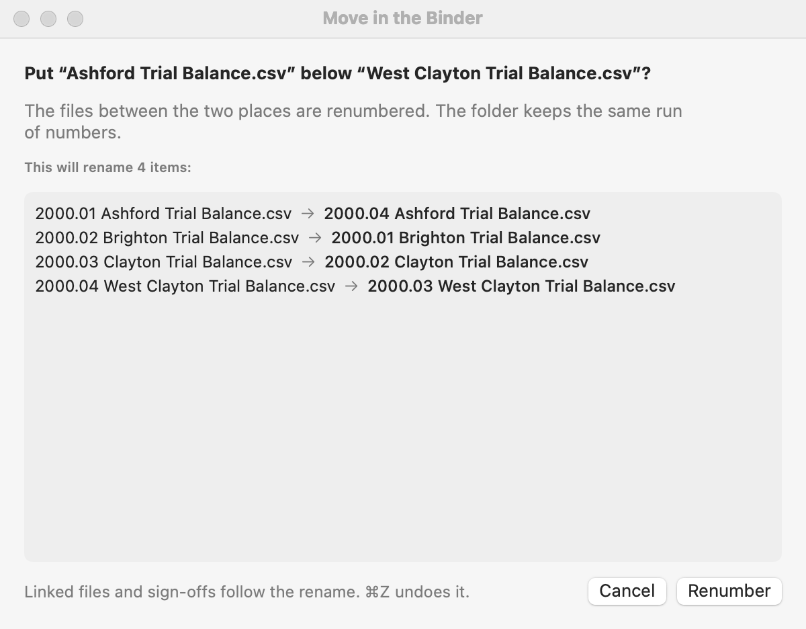

**Cancel**, or closing the window, leaves everything as it was.

| Let go… | What happens |
|---|---|
| **Between two files with a free number between them** | The file takes the first free number there. Nothing else is renamed, and nothing is asked. |
| **Above or below a file in the same folder**, with no free number there | The file goes there, and the files between its old place and its new one are renumbered. The folder keeps the same run of numbers. You confirm. |
| **Above or below a file in another folder** (or dragging a file that has no index), with no free number there | The file moves to that folder and takes the number at that spot. The file that had it, and any that follow it without a gap, move up by one. You confirm. |
| **On a placeholder** | You are asked whether it replaces the placeholder (above). |
| **On a folder** | The file is filed in that folder with the folder's next index. Nothing is asked. |
| **Beside a file with no index** | There is no number to take, so the file gets the folder's next index. |

| **On a file** | You are asked whether it is a new version of that file, takes its index, or joins the folder (above). |

**Several files at once.** Select them (⌘-click, ⇧-click) and drag any one of them: all of
them go.

- **Onto a folder, or onto a file in a folder**: they all move into that folder, each taking
  its next index in the order they are listed. Nothing is asked, and ⌘Z moves them back.
- **Out of the binder**, to a Finder window, the Desktop, an email or another app: all of them
  are handed over. What receives them gets **copies**; the binder keeps its files, so nothing
  an entry refers to goes missing. (The same is true of one file dragged out, and of rows
  dragged out of the All Files view.)

No two files ever end up with the same index. Folders are not dragged; change a folder's
number with Set Index…. Every one of these can be undone with ⌘Z.

### Indexing several files, and closing gaps

- **Index ▸ Index the Selected Files** (or right-click a selection): every selected file that
  has no index takes the next index of the folder it is in, in the order listed. Files that
  already have an index are left alone.
- **Index ▸ Close the Gaps in “folder”** (or right-click a folder ▸ **Close the Gaps in the
  Numbering**): renumbers that folder's indexed files 01, 02, 03… in their present order, so
  no number is skipped. **Files with no index are left with no index.** Select the folder, or
  any file in it, first.
- **Index ▸ Index the Unindexed Files in “folder”**, and **Index Every Unindexed File in the
  Binder**: the same as indexing a selection, for a whole folder or everything.

### Moving to the Trash

Select files or folders and press **⌘⌫** (or click Delete, or right-click ▸ Move to Trash).
You are asked first, and told if a folder has files in it or if a journal entry refers to
something being removed. The items go to the Mac's Trash, not out of existence: put them back
from the Trash, or with ⌘Z. Sign-off marks on removed files come off (the change log keeps the
record), and a journal entry's reference to a removed file shows as missing.

### Signing off workpapers

Every file has three marks at the right of its row: **P** (prepared), **R** (reviewed) and
**2R** (second reviewed).

- **Click an empty mark to sign it off as yourself.** It turns green and shows your initials
  and the date: `P JA 11/18/26`. Hover over it for the full record.
- What is recorded with each mark: **your name and login on the Mac, the Mac's name, the Mac's
  hardware identifier** (the same for every user of that machine, and unchanged if it is
  renamed), **the date and time**, and a **fingerprint of the file's contents** (SHA-256).
- **A mark turns orange if the file changes afterwards.** The fingerprint no longer matches, so
  what is in the binder is not what was looked at. The alert at the top counts these. Click the
  mark to **Mark Again** (signing the file as it is now), remove the mark, or leave it.
- **Click a green mark to take it off.** You are shown who made it and when, and asked to
  confirm.
- Marks **follow the file** when it is renumbered, renamed or moved in the Binder screen.
- Any of the three can be made in any order and by anyone using the file; the record says who.
- Placeholders and folders have no marks.
- Every mark made or removed is a line in the change log, so a removed mark is not a lost one
  ([section 14](#14-saving-undo-backups-and-the-data-check)).

Sign-offs are stored in the trial balance file, not on the workpaper, so they do not depend on
Finder tags. The **Workpaper Sign-offs** report lists them
([section 13](#13-reports-and-exports)). They do **not** roll forward: next year's binder
starts with nothing signed off.

### Setting one index

Select an item and choose Index ▸ **Set Index…** (or right-click it).

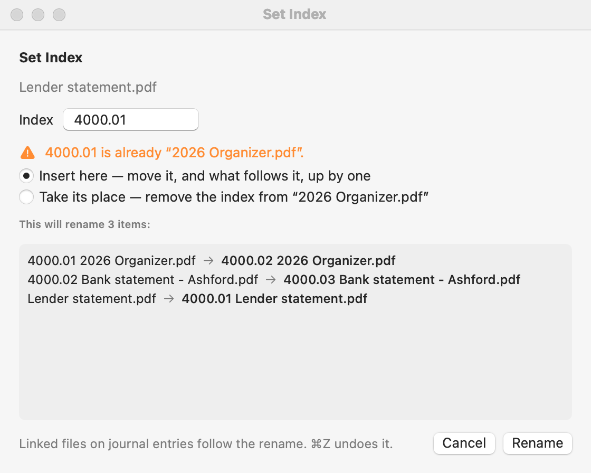

- The field starts on the next free number for the folder the file is in (or, for a folder,
  ten past the highest number beside it). Type any number.
- **If the number is taken**, choose what happens to the item that has it:
  - **Insert here**: it moves up by one, and so does each item after it, until there is a
    free number. Nothing ends up sharing an index.
  - **Take its place**: it loses its index and becomes unindexed.
- The list underneath shows every file that will be renamed, before anything is.
- **Renumbering a folder** renames the files inside that carry its number: making
  `5020 Entity Formation Documents` 5040 turns `5020.01 …` into `5040.01 …`.

The right-click menu also has **Remove Index**, and **File In** / **Move To**, which moves a
file into a folder and gives it that folder's next index. This is how a loose file is filed
without dragging.

**Renames are real.** These, and the drags above, rename and move the files on disk. Journal
entry references and sign-offs follow every rename and move. ⌘Z puts the names back. A rename
is refused, with nothing changed, if a file of the target name is already there. Each one is a
line in the change log, listing every file renamed.

## 12. Prior years and rolling forward

### Prior periods

A file's year end sets its current year. Prior years' closing balances are stored by calendar
year and shown relative to it: with a current year of 2026, PP1 is 2025 and PP2 is 2024.

The **Prior Periods** menu on each balance screen chooses how many to show. The columns are
followed by **Change vs PP1**: this year's balance less PP1's.

Ways to get prior-year balances in:

- **Import a file**: a trial balance's Balances ▸ PP1 ▸ Import from File…, or pick the year in
  the import screen's *These are* menu.
- **Key them in**: Balances ▸ PP1 ▸ Enter Balances….
- **Roll forward**: the closing balances of the year you roll from become PP1 automatically.

An imported prior year is one set of balances, used for both book and tax. A year that arrived
by roll forward keeps book, tax and eliminations separately, so prior columns follow the Book /
Tax switch.

### Rolling forward


The toolbar's **Roll Forward** (or File ▸ Roll Forward to Next Year…) creates next year's
trial balance file and, with it, next year's binder. **Nothing in this year's folder is
changed.**

**Where it goes.** With **Roll the binder forward too** ticked, everything is written into
next year's folder, which by default sits beside this year's and is named for the new year
(`…/2026` becomes `…/2027`). **Choose…** picks another folder. The new trial balance file goes
at the top of that folder. If a trial balance file of that name is already there, roll forward
stops rather than replace it. Untick the box to roll only the trial balance file; you are then
asked where to save it.

What the new file holds:

- **Prior years.** This year's final balances (book, tax, and eliminations) become PP1. Older
  years move back one. *Keep N prior years* sets how many are kept (5 unless changed).
- **The chart, groupings, grouping list and binder details.** A year in the engagement name
  moves on ("2026 Tax Return" becomes "2027 Tax Return").
- **Opening balances.** Either empty, ready for next year's trial balances to be imported; or
  the balance sheet carried forward, with income and expense accounts starting at zero and
  their net closed into the equity account you choose.
- **Journal entries**, according to each entry's *Next year* setting.

### What happens to each journal entry

Set this in the entry window, with the Next Year menu on the Journal Entries screen, or in the
roll forward window itself (which also has **Set All**).

| Setting | In next year's file |
|---|---|
| **Don't roll forward** (the default) | The entry is left behind. |
| **Roll forward with amounts** | A recurring entry: posted with the same amounts, dated one year later. It keeps this setting. |
| **Roll forward without amounts** | The accounts and description come across with blank amounts. The entry is listed as **needs amounts** and posts nothing until you fill it in and post it. |
| **Roll forward as reversal** | Every debit and credit is swapped. The entry is dated the first day of the new year. Each line's memo starts with `[Reversal from 2026]`. It is not marked to roll forward again. |

Linked files are not carried to rolled entries unless you tick **Carry workpaper links**; they
point at last year's workpapers.

### What happens to the binder

The **Binder** tab of the roll forward window shows the whole binder opened out: every folder,
every file inside them, and any loose files beside the trial balance. Each has a checkbox, and
each file has a choice:

| Choice | In next year's binder |
|---|---|
| **Roll forward** (the default) | The file is copied, under the same name and index. **Its Finder tags are not copied**, so nothing arrives looking already reviewed. |
| **Placeholder only** | An empty text file is left in its place. It keeps the index, then has `(PLACEHOLDER)`, then the file's own name, then `.txt`: `4000.03 Bank statement.pdf` becomes `4000.03 (PLACEHOLDER) Bank statement.pdf.txt`. Its only content is the path of this year's file. |
| **Don't roll forward** (unticked) | Nothing. |

- A **folder** that is ticked is created, with its index number, even if it ends up empty.
  Unticking a folder leaves out everything inside it. **Everything Inside** sets every file in
  a folder at once, and **Set Every File** sets the whole binder.
- **Index numbers roll forward** as they are, on folders, files and placeholders.
- A **placeholder that was never replaced** stays a placeholder next time, under the same
  name, and keeps a note of where the real document last was. (Placeholders made before
  version 1.5 were named `… (placeholder).txt`; they are still recognised, and take the present
  name the next time they roll forward.)
- **When the document arrives**, drop it on its placeholder in the Binder screen, from Finder
  or from elsewhere in the binder: it takes the placeholder's index, and the placeholder goes
  to the Trash ([section 11](#11-the-binder)).
- If entries' references roll forward (*Carry workpaper links on entries that roll forward*), a reference to a document that became
  a placeholder points at the placeholder, and moves to the real document when it replaces it.
- **Sign-offs do not roll forward**, and next year's file starts its **own change log**, whose
  first line records the roll forward.
- The binder layout in the app's settings is not used: next year's folders are this year's.
- The trial balance file itself, `TB Backups`, and hidden files are never part of the binder.
- Nothing already in the destination is overwritten. Items that are already there are left as
  they are and counted in the message at the end.

When it is done, a message says how many folders were created, how many files rolled forward
and how many placeholders were left, and offers to open the new year's file.

## 13. Reports and exports

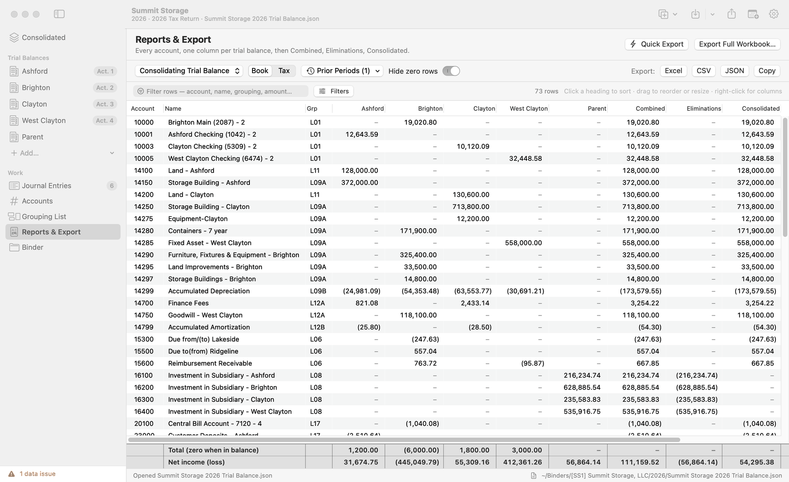

**Reports & Export** shows any report in a grid and exports it.

| Report | What it is |
|---|---|
| Consolidating Trial Balance | Every account, one column per trial balance, then Combined, Eliminations, Consolidated. |
| Grouping Summary | The consolidation rolled up to groupings, subgroups nested, net income at the bottom. |
| Grouping Detail | The same, opened to the accounts. |
| Single Trial Balance | One trial balance with all its columns. Tick **By grouping** to lay the accounts out under their groupings and subgroups, with a total for each. |
| Journal Entries | The journal, set out entry by entry (below). Can be limited to one type. |
| Data (Long Format) | One row per trial balance and account, with every column. Made for pivot tables, charts, or handing to another tool. |
| Chart of Accounts | Accounts with types, grouping and subgroup, and which trial balances use them. |
| Workpaper Sign-offs | One row per signed-off workpaper: its index, name and folder, then who marked it prepared, reviewed and second reviewed, and when. |
| Change Log | Every line of the change log: when, the action, what changed, and the person's name, login, Mac and device identifier. |

Controls appear as they apply: Book / Tax, the trial balance, the entry type, Prior Periods,
Hide zero rows. Double-click a row to open the entry, the account's activity, or the grouping's
accounts.

### The journal entries report

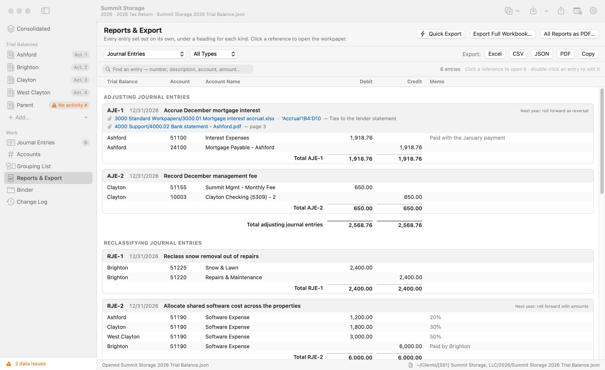

The Journal Entries report reads like a journal, not a table of lines:

- A heading for each kind of entry, in order: **Adjusting**, **Reclassifying**, **Tax**,
  **Eliminating** journal entries. Only the kinds the file has are shown.
- **Each entry stands on its own.** Its number, date and description are given once, across
  the top, not repeated on every line.
- **Its references come straight after the description.** On screen each shows the file's
  full path within the binder, the tab and cells of a workbook, and its note, and **is a
  link**: click it to open the workpaper (a workbook opens on its tab).
- Then its lines: trial balance, account, account name, debit, credit, memo. Then the entry's
  total.
- A total for each kind, and at the end a total of everything.
- An entry's *Next year* setting is shown at its top right, on screen only.

Search finds entries by number, description, account, memo or amount. Double-click an entry to
edit it. An entry still waiting for amounts after a roll forward posts nothing and is not
listed.

**What is exported is the same layout, made for a client to read**, in every format (Excel,
CSV, PDF and Copy):

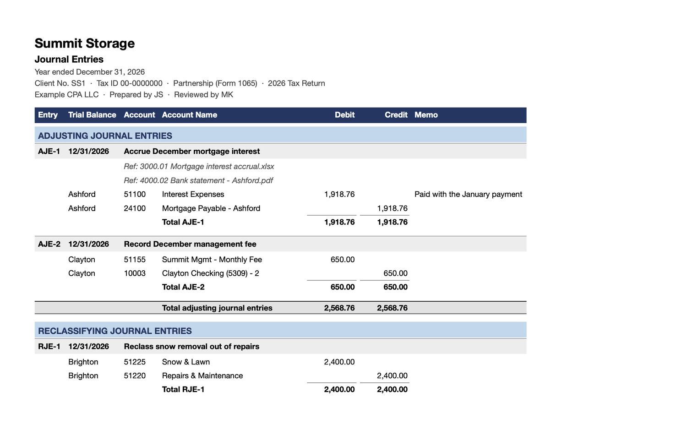

- Each entry is set apart: a shaded line with its number, date and description, its lines, its
  total, and a gap before the next.
- **References are given as the index and file name only**, one per line under the
  description: `Ref: 3000.01 Mortgage interest accrual.xlsx`. No folder path, no tab or cells,
  no note, and nothing that is a link.
- **The next-year setting is left out.**
- The JSON export is the one exception to the layout: it is data, so it has one record per
  journal line with the entry's fields on each. It too gives references by index and file
  name and leaves out the next-year setting.

Like the other balance screens, the reports include an entry that is being typed, but
**exports and Copy leave it out**:

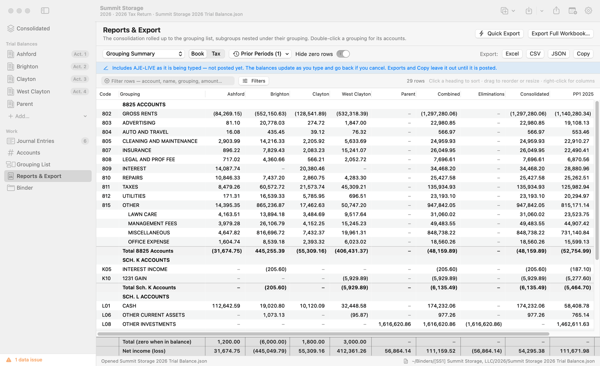

### Exporting

**Every export asks where to save, starting in the folder the JSON file is in.**

- **Excel**, **CSV**, **JSON**, **PDF**, **Copy** on the Reports screen export the report
  shown. The Change Log screen, the activity window and the grouping-accounts window offer the
  same formats.
- **Export Full Workbook…** (⇧⌘E) writes one Excel workbook with every report as a sheet:
  Consolidated, Consolidated (Tax) when there are tax-only entries, Groupings, Grouping Detail,
  one sheet per trial balance, **Journal Entries** (every entry, under a heading for each
  kind), then a sheet for each kind the file has — **AJEs**, **RJEs**, **TJEs**, **EJEs** —
  then Data and Accounts. (The sign-offs and the change log are not in the workbook; export
  them on their own.)
- **All Reports as PDF…** writes every report into one PDF, each starting on a new page, with
  the pages numbered right through. The long-format data and the chart of accounts are left
  out; they are for spreadsheets.
- **Quick Export** (⌘E) asks for a folder and writes two time-stamped files there: the full
  workbook and `… data.csv`, the long-format data.
- The activity window and the grouping-accounts window have their own Copy and Export.

**What an Excel export looks like:**

- A heading at the top of each sheet from the binder details: client name, report title, "Year
  ended December 31, 2026", then client number, tax ID, entity type and engagement, then firm,
  prepared by and reviewed by.
- Real numeric cells, formatted with brackets for credits; bold totals.
- **Shaded bands set the rows apart**, the same in Excel and PDF: the column titles are white
  on dark blue; a **section** ("Sch. L Accounts") is a blue band; in the grouping detail and a
  trial balance by grouping, each **grouping** that heads its accounts is a light blue band,
  with its subgroups a shade lighter; a journal entry's heading is grey; a **grand total** is a
  grey band ruled above and double-ruled below. Subtotals inside a section are bold with a
  rule over them. The long-format Data sheet is left plain, since it is data for another
  program.

  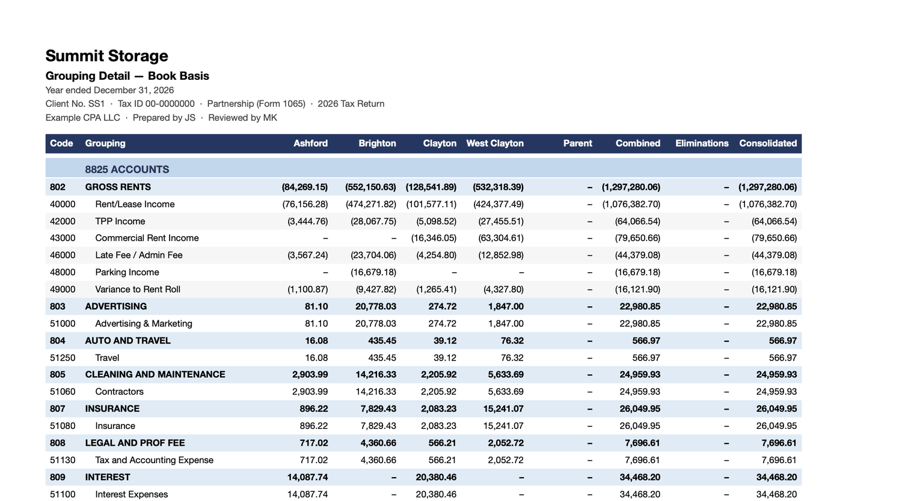
- The heading and column titles are frozen and repeat on every printed page; pages are
  landscape and fit to width, with the sheet name and page number in the footer.
- The **Data** sheet has no heading: one header row and one record per row, so it pivots.

**What a PDF export looks like:**

- The same heading, in full on a report's first page; later pages say "(continued)".
- **The column titles repeat on every page**, and every page is numbered at its foot, *Page 2
  of 5*, beside the client and report name.
- **The page is chosen to fit the report.** A narrow report is printed upright on letter
  paper; a wider one sideways; a consolidation with many trial balances on legal or tabloid
  paper, with smaller type, so that no column of figures is ever cut off. Columns of words
  (names, memos) wrap onto a second line when they must.
- **Nothing is broken across pages that belongs together.** A journal entry — its heading, its
  references, its lines and its total — is always on one page (unless one entry is longer than
  a page). A heading is never left at the foot of a page without what follows it, and a total
  is never carried over alone.
- Credits are in brackets, zero is a dash, and totals are ruled above. The bands are those of
  the Excel export; in a plain list of accounts every other row is lightly tinted, to follow a
  wide row across the page.

CSV exports of a report carry the same heading lines above the columns. A JSON export holds
the report's title and heading and a `rows` array of records keyed by column title, without
subtotal rows. Amounts in every export are
plain signed numbers: debits positive, credits negative.

## 14. Saving, undo, backups and the data check

**Saving.** There is no Save command. Every change is written to the JSON file as you make it.

**Undo.** ⌘Z undoes any change to the file, from any window, back to when you opened it. ⇧⌘Z
redoes. That includes renames, moves, adds and moves to the Trash in the binder, which are put back on
disk.
Changes to standard grouping lists and binder layouts in the app's settings are the exception,
and so are a replaced placeholder sent to the Trash (take it out of the Trash) and a folder or
placeholder you made (move it to the Trash). Undo never removes
anything from the change log: undoing a change adds a line that says so.

**Backups.** The first time you change a file in a session, the file as it was is copied to a
`TB Backups` folder beside it, with the date and time in its name. The 20 most recent are kept.

**Changes made outside the app.** If the JSON file is changed by something else (a script, a
text editor, a sync), the app reloads it when you return. If it changed while you had it open
and you then make a change, the outside version is kept in `TB Backups` before yours is
written. If the outside version cannot be read, the app keeps showing the last good version
and tells you.

**The data check** at the bottom of the sidebar is green when nothing is wrong. Otherwise it
counts the problems; click it to read them. It reports:

- a trial balance whose imported balances do not balance;
- an entry that breaks a posting rule (possible only in a file edited by hand);
- a balance or journal line for an account that is not in the chart;
- an account pointing at a grouping that is not in the list;
- duplicate ids;
- a code used by more than one grouping;
- accounts that have no grouping, with a **Show Ungrouped Accounts** button (counted as one
  issue however many there are);
- a subgroup whose grouping is missing;
- linked files that cannot be found, with a **Fix Links…** button;
- in the binder: files sitting loose beside the trial balance, items with no index, index
  numbers used more than once, and workpapers changed or missing since they were signed off,
  with an **Open Binder** button;
- trial balances with **no activity number**, with a **Set…** button (counted as one issue
  however many there are).

### The change log

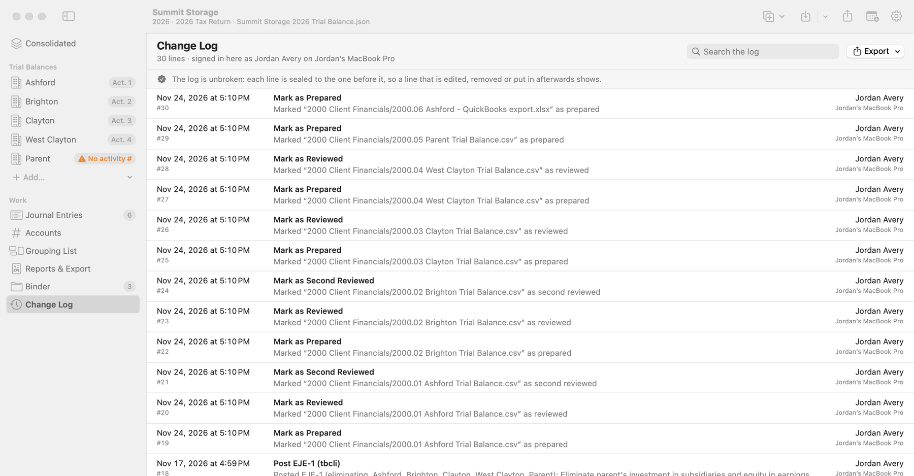

**Change Log** in the sidebar lists every change made to the file, newest first. Each line has:

- **when**, in your Mac's time (the file stores it in UTC);
- **what was done**: the same name the Edit menu's Undo shows, such as *Post AJE-3*, *Apply
  Grouping*, *Set Index*, *Mark as Reviewed*;
- **what it changed**, worked out by comparing the file before and after: the entry posted with
  its amount, the accounts regrouped and from what to what, the balances that differ, the files
  renamed, and so on;
- **who**: the person's name, and under it the Mac. Hover for their login and the Mac's
  hardware identifier.

What is logged: everything that changes the file (imports, balances typed by hand, entries
posted, changed and deleted, accounts and groupings, settings, activity numbers, sign-offs,
prior years), everything the Binder screen does to the folder (renames, moves, files added,
folders made), the file's creation, a roll forward, and changes made with `tbcli`. **Undo and
redo are logged too**, as *Undo: …* and *Redo: …*; a line is never taken out.

If the file is changed by something that does not write to the log (a text editor, a script)
**while it is open in the app**, the app notices when it reads the file again and adds a line,
*Changed outside TB Tool*, saying what is different. A change made while the file is not open
in the app leaves no line: the app has nothing to compare it with.

**Search** narrows the list to lines containing every word you type. **Export** writes the log,
or the workpaper sign-offs, to Excel, CSV or JSON.

**How far it can be trusted.** Each line carries a seal computed from its own contents and the
seal of the line before it. If a line is edited, removed or inserted afterwards, the seals stop
matching from that point: the screen says which line, and marks every line from there on.
`tbcli log` and `tbcli check` report the same. This makes changes to the log **evident**; it
does not make them impossible. The log lives in a file on your Mac, and someone with the file,
the time and the knowledge could rewrite every seal. The names in it are those the Mac reports
for whoever is logged in; the app does not ask for a password. For a record that has to stand
up on its own, keep dated copies of the file where they cannot be changed (the `TB Backups`
folder, a backup system, or a read-only archive at sign-off).

A file made before version 1.5 has no log until its first change in this version; its earlier
history is not known.

## 15. The JSON file

The file is ordinary JSON with a fixed key order and one record per line, so it reads well and
compares cleanly in version control.

```json
{
  "fileType": "trial-balance",
  "schemaVersion": 5,
  "name": "Summit Storage",
  "periodEnd": "2026-12-31",
  "binder": { "clientNumber": "1042", "engagement": "2026 Tax Return", "entityType": "Partnership (Form 1065)",
              "taxID": "", "firm": "", "preparedBy": "JS", "reviewedBy": "" },
  "groupingListName": "Standard (Form 1065 / 8825)",
  "rolledForwardFrom": "Summit Storage 2025 Trial Balance.json",
  "entities": [
    { "id": "ashford", "name": "Ashford", "source": "Summit_TB_Ashford_2026-12-31.csv", "importedAt": "2026-11-13T15:20:11Z",
      "editedAt": "2026-11-14T09:02:40Z",
      "balances": [ { "account": "10001", "debit": 12643.59, "credit": 0.00 } ],
      "priorPeriods": [
        { "year": 2025, "source": "Rolled forward from …", "importedAt": "…",
          "balances": [ { "account": "10001", "book": 9862.00, "tax": 9862.00, "elim": 0.00 } ] } ] }
  ],
  "journalEntries": [
    { "id": "…", "number": "AJE-1", "type": "adjusting", "date": "2026-12-31",
      "description": "Accrue December mortgage interest", "rollForward": "reversal",
      "createdAt": "…", "modifiedAt": "…",
      "lines": [ { "entity": "ashford", "account": "51100", "debit": 1918.76, "credit": 0.00, "memo": "" },
                 { "entity": "ashford", "account": "24100", "debit": 0.00, "credit": 1918.76, "memo": "" } ],
      "references": [ { "path": "3000 Standard Workpapers/3000.01 Mortgage interest accrual.xlsx", "note": "",
                        "sheet": "Accrual", "cells": "B4:D10" },
                      { "path": "4000 Support/4000.02 Bank statement - Ashford.pdf", "note": "page 3" } ] }
  ],
  "accounts":  [ { "id": "10001", "number": "10001", "name": "Ashford Checking", "type": "asset", "grouping": "L01" } ],
  "groupings": [ { "id": "815", "code": "815", "name": "OTHER", "section": "8825 Accounts", "type": "expense" },
                 { "id": "815-MGMT", "code": "", "name": "MANAGEMENT FEES", "section": "8825 Accounts", "parent": "815" } ],
  "signOffs": [
    { "path": "2000 Client Financials/2000.01 Ashford Trial Balance.csv", "level": "prepared", "at": "2026-11-18T16:34:10Z",
      "by": { "name": "Jordan Avery", "account": "javery", "computer": "Jordan’s MacBook Pro", "device": "00000000-0000-4000-8000-000000000001" },
      "fileHash": "9f86d081884c7d659a2feaa0c55ad015a3bf4f1b2b0b822cd15d6c15b0f00a08" } ],
  "auditLog": [
    { "at": "2026-11-17T11:24:00Z", "action": "Post AJE-1",
      "details": ["Posted AJE-1 (adjusting, Ashford): Accrue December mortgage interest — debits 1,918.76"],
      "by": { "name": "Jordan Avery", "account": "javery", "computer": "Jordan’s MacBook Pro", "device": "00000000-0000-4000-8000-000000000001" },
      "hash": "5d1f…" } ]
}
```

### Fields

**Top level**

| Field | Meaning |
|---|---|
| `fileType` | Always `"trial-balance"`. The app refuses a JSON file without it. |
| `schemaVersion` | `5`. Files with 1 to 4 open and are saved as 5 on the next change. A higher number than the app knows is refused. |
| `name` | The client name. Heads every report. |
| `periodEnd` | The year end, `YYYY-MM-DD`. Its year is the current year. |
| `binder` | `clientNumber`, `engagement`, `entityType`, `taxID`, `firm`, `preparedBy`, `reviewedBy`. All text. |
| `groupingListName` | Optional. The name of the list the file's groupings came from. A label only. |
| `rolledForwardFrom` | Optional. The file this one was rolled forward from. |
| `entities` | The trial balances. |
| `journalEntries` | The entries. |
| `accounts` | The shared chart. |
| `groupings` | The file's grouping list. |
| `signOffs` | Optional. Workpapers marked prepared, reviewed or second reviewed. |
| `auditLog` | Optional. The change log, oldest first. |

Top-level fields the app does not know are kept when it saves. Unknown fields nested inside
entities, entries, accounts or groupings are not.

**An entity (a trial balance)**

| Field | Meaning |
|---|---|
| `id` | A short identifier made from the name ("west-clayton"). Journal lines refer to it. |
| `name` | The name shown. |
| `source`, `importedAt` | The file the balances came from, and when. |
| `editedAt` | Optional. When the balances were last changed by hand. |
| `activityNumber` | Optional. The activity number this trial balance is imported under in the tax software. |
| `balances` | Unadjusted balances: `account`, `debit`, `credit`. One of the two amounts is zero. |
| `priorPeriods` | Optional. Per year: `year`, `source`, `importedAt`, and `balances` with `account`, `book`, `tax`, `elim`, written signed (debit positive). `elim` is this trial balance's share of that year's eliminations. |

**A journal entry**

| Field | Meaning |
|---|---|
| `id` | A unique identifier. |
| `number` | "AJE-1". Unique within the file. |
| `type` | `adjusting`, `reclassifying`, `tax-only`, or `eliminating`. |
| `date` | `YYYY-MM-DD`. |
| `description` | Text. |
| `rollForward` | `none`, `amounts`, `blank`, or `reversal`. |
| `pending` | Optional, `true` for an entry rolled forward without amounts and not yet completed. A pending entry posts nothing. |
| `createdAt`, `modifiedAt` | Timestamps. |
| `lines` | `entity` (a trial balance id), `account` (an account id), `debit`, `credit`, `memo`. |
| `references` | Referenced files: `path` and `note`, and for a workbook `sheet` (the tab) and optionally `cells` (`B4:D10`). A path is relative to the JSON file's folder when the file is inside it, otherwise absolute. |

**An account**

| Field | Meaning |
|---|---|
| `id` | The account number, or the name when there is no number. Balances and journal lines refer to it. |
| `number`, `name` | As shown. |
| `type` | `asset`, `liability`, `equity`, `revenue`, or `expense`. For a grouped account this is always its grouping's type; the app rewrites it to match when the file is opened. For an account with no grouping it is the provisional type from the import. |
| `grouping` | The id of a grouping or subgroup, or `null`. |

**A grouping**

| Field | Meaning |
|---|---|
| `id` | Unique. Accounts refer to it. |
| `code` | The code shown. Unique across the list. May be empty on a subgroup. |
| `name`, `section` | As shown. |
| `parent` | Optional. On a subgroup, the id of its grouping. |
| `type` | Optional. The account type of every account in the grouping: `asset`, `liability`, `equity`, `revenue` or `expense`. Left out for "any type", and on a subgroup (which uses its grouping's). In a file older than version 4, groupings from the built-in list take the built-in types when the file is opened. |

**A sign-off**

| Field | Meaning |
|---|---|
| `path` | The workpaper, relative to the JSON file's folder. |
| `level` | `prepared`, `reviewed`, or `second-reviewed`. One of each per workpaper. |
| `at` | When, in UTC. |
| `by` | Who: `name` (the person's name on the Mac), `account` (their login), `computer` (the Mac's name), `device` (the Mac's hardware UUID). |
| `fileHash` | The SHA-256 of the workpaper's contents when it was marked. The mark is shown as out of date when the file no longer matches. |

**A line of the change log**

| Field | Meaning |
|---|---|
| `at` | When, in UTC. |
| `action` | What was done ("Post AJE-1", "Undo: Set Index", "Import Ashford (tbcli)"). |
| `details` | Lines of text saying what changed. |
| `by` | Who, as on a sign-off. |
| `hash` | The seal: the SHA-256, in hex, of the previous line's `hash` (empty for the first line), then `at`, `action`, each of `details`, and `by`'s `name`, `account`, `computer` and `device`, in that order, joined by the unit-separator character (U+001F) and encoded as UTF-8. A line whose `hash` is not what this gives marks where the log was altered. |

### What is and is not stored

Only source data is stored: imported balances, journal entries, the chart and the grouping
list, with the sign-offs and the change log beside them. Adjusted, final, tax and consolidated figures are **not** in the file. They are computed
each time, so they cannot drift from the entries.

### Related files

- **A grouping list**: `{ "fileType": "grouping-list", "schemaVersion": 2, "name": …,
  "entityTypes": […], "groupings": […] }`, with groupings as above.
- **A chart of accounts**: `{ "fileType": "chart-of-accounts", "schemaVersion": 2, "name": …,
  "exportedAt": …, "accounts": [ { "number", "name", "type", "grouping" } ], "groupings": […] }`.
- **The binder layouts**: `{ "fileType": "tb-tool-binder-layouts", "schemaVersion": 1,
  "folders": [ { "name": "5000 Permanent Files", "folders": [ { "name": "5010 PY Tax Returns" } ] } ],
  "byEntityType": { "Nonprofit (Form 990)": { "folders": […] } } }`. `folders` is the layout for
  every entity type; `byEntityType` holds the types that have their own.

## 16. The command line

`tbcli` works on the same files through the same engine and the same rules as the app. It is
inside the app bundle at `TB Tool.app/Contents/MacOS/tbcli`, and is built by `swift build` as
`.build/debug/tbcli`.

```
tbcli new <file.json> [--name "Client"] [--period YYYY-MM-DD]
tbcli import <file.json> <tb.xlsx|csv|txt> [--entity "Name"] [--sheet "Tab"] [--prior-year YYYY] [--use-file-names] [--append | --append-replace] [--keep-names-whole]
tbcli map <file.json> <mapping.csv>
tbcli coa-export <file.json> <out.json|out.csv>
tbcli coa-import <file.json> <chart.json|csv|xlsx|other TB.json> [--overwrite] [--add-missing] [--no-types]
tbcli groupings-export <file.json> <out.json|out.csv>
tbcli groupings-import <file.json> <list.json|csv|xlsx|other TB.json> [--merge]
tbcli post <file.json> <entry.json>
tbcli links <file.json>
tbcli rollforward <file.json> <next-year.json> [--carry-balance-sheet <equity account>] [--binder]
tbcli check <file.json>
tbcli log <file.json>
tbcli summary <file.json>
tbcli export <file.json> <out.xlsx | out.csv>
```

| Command | What it does |
|---|---|
| `new` | Creates an empty file with the built-in grouping list. |
| `import` | Imports one trial balance, detecting the layout (or using a saved one). The trial balance is named with `--entity`, or from the file name; if one by that name exists, its balances are replaced. With `--prior-year`, the file is that year's closing balances. An account the file names differently from the chart keeps the chart's name, and each is reported; with `--use-file-names` the chart takes the file's names instead. With `--append` the file is added to the trial balance instead of replacing its balances (an account both have gets the two amounts added; with `--append-replace`, the file's amount). With `--keep-names-whole`, a number at the front of an account's text is not split off as its account number: the text is kept whole as the name. Prints what was read and what was skipped. |
| `map` | Assigns groupings from a two-column CSV: `account,grouping`. The grouping may be an id, a code, or "code name". An empty grouping clears the assignment. |
| `coa-export` / `coa-import` | The chart of accounts with types and groupings. Import fills in ungrouped accounts unless `--overwrite`; `--add-missing` adds accounts; `--no-types` leaves types alone. |
| `groupings-export` / `groupings-import` | The grouping list. Import replaces the list unless `--merge`. |
| `post` | Posts one journal entry from a JSON file. It is refused, with every reason, if it breaks a posting rule. |
| `links` | Lists linked files that cannot be found. Exits with status 2 if there are any. |
| `rollforward` | Writes next year's file. The source is unchanged. With `--binder`, the folders and files beside the source are rolled into the new file's folder too: every file copied without its Finder tags, placeholders kept as placeholders, nothing overwritten. Sign-offs are not carried, and the new file starts its own change log. |
| `check` | Lists every data-check problem, or says the file is clean. Also says how many accounts aren't grouped, what in the binder is loose, unindexed or numbered twice, which trial balances have no activity number, and whether the change log has been altered. |
| `log` | Prints the change log: when, the action, who and on which Mac, and what changed. Exits with status 2 if a line does not follow from the one before it. |
| `summary` | Balance check and net income per trial balance (with its activity number, and anything reclassified to or from other trial balances) and consolidated. |
| `export` | `.xlsx` writes the full workbook, with the journal sheets described in [section 13](#13-reports-and-exports); `.csv` writes the long-format data. PDFs are made by the app, not by `tbcli`. |

**An entry file for `post`:**

```json
{
  "type": "eliminating",
  "date": "2026-12-31",
  "description": "Eliminate parent's investment in subsidiaries",
  "rollForward": "amounts",
  "lines": [
    { "entity": "Ashford", "account": "32000", "debit": 181441.23, "memo": "Subsidiary equity" },
    { "entity": "Parent",  "account": "16100", "credit": 181441.23 }
  ],
  "references": [ { "path": "3000 Standard Workpapers/3000.04 Investment rollforward.xlsx", "note": "", "sheet": "Rollforward", "cells": "B4:F12" } ]
}
```

`number` may be left out (the next number for the type is used), as may `date` (the year end is
used) and `rollForward`. A line's `entity` may be the trial balance's id or its name. A
reference's `sheet` and `cells` are optional here; the app asks for the tab when the entry is
next edited.

**Every command that changes a file adds a line to its change log**, marked "(tbcli)", with the
name, login and Mac of whoever ran it and what the command changed.

## 17. Menus and shortcuts

**TB Tool**

| Item | Shortcut | |
|---|---|---|
| Settings… | ⌘, | The app's settings: new-file defaults, standard grouping lists, the binder layout, and the AI key. |

**File**

| Item | Shortcut | |
|---|---|---|
| New Trial Balance File… | ⌘N | |
| New Window | ⌥⌘N | Another window, at the welcome screen. |
| Open in New Window… | ⇧⌘O | Another trial balance, beside the one that is open. |
| Open… | ⌘O | Replaces the file in this window. |
| Close File | | Returns to the welcome screen. |
| Trial Balance Settings… | ⇧⌘, | Client, year and binder details of the open file. |
| Roll Forward to Next Year… | | |
| Import Trial Balances… | ⌘I | |
| Paste Trial Balance | ⇧⌘V | From copied cells. |
| New Blank Trial Balance… | | |
| Import Chart of Accounts… / Export Chart of Accounts… | | |
| Group Ungrouped Accounts with AI… | ⌥⌘G | A first pass at the accounts with no grouping, by Claude. You choose what is sent and review what comes back. |
| Import Grouping List… / Export Grouping List… | | |
| Make Binder Folders in a Folder… | | The standard binder folders, in any folder you choose. |
| Show JSON File in Finder | ⇧⌘R | |

**Edit**: Undo (⌘Z), Redo (⇧⌘Z), Copy (⌘C), Select All (⌘A).

**View**: Hide Zero Balance Rows (⇧⌘0); Appearance ▸ Automatic, Light, Dark.

**Entries**

| Item | Shortcut |
|---|---|
| New Adjusting Entry | ⌘J |
| New Reclassifying Entry | ⇧⌘J |
| New Tax-only Entry | ⌥⌘J |
| New Eliminating Entry | ⌃⌘J |
| Fix Broken File Links… | |
| Quick Export… | ⌘E |
| Export Workbook… | ⇧⌘E |

**Everywhere:** Tab moves between fields and buttons (with *Keyboard navigation* turned on in
System Settings ▸ Keyboard); **Return presses the button the keyboard is on**, as Space does.
With the keyboard in a field, Return still does what it always did (Post Entry, Save, Import).
**Esc**, Return or a click elsewhere leaves a search box without clearing it.

**In a journal entry window:** Add Line ⌘L; Post Entry or Save Changes Return; Post & New ⇧⌘↩;
Cancel Esc. In an account field: ↑ ↓ to move through matches, Return or Tab to pick, Esc to
close the list.

**In the reference field of an entry:** type an index or part of a file name; ↑ ↓ to move
through the binder's indexed files, Return or Tab to add the highlighted one, Esc to close.

**On the Accounts screen:** Apply Grouping… ⌘G.

**On the Binder screen:** Space previews the selected file and closes the preview; ↑ ↓ move
through the list (⇧↑ ⇧↓ extend the selection); ← closes a folder (or goes to the folder a file
is in); → opens a folder; **Return** renames what is selected, in its row; **⌘O** opens what is selected; **⌘⌫** moves it
to the Trash; ⌘A selects everything; ⌘-click and ⇧-click select several. ⌘O and ⌘⌫ act on the binder only when
something in it is selected.

**Toolbar:** New Entry (menu of the four types), Import (click to import files; the arrow
offers Paste, New Blank Trial Balance, Import Chart of Accounts, Import Grouping List), Quick
Export, Roll Forward, Trial Balance Settings.

## 18. Where things are kept

| What | Where |
|---|---|
| An engagement | Its `.json` file, wherever you put it. |
| Backups | `TB Backups/` beside the file. |
| Standard grouping lists | `~/Library/Application Support/TB Tool/Grouping Lists/`, one JSON file per list. The built-in list appears there only once you change it. |
| Binder layouts | `~/Library/Application Support/TB Tool/Binder Layouts.json`. It appears only once you change the layout. |
| Saved import layouts | `~/Library/Application Support/TB Tool/import-layouts.json` |
| Workpaper sign-offs and the change log | In the engagement's `.json` file. |
| The Anthropic API key (if you use Group with AI) | The Mac's Keychain, as "TB Tool Anthropic API key". |
| Saved filters, column layouts and widths, window positions, view choices, light or dark appearance, which binder folders are closed, new-file defaults | The app's preferences. |

Nothing is sent anywhere, with one exception that you start yourself: **Group with AI**
([section 9](#9-accounts)) sends the ungrouped accounts, the grouping list, and any workbooks
you tick to Anthropic's API. If you never use it, TB Tool never makes a network connection.
The one time TB Tool talks to another app is when you open a workbook reference: it asks
Excel, on your Mac, to go to a tab and select cells.

## 19. For AI assistants and scripts

A trial balance file can be read and changed without the app. If you are an assistant working
on one, these are the things to get right.

**Reading**

- Confirm `"fileType": "trial-balance"` before treating a JSON file as one.
- Balances in `entities[].balances` are **unadjusted**. To get an adjusted balance, add the
  journal lines for that trial balance and account, by entry type:
  - adjusted = unadjusted + `adjusting`
  - book = adjusted + `reclassifying`
  - tax = book + `tax-only`
  - consolidated = the sum of the trial balances' book (or tax) balances + `eliminating`
- Skip entries with `"pending": true`. They post nothing.
- An amount is `debit − credit`. Debits are positive.
- Net income is minus the sum of the `revenue` and `expense` accounts' balances. An account's
  type is its grouping's `type` when the grouping has one; read `accounts[].type` only after
  the app or `tbcli` has saved the file, or work it out from the grouping yourself.
- An account in a subgroup rolls up to the subgroup's `parent`. A subgroup with an empty `code`
  reports under its parent's code.
- For figures you do not want to compute yourself, run `tbcli export file.json out.csv` and
  read the long-format data: one row per trial balance and account with every column.

**Writing**

- Prefer `tbcli`. It applies the posting rules, numbers entries, and cannot leave the file in a
  state the app would reject. `tbcli post` for entries, `tbcli import` for balances, `tbcli map`
  for groupings.
- If you edit the JSON directly: never store a computed balance; keep `debit` and `credit` as
  two-decimal numbers with one of them zero; refer to trial balances and accounts by `id`; give
  a new entry a unique `id` and `number`; keep codes unique in `groupings`.
- **Leave `auditLog` and `signOffs` alone.** Do not edit, reorder or remove their entries:
  each log line is sealed to the one before it, and a change shows as a broken log. You do not
  need to add a line for your own edit. If the file is open in the app when you change it, the
  app adds a line itself (*Changed outside TB Tool*) listing what is different; if it is not,
  your edit is not in the log, so say what you changed. `tbcli` commands add their own line,
  which is one more reason to prefer them.
- A reference to a workbook should carry `sheet` (the tab's exact name) and may carry `cells`.
  Reference paths are relative to the JSON file's folder; use the file's current indexed name.
- Do not rename workpapers on disk without updating `references[].path` and `signOffs[].path`
  to match. The app's Binder screen does both.
- Run `tbcli check file.json` afterwards. It lists everything the app's data check would.
- The app picks up outside changes when it next comes to the front, and keeps a backup of the
  version it replaces.

**The rules, in one place**

1. An entry balances, has at least two lines, a unique number and a real date.
2. Every line names an existing trial balance and an existing account, with a non-zero amount.
3. Only a `reclassifying` or an `eliminating` entry may name more than one trial balance.
4. Account ids, trial balance ids, grouping ids and grouping codes are each unique.
5. A subgroup's `parent` is a grouping that is not itself a subgroup.
6. Each trial balance should have an `activityNumber`, and no two share one. A missing one is
   flagged, not refused.
7. An account's type is its grouping's `type` (for a subgroup, its parent's) whenever the
   grouping has one. Don't set `type` on a grouped account: set its `grouping`. The app and
   `tbcli` rewrite a grouped account's `type` to match whenever they open the file.

## 20. Troubleshooting

**macOS won't open the app.** A downloaded copy is not notarized. System Settings ▸ Privacy &
Security ▸ Open Anyway. See [section 3](#3-installing-and-opening).

**The import read my file wrongly.** Set the header row, then the role above each column.
Change the balance signs if debits and credits are reversed. Tick or untick rows. If a column
of account types is present, give it the Account Type role.

**The import asked me about account names.** The file uses a number the chart already has,
under another name. Choose which name stands, or bring it in as a different account. See
[section 5](#5-importing-trial-balances).

**The import turned the start of an account's name into an account number.** A name such as
"2024 Bonus Accrual" looks like a numbered account. Untick **Split account numbers from
names** on the import screen and the names come in whole. For one stray account, import as
usual and fix it with Edit… on the Accounts screen.

**An account won't delete.** Something refers to it; the window lists what. Often it is a
prior-year balance, which this year's screens don't show unless the prior-year columns are
on. **Delete Anyway** removes the account with those balances and lines and tells you what is
left out of balance. See [section 9](#9-accounts).

**Group with AI says the key wasn't accepted, or nothing comes back.** See the table at the
end of [Grouping accounts with AI](#grouping-accounts-with-ai).

**A trial balance is out of balance after import.** Open the import again with **Show only rows
that are left out or flagged**: a total line may have been brought in, or an account left out.
Or correct the balance in Balances ▸ Edit Unadjusted Balances….

**Net income looks wrong.** Check account types on the Accounts screen. Net income comes from
the revenue and expense accounts.

**An account I need is not in the list.** New Account… in the entry window, the balance editor
or the Accounts screen's Chart menu.

**A linked file shows as missing.** Fix Links… on the Journal Entries screen. Or open the
entry, remove the reference, and pick the file again from the binder's list.

**Tab skips the buttons.** macOS only tabs to buttons when *Keyboard navigation* is on: System
Settings ▸ Keyboard. With it on, Tab reaches Add Line and the rest, and Return presses them.

**I imported a second file and the first one's balances are gone.** The import replaced them.
Press ⌘Z, then import again with **Its balances ▸ Add to them**.

**I renamed a file and its extension is still there.** That is deliberate: renaming changes
only the name, so a file can't be left without its type.

**There are two TB Tools in the Dock.** Each trial balance window is its own copy of the app.
Quit one with ⌘Q and the others stay open.

**Control-click doesn't add to the selection.** On the Mac, Control-click is a right-click.
Use ⌘-click to add or remove one item and ⇧-click to select a run.

**⌘O opened a file from the binder instead of the Open dialog.** Something was selected on the
Binder screen. Click an empty part of the list first, or use File ▸ Open… from another screen.

**A workpaper isn't in the reference list.** Only indexed files are offered. Give it an index
on the Binder screen.

**The entry won't post: "Choose the tab…".** A reference to a workbook has to name a tab.
Choose it from the menu beside the reference, even if the workbook has only one.

**The workbook opened, but not on the tab.** The status line says why. Usually macOS has not
been told that TB Tool may control Excel: System Settings ▸ Privacy & Security ▸ Automation ▸
TB Tool ▸ turn on Microsoft Excel. A tab that has since been renamed in the workbook also does
it; the reference then shows the old name marked *not in the workbook*. Choose the tab again.

**A trial balance says "No activity #".** Give it its activity number: click the orange button
at the top of its screen, or right-click it in the sidebar ▸ Details….

**A sign-off mark is orange.** The file changed after it was signed off. Click the mark to
sign it again as it is now, or to remove the mark.

**The change log says a line doesn't follow from the one before it.** The log in the JSON file
was edited, or lines were removed or put in, by something other than TB Tool. Compare with a
copy in `TB Backups`.

**The binder folders weren't made for a new file.** The folder you saved it in already had
folders, or is a general folder. On the Binder screen choose New ▸ **Add the Standard Folders
to This Binder…**, which adds whichever are missing.

**The data check mentions the binder.** Open Binder from the data check. File loose files with
right-click ▸ File In, index what has no index with Index ▸ Index Every Unindexed File, and
change one of any two items that share a number. See [section 11](#11-the-binder).

**Roll forward says the trial balance file is already there.** Next year's folder already has
a file of that name. Roll forward never replaces a file. Choose another folder, or move the
existing file.

**A trial balance shows "reclassified from other trial balances".** A reclassifying entry
names more than one trial balance. That is allowed; the consolidation still balances.

**The data check says a code is used by several groupings.** The file predates unique codes.
Grouping List ▸ Combine as Subgroups.

**I can't change an account's type.** By design: the type is the grouping's. Change the
account's grouping, or change the grouping's account type on the Grouping List screen.

**Prior-year columns are not showing.** Use the Prior Periods menu. A stored year shows only if
it is before the file's current year.

**I changed a standard grouping list but my file did not change.** Files keep their own copy.
Grouping List ▸ List ▸ Switch to a Standard List.

**I want an earlier version of a file back.** Look in `TB Backups` beside it.
